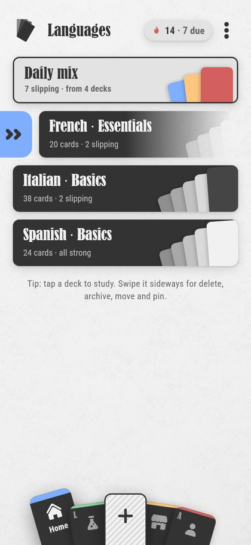
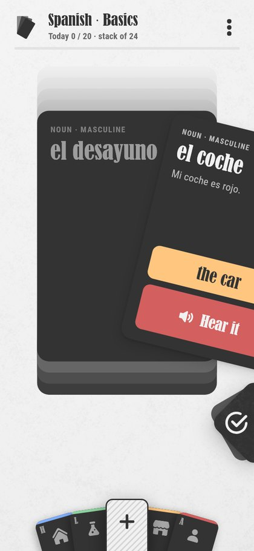
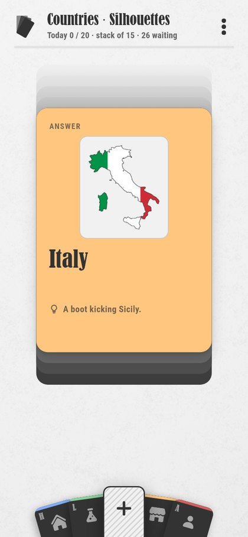
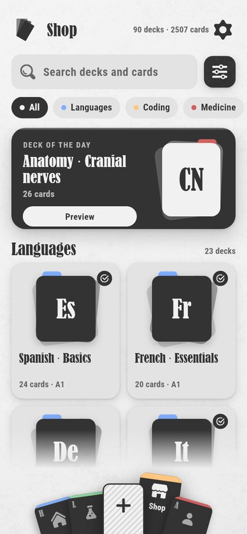
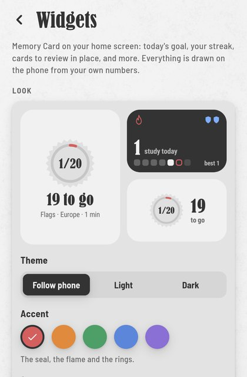

# Memory Card

**Flashcards that come back when you are about to forget them.** Memory Card is an Android app for spaced-repetition
study: you swipe through an endless stack of cards, and an engine that learns how *you* remember decides when each
card returns. Everything stays on your phone. There is no account, no server and no ads.

<p align="center">
  <a href="https://github.com/ameeralhatemi67-debug/Memory_card/releases/latest/download/MemoryCard.apk"></a>
  &nbsp;
  <a href="https://github.com/ameeralhatemi67-debug/Memory_card/releases/latest"></a>
</p>

<p align="center">
  
  
  
  
  
</p>

- [What it does](#what-it-does)
- [Install it on your Android phone](#install-it-on-your-android-phone) (about two minutes)
- [Trouble installing?](#trouble-installing)
- [Report a bug or send feedback](#report-a-bug-or-send-feedback)
- [Build it yourself](#build-it-yourself)
- [What is in this repository](#what-is-in-this-repository)
- [Credits](#credits)

## What it does

- **An endless stack.** Swipe right when you knew a card, left when you did not. A missed card comes back a few cards
  later (8 to 20, depending on how well you are doing), a known one goes to the back of the stack. There is no
  "session over" wall: stop whenever, and tomorrow's cards are already waiting.
- **A scheduler that reads you.** Under the swipes runs a repetition engine built on FSRS-6, written in Dart and
  checked against the reference implementation. It also notices *how* you answer (hesitation, speed) and tunes itself
  to your memory; after enough reviews it trains on your own history, on the phone.
- **90 ready-made decks, 2,507 cards** in the in-app shop: languages, coding, medicine, science, geography, arts,
  anime, car brands, football and general knowledge. Add one with a tap.
- **Pictures on cards.** Flags, crests, character portraits, silhouettes, road signs. Card sides can mix pictures and
  text, with a layout editor, PNG cut-outs, and a "blur until revealed" setting so the picture does not give the answer
  away.
- **Your own decks.** Write cards, import a CSV, give a deck a picture skin and design its wax seals.
- **Goal, streak and seals.** A daily goal, a streak with monthly grace shields, and seals for milestones.
- **13 home-screen widgets and a Quick Settings tile.** Today's goal, your streak, a Quick card you can answer without
  opening the app, an activity heatmap, the next two weeks and more. They draw themselves in your accent colour and
  follow the phone's light and dark mode.
- **Made to be touched.** A papercraft look in light and dark, springy card physics, synthesized sounds and haptics,
  and a navigation bar that is a hand of cards.
- **Yours alone.** Data lives in a database on the device. *Settings > Your data* exports a full backup and your
  review history as CSV.

## Install it on your Android phone

You need an Android phone running **Android 7.0 or newer** and about 150 MB of free space. Widgets look best on
Android 12 or newer; older phones get still pictures.

<table>
<tr>
<td>

1. **On your phone**, open the [latest release](https://github.com/ameeralhatemi67-debug/Memory_card/releases/latest)
   and tap **MemoryCard.apk** under *Assets* (or tap the direct link:
   [MemoryCard.apk](https://github.com/ameeralhatemi67-debug/Memory_card/releases/latest/download/MemoryCard.apk),
   about 150 MB, so Wi-Fi is kind).
2. If the browser says *"This type of file can harm your device"*, tap **Download anyway**. Android shows that for
   every APK.
3. When it has downloaded, tap **Open**. The first time, Android says your phone is not allowed to install unknown
   apps from this source: tap **Settings**, switch on **Allow from this source**, then press back.
4. Tap **Install**. If Play Protect says the developer is unrecognised, tap **More details**, then
   **Install anyway**.
5. Open **Memory Card**. Stay online for the first launch: it downloads its two text fonts once and keeps them.

</td>
<td align="center" width="200">

**On a computer?**<br>Scan with your phone


</td>
</tr>
</table>

**Updating.** Install a newer `MemoryCard.apk` over the old one. Every release is signed with the same key, so your
cards, streak and settings stay. To move to a new phone, use *Settings > Your data > Export backup* and restore it on
the other side. Uninstalling the app deletes its data, so export a backup first.

**Checking the file.** Each release lists the file's SHA-256. On a computer, `certutil -hashfile MemoryCard.apk SHA256`
(Windows) or `sha256sum MemoryCard.apk` (macOS and Linux) prints the same value if the download is intact.

**What the app asks for.** Internet (once, for the fonts), notifications and "start after a reboot" (both only for the
daily reminder, which is off until you turn it on) and vibration (the haptics). No contacts, location, camera,
microphone or storage access.

**iPhone.** There is no iOS build yet: it needs a Mac with Xcode. The code has no Android-only parts apart from the
widgets.

## Trouble installing?

<details>
<summary><b>"For your security, your phone is not allowed to install unknown apps"</b></summary>

That is the permission in step 3. Open **Settings > Apps > Special app access > Install unknown apps** (the path
differs a little between brands), pick the browser or the Files app you used to open the download, and switch on
**Allow from this source**.
</details>

<details>
<summary><b>Play Protect blocks it, or says the developer is unrecognised</b></summary>

The app is not on the Play Store, and it is signed with a developer key rather than a store key, so Play Protect
cannot vouch for it. Tap **More details > Install anyway**. If the dialog only offers **OK**, your phone has a
stricter setting switched on (for example Advanced Protection), and you would have to loosen that yourself.
The source of every build is in this repository, and each release lists its SHA-256 so you can check the file.
</details>

<details>
<summary><b>Samsung phones: the install is greyed out or silently blocked</b></summary>

One UI's **Auto Blocker** stops sideloaded apps. Open **Settings > Security and privacy > Auto Blocker** and turn
it off (you can turn it back on afterwards).
</details>

<details>
<summary><b>"App not installed"</b></summary>

- Not enough free space: the install needs a few hundred MB while it unpacks.
- The download is incomplete: download it again and compare the SHA-256 shown above.
- A copy signed with a different key is already installed (for example a copy built on someone else's computer).
  Export a backup, uninstall that copy, then install this one and restore.
</details>

<details>
<summary><b>Google's developer verification</b></summary>

Google is rolling out developer verification for apps installed from outside the Play Store: it started in Brazil,
Indonesia, Singapore and Thailand on 30 September 2026, and is planned worldwide for 2027. If your phone says the
developer is not verified, Google provides an advanced path for installing anyway. See
[Google's page on developer verification](https://developer.android.com/developer-verification) for how it works on
your version of Android.
</details>

<details>
<summary><b>I cannot find the widgets</b></summary>

Long-press an empty spot on your home screen, tap **Widgets**, and look for **Memory Card**. Or open the app,
**Settings > Home screen widgets**, where every widget has a live preview and an **Add** button. After an app update
the launcher may show grey placeholders for a moment; open the app once.
</details>

## Report a bug or send feedback

Open an [issue](https://github.com/ameeralhatemi67-debug/Memory_card/issues/new/choose). It helps to say your phone
model, your Android version, and the app version (shown at the bottom of *Settings*). A screenshot or a short screen
recording is worth a paragraph. The same page takes feature ideas, and so do the decks: if one has a wrong answer,
say which deck and card.

A five-minute tour that covers most of the app: add a deck from the **Shop**, study 20 cards, turn on a widget in
**Settings > Home screen widgets**, then make a card with the **+**.

## Build it yourself

You need [Flutter](https://docs.flutter.dev/get-started/install) 3.41 or newer (Dart 3.11), the Android SDK 36 and a
JDK 17. Everything the build needs, fonts included, is in the repository.

```bash
git clone https://github.com/ameeralhatemi67-debug/Memory_card.git
cd Memory_card/app
flutter pub get
flutter build apk --release     # -> build/app/outputs/flutter-apk/app-release.apk
flutter run                     # on a connected phone or an emulator
```

The release build is signed with your own debug key, so an APK built on your computer will not install over one
built on another (uninstall first, after a backup). The tests, the screenshot galleries, the web preview and the
widget internals are described in [`app/README.md`](app/README.md).

To publish your own build as a GitHub release, run `tools/release.ps1` (Windows PowerShell). It builds, names the
file `MemoryCard.apk`, writes the SHA-256 and, if the GitHub CLI is installed, creates the release.

## What is in this repository

| Folder | What is there |
|---|---|
| [`app/`](app/README.md) | The Flutter app: `lib/` (engine, data, screens), `android/` (the native widgets in Kotlin), tests and screenshot galleries |
| [`content/`](content/decks/visual/README.md) | The decks as plain JSON (`decks/`) and where every picture came from (`sources/`) |
| [`fonts/`](fonts/README.md) | The display font and notes on every font the project uses |
| [`docs/`](docs/project-hub.md) | The design programme: 48 research papers, the audit, the design canvas, the locked decisions, the promo plan |
| [`text_Mockup/`](text_Mockup/README.md) | The first design lab: a web page with card physics and Web Audio. Open `index.html` in any browser |
| [`prototype/`](prototype/README.md) | A playable web prototype of every screen, built before the app |
| [`promo/`](docs/marketing/promo_videos.md) | Sources of the promo videos ([HyperFrames](https://hyperframes.heygen.com), HTML to MP4) |
| `tools/` | Deck catalog builder, picture toolkit, sound and texture generators, the release script |
| `icons/`, `reference/` | The 20 hand-drawn SVG icons and the reference mockups the design followed |

Project notes, kept as the work went: [`Status.md`](Status.md) (where things stand), [`progress.md`](progress.md)
(what was done and how it was checked), [`Roadmap.md`](Roadmap.md) and [`feature_checklist.md`](feature_checklist.md).

The engine is documented in [RES-47](docs/research/RES-47_Repetition_Engine_Comparative_Research.md) (why this design)
and [RES-48](docs/research/RES-48_Engine_v2.md) (how it works).

## Credits

- Fonts: Bernard MT Condensed (Monotype), Barlow Semi Condensed and JetBrains Mono (SIL Open Font License). Details in
  [`fonts/README.md`](fonts/README.md).
- Pictures in the picture decks come from Wikimedia Commons, Wikipedia, flagcdn and the series' fan wikis. Each deck's
  provenance, file by file, is in [`content/sources/`](content/sources/README.md).
- Built with [Flutter](https://flutter.dev), [Hive](https://pub.dev/packages/hive_ce),
  [home_widget](https://pub.dev/packages/home_widget) and the packages listed in
  [`app/pubspec.yaml`](app/pubspec.yaml).
- The source has no open-source licence yet, so by default all rights stay with the author. Memory Card is a personal
  project that is free to try; open an issue if you would like to reuse something.
