# Memory Card Product Roadmap

**Last updated:** 2026-09-12

**Active version:** Version 2.0 (Design Finalization & Living Lab)

**Active checkpoint:** Checkpoint 2.1 (Repository Baseline & Feature Checklist)

**Planning state:** Approved and active

> [!abstract] Project Knowledge Map
> - **Parent Hub:** [[README|Memory Card Project Hub]]
> - **Current state:** [[Status|Memory Card Current Status]]
> - **Verified history:** [[progress|Memory Card Progress Log]]
> - **Verification ledger:** [[feature_checklist|Feature Reverification Checklist]]
> - **System audit:** [[idea_Audit|Architectural & UX Audit Report]]
> - **Master feature scope:** [[MC_Feature_list|Complete Feature List]]
> - **Interactive sandbox:** [[text_Mockup/README|Living Design System Lab]]

---

## Product Purpose

**Memory Card** is a hyper-tactile, mobile-first spaced-repetition memory application designed for iOS and Android. It transforms the grueling chore of daily memorization into an addictive, visceral sensory ritual through physical spatial metaphors, micro-animated conscious states, and the FSRS-5 cognitive scheduling engine.

> [!important] North Star
> Intoxicating tactile design must serve cognitive retention, not distract from it. Every animation, sound, and haptic impulse must reduce cognitive friction and accelerate long-term recall.

---

## Daily Study Journey

```mermaid
flowchart LR
    Open[Open Memory Card] --> Drawer[Conscious Drawer: Select Folder]
    Drawer --> Decks[Decks List: Choose Stepped Deck]
    Decks --> Study[6-Layer 3D Study Stack]
    Study --> Recall[Active Recall: Tap to Reveal]
    Recall --> Swipe[Tactile Swipe: Review vs Master]
    Swipe --> Scheduled[FSRS-5 Dynamic Rescheduling]
    Scheduled --> Celebrate[Completion Fanfare & Streak]
```

The phased delivery dependency across versions is:
`Version 1.0 (Research & Initial Lab) -> Version 2.0 (Design Polish & Resizable Frame) -> Version 3.0 (Advanced Sensory & Shaders) -> Version 4.0 (Native Flutter Application Build)`.

---

## Operating Rules

### Roadmap Truth
- `[x]` means completed and supported by verifiable evidence.
- `[/]` means actively in progress.
- `[ ]` means planned but not yet started.
- `[-]` means cancelled or deliberately pruned based on audit findings.
- A prototype is never marked as a shipped production feature.
- A capability is never called verified until its real runtime path has been exercised.
- `Roadmap.md` defines future and planned work, `Status.md` reports current conditions, and `progress.md` records verified outcomes.

### Change Safety & Git Commit Boundaries
Every major milestone and phase must follow a strict Git boundary protocol:
1. Confirm a clean, recoverable Git baseline before beginning work.
2. Apply changes scoped strictly to the active task.
3. Verify the changes locally (automated checks, visual tests, or browser tests).
4. Commit the phase with clear, traceable commit messages so every phase is checkpointed.

---

# ═══════════════════════════════════════════════════
# 📦 VERSION 1.0 — Research, Foundations & Initial Prototype [COMPLETED]
# ═══════════════════════════════════════════════════

**Goal:** Establish the theoretical foundations, cognitive models, physics formulas, initial UI prototype, and conduct a candid architectural audit.

### Checkpoint 1.1: Cognitive Science & Mathematical Modeling
- [x] **Task 1.1.1:** Research and document FSRS-5 spaced repetition vs SM-2 algorithm mechanics (`RES-12`).
- [x] **Task 1.1.2:** Model the mathematical transfer function for 3D card swipe trajectories ($\pm 45^\circ$ rotation, scale reduction $1.0 \to 0.75$, parabolic drift) (`RES-01`).
- [x] **Task 1.1.3:** Research gradient edge-sinking alpha shaders for deck lists (`RES-02`).
- [x] **Task 1.1.4:** Research squash-and-stretch collision dynamics and action block overshoot (`RES-03`).
- [x] **Task 1.1.5:** Analyze multi-harmonic sinusoidal wiggle equations for conscious folder emotional states (`RES-07`).
- [x] **Task 1.1.6:** Research inverted Z-index layering with OKLCH perceptually uniform lightness interpolation (`RES-08`).
- [x] **Task 1.1.7:** Formulate behavioral dwell time, AFK filters, and hesitation metrics (`RES-13`, `RES-14`).

### Checkpoint 1.2: Technical Feasibility & 46 Research Papers
- [x] **Task 1.2.1:** Compile all 46 specialized research papers across 8 core domains (`research/RES-01` through `RES-45`, plus `FES-46`).
- [x] **Task 1.2.2:** Establish the master research checklist and technology cross-platform benchmark (`research_check_list.md`, `research.md`, `RES-38`).

### Checkpoint 1.3: Concept Specification & Q&A Alignment
- [x] **Task 1.3.1:** Draft complete master concept and storage hierarchy (`brain_dump.md`, `brain_storming.md`).
- [x] **Task 1.3.2:** Author complete feature list with MVP vs Later categorization across 18 domains (`MC_Feature_list.md`).
- [x] **Task 1.3.3:** Record authoritative user architectural decisions across 13 core areas (`Questions.md`).
- [x] **Task 1.3.4:** Catalog the 20 custom SVG application glyphs (`icons/`, `icons list.md`).

### Checkpoint 1.4: Initial Living Design Lab & Gesture Sandbox
- [x] **Task 1.4.1:** Author initial web living design lab with interactive HTML/CSS/JS (`text_Mockup/index.html`, `styles.css`, `app.js`).
- [x] **Task 1.4.2:** Implement interactive 6-layer 3D swipe sandbox with 40%/60% thresholds.
- [x] **Task 1.4.3:** Build procedural Web Audio synthesizer prototype for mechanical ticks and fanfares.
- [x] **Task 1.4.4:** Render 5 basic mobile phone walkthrough screens.

### Checkpoint 1.5: Deep Architectural, UX & Engineering Audit
- [x] **Task 1.5.1:** Conduct senior-level architectural and product audit (`idea_Audit.md`).
- [x] **Task 1.5.2:** Identify 120 FPS mobile hardware bottlenecks, sensory fatigue risks, and the Day-2 card creation blind spot.
- [x] **Task 1.5.3:** Catalog all visual discrepancies between reference mockups (`reference/*.png`) and prototype (`text_Mockup/`).

---

# ═══════════════════════════════════════════════════
# 🚀 VERSION 2.0 — Design Finalization & Resizable Living Lab [ACTIVE]
# ═══════════════════════════════════════════════════

**Goal:** Bridge all visual discrepancies identified in the audit, finalize the living design system to 100% reference fidelity, implement a real-time resizable phone viewport for adaptive layout testing, establish Git version control, and lock design tokens for production.

### Checkpoint 2.1: Repository Baseline, Git Scaffolding & Feature Checklist

**Outcome:** Establish clean Git version control, create the canonical feature checklist, and align all root documentation.

#### Phase 2.1.1: Git Scaffolding & Initial Commit
- [ ] **Task 2.1.1.1:** Initialize Git repository in the project root (`git init`).
- [ ] **Task 2.1.1.2:** Author `.gitignore` excluding OS artifacts, caches, and temporary files.
- [ ] **Task 2.1.1.3:** Create clean baseline Git commit preserving all imported Version 1.0 assets.

#### Phase 2.1.2: Canonical Feature Checklist
- [ ] **Task 2.1.2.1:** Create `feature_checklist.md` tracking all composite features across mockup, design system, and future app layers.
- [ ] **Task 2.1.2.2:** Establish clear verification criteria and retest instructions for every visual component.

#### Phase 2.1.3: Documentation Alignment
- [ ] **Task 2.1.3.1:** Author canonical `README.md` following project standards.
- [ ] **Task 2.1.3.2:** Author canonical `Status.md` reflecting Version 2.0 active state.
- [ ] **Task 2.1.3.3:** Author canonical `progress.md` capturing all Version 1.0 historical outcomes.
- [ ] **Task 2.1.3.4:** Commit Checkpoint 2.1 completion to Git.

### Checkpoint 2.2: Mockup Visual Discrepancy Remediation (Adding What Is Missing)

**Outcome:** Elevate `text_Mockup` to 100% visual parity with the 8 reference mockups in `reference/`.

#### Phase 2.2.1: Typography & Asset Calibration
- [ ] **Task 2.2.1.1:** Integrate **Bernard MT Condensed** font (or high-fidelity local/web fallback matching the reference aesthetic) for all headlines, folder labels, and action badges.
- [ ] **Task 2.2.1.2:** Normalize and polish all 20 custom SVG icons in `text_Mockup/` with correct bounding boxes and stroke weights.

#### Phase 2.2.2: Signature Decks List Polish (`Card_stacks_page.png` & `side_swaip_justes.png`)
- [ ] **Task 2.2.2.1:** Build authentic 4-to-5 layer stepped staircase fans on the right side of deck cards.
- [ ] **Task 2.2.2.2:** Implement dual-action split reveal on left swipe: Red `[✖ Delete]` and Peach `[⬇ Archive]`.
- [ ] **Task 2.2.2.3:** Implement Blue `[» Move]` action underlay on right swipe.
- [ ] **Task 2.2.2.4:** Implement dynamic edge-sinking gradient opacity mask dissolving the card into background during drag.
- [ ] **Task 2.2.2.5:** Replace bottom nav hex button with the signature rounded diamond `+` action button.
- [ ] **Task 2.2.2.6:** Add smooth bottom-list canvas fade-out masking.

#### Phase 2.2.3: 3D Study Viewport Polish (`Cards_page.png`)
- [ ] **Task 2.2.3.1:** Embed the full interactive 6-layer 3D perspective card stack directly inside Mobile Screen 3 (`#screen-study`).
- [ ] **Task 2.2.3.2:** Implement the iconic screen-edge notched corner buttons (Left: Archive/Box notched ear; Right: Checkmark notched ear).
- [ ] **Task 2.2.3.3:** Reconstruct the card front face layout: Title, multi-line content, input/reveal pill, and coral/red action container.
- [ ] **Task 2.2.3.4:** Add interactive flip/reveal switcher directly inside the mobile screen frame.

#### Phase 2.2.4: Conscious Side Drawer Polish (`side_drwer.png`)
- [ ] **Task 2.2.4.1:** Replace full-width "New Folder" pill button with the floating bottom-right folder icon containing a `+` glyph.
- [ ] **Task 2.2.4.2:** Refine asymmetric Bézier folder tab silhouettes and peeking cyclic tab cutouts to match reference curvature.
- [ ] **Task 2.2.4.3:** Calibrate inverted OKLCH luminance in both Light Mode (top dark $\to$ bottom light) and Dark Mode (top light $\to$ bottom dark).

#### Phase 2.2.5: True 4-Column Pinterest Deck Shop (`shop_page.png` & `highlited_deck_shop.png`)
- [ ] **Task 2.2.5.1:** Replace horizontal row tiles with a genuine **4-column vertical staggered masonry grid** with variable pill heights.
- [ ] **Task 2.2.5.2:** Implement fluid viewport dimming on long-press with orbiting scalloped action buttons (Pin, Search burst, Bookmark, Share).
- [ ] **Task 2.2.5.3:** Add search bar and filter controls matching reference specifications.

#### Phase 2.2.6: Tactile Auth & Profile Screen (`Log_Sign_pages.png`)
- [ ] **Task 2.2.6.1:** Add background decorative diagonal ribbon/sash element.
- [ ] **Task 2.2.6.2:** Style the embossed physical Membership Card with accurate typography and cardholder layout.
- [ ] **Task 2.2.6.3:** Reconstruct social login buttons with scalloped circular badge frames (Google, Apple, Memory Card native).
- [ ] **Task 2.2.6.4:** Commit Checkpoint 2.2 completion to Git.

### Checkpoint 2.3: Interactive Resizable Phone View & Adaptive Layout Testing

**Outcome:** Transform the static 390×844 device frame into a fully interactive, draggable resizable viewport to test adaptive layout and responsiveness live in the browser.

#### Phase 2.3.1: Drag-to-Resize Frame Controller
- [ ] **Task 2.3.1.1:** Add an interactive resize handle at the bottom-right corner of the mobile phone mockup frame.
- [ ] **Task 2.3.1.2:** Implement mouse and touch drag controllers allowing real-time horizontal (width: 320px–768px) and vertical (height: 568px–1024px) resizing.
- [ ] **Task 2.3.1.3:** Render a live dimension HUD showing current pixel dimensions, aspect ratio (e.g., 9:19.5, 9:16, 4:3), and active device class.

#### Phase 2.3.2: Quick-Select Device Presets
- [ ] **Task 2.3.2.1:** Add one-click preset buttons: iPhone SE (375×667), iPhone 15 Pro (393×852), Pixel 8 (412×915), iPad Mini (744×1133), and Galaxy Z Fold outer (344×882).
- [ ] **Task 2.3.2.2:** Add a reset button to instantly restore standard 390×844 dimensions.

#### Phase 2.3.3: Adaptive Layout & Stress Testing
- [ ] **Task 2.3.3.1:** Verify responsive fluid behavior of folder silhouettes and tab cutouts across extreme widths.
- [ ] **Task 2.3.3.2:** Verify 4-column shop masonry adaptation (auto-collapsing to 2 or 3 columns on narrow viewports).
- [ ] **Task 2.3.3.3:** Verify 3D card stack perspective scaling on compact and oversized screens.
- [ ] **Task 2.3.3.4:** Commit Checkpoint 2.3 completion to Git.

### Checkpoint 2.4: Design Sign-Off & Token Freeze
- [ ] **Task 2.4.1:** Verify all checklist items in `feature_checklist.md`.
- [ ] **Task 2.4.2:** Export production-ready Dart theme files (`AppColors.dart`, `FolderSilhouettePainter.dart`, `PhysicsTokens.dart`).
- [ ] **Task 2.4.3:** Commit Checkpoint 2.4 completion and tag `v2.0-design-freeze`.

---

# ═══════════════════════════════════════════════════
# 🔮 VERSION 3.0 — Advanced Sensory Laboratory [PLANNED]
# ═══════════════════════════════════════════════════

**Goal:** Build and calibrate advanced sensory capabilities in isolation before integrating into the production application.

### Checkpoint 3.1: Haptic & Audio Engine
- [ ] **Task 3.1.1:** Design and benchmark 4 static mechanical click WAV audio assets (<50KB total) replacing procedural synthesis.
- [ ] **Task 3.1.2:** Map tactile click events to swipe thresholds, folder drawer expansion, and card flips.
- [ ] **Task 3.1.3:** Create celebratory fanfare chords for deck completion and streak milestones.
- [ ] **Task 3.1.4:** Model Flutter native haptics integration (iOS `UIImpactFeedbackGenerator` & Android `VibrationEffect`).

### Checkpoint 3.2: Sensors & Ambient Visual Shaders
- [ ] **Task 3.2.1:** Build gyroscope 3D parallax depth prototype with low-pass accelerometer filtering and low-power standby.
- [ ] **Task 3.2.2:** Implement dynamic ambient backdrop glow shaders with GPU mipmapping and power-saver fallback.
- [ ] **Task 3.2.3:** Profile battery consumption and thermal behavior under continuous sensor sampling.

### Checkpoint 3.3: Advanced Interaction Statecharts
- [ ] **Task 3.3.1:** Implement interruptible gesture timelines and mid-air fling catching (`RES-04`).
- [ ] **Task 3.3.2:** Calibrate two-finger undo and phone shake gesture detection (`RES-06`).
- [ ] **Task 3.3.3:** Fine-tune conscious folder emotional tremor frequencies to prevent study nausea.

### Checkpoint 3.4: Membership Profile Shaders & Gamification
- [ ] **Task 3.4.1:** Implement 6-tier material profile shaders: Bronze, Silver, Gold, Emerald, Diamond, Obsidian Black (`FES-46`).
- [ ] **Task 3.4.2:** Formulate Composite Mastery Score (CMS) telemetry aggregation pipeline.

---

# ═══════════════════════════════════════════════════
# 📱 VERSION 4.0 — Native Flutter Application Build [FUTURE]
# ═══════════════════════════════════════════════════

**Goal:** Build, test, and ship the high-performance native Flutter application on iOS and Android.

### Checkpoint 4.1: Flutter Project Scaffolding & 120 FPS Impeller Harness
- [ ] **Task 4.1.1:** Scaffold clean Flutter project structure (`lib/core/`, `lib/features/`, `lib/data/`).
- [ ] **Task 4.1.2:** Set up Impeller rendering engine configuration and 120 FPS performance harness (`RES-39`).
- [ ] **Task 4.1.3:** Configure Bernard MT Condensed and custom typography in `pubspec.yaml`.
- [ ] **Task 4.1.4:** Import the 20 custom SVG assets and create vector glyph widgets.

### Checkpoint 4.2: 3D Card Stack Study Engine
- [ ] **Task 4.2.1:** Implement 6-layer 3D card stack using `GestureDetector`, `Transform`, and `Matrix4`.
- [ ] **Task 4.2.2:** Implement 40% threshold badge slide-ins and 60% commit trajectory.
- [ ] **Task 4.2.3:** Implement card flip and progressive answer revelation.
- [ ] **Task 4.2.4:** Build screen-edge notched corner action buttons (Archive / Done).

### Checkpoint 4.3: Conscious Drawer & Stepped Decks List
- [ ] **Task 4.3.1:** Implement asymmetric Bézier folder drawer using `CustomPainter` with C¹ continuity.
- [ ] **Task 4.3.2:** Implement OKLCH inverted luminance depth interpolation.
- [ ] **Task 4.3.3:** Implement peeking deck spine tabs with $\mathbb{Z}_3$ cyclic color permutations.
- [ ] **Task 4.3.4:** Implement stepped staircase card fans on the deck list and edge-sinking swipe actions.

### Checkpoint 4.4: Local-First Database & FSRS-5 Spaced Repetition Engine
- [ ] **Task 4.4.1:** Set up local-first SQLite persistence using `drift`.
- [ ] **Task 4.4.2:** Implement native Dart FSRS-5 scheduler (Difficulty, Stability, Retrievability).
- [ ] **Task 4.4.3:** Build study session queue generator with short-term adaptive reinsertion.

### Checkpoint 4.5: Frictionless Card Editor & 1-Tap Import Pipeline
- [ ] **Task 4.5.1:** Build bottom-sheet card authoring editor (rich text formatting, image attachments).
- [ ] **Task 4.5.2:** Build 1-tap CSV / text flashcard import engine.
- [ ] **Task 4.5.3:** Build native Anki (`.apkg`) SQLite extraction and deck converter.
- [ ] **Task 4.5.4:** Bundle 10 high-quality curated starter decks (German, Spanish, Medical, Coding).

### Checkpoint 4.6: Verification, Optimization & Store Release
- [ ] **Task 4.6.1:** Execute automated unit, widget, and golden test battery.
- [ ] **Task 4.6.2:** Conduct 120 FPS frame-time profiling on physical iOS and Android devices.
- [ ] **Task 4.6.3:** Complete accessibility auditing (TalkBack, VoiceOver, Reduced Motion).
- [ ] **Task 4.6.4:** Prepare release builds and store metadata for App Store & Google Play.
