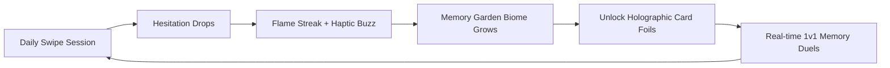
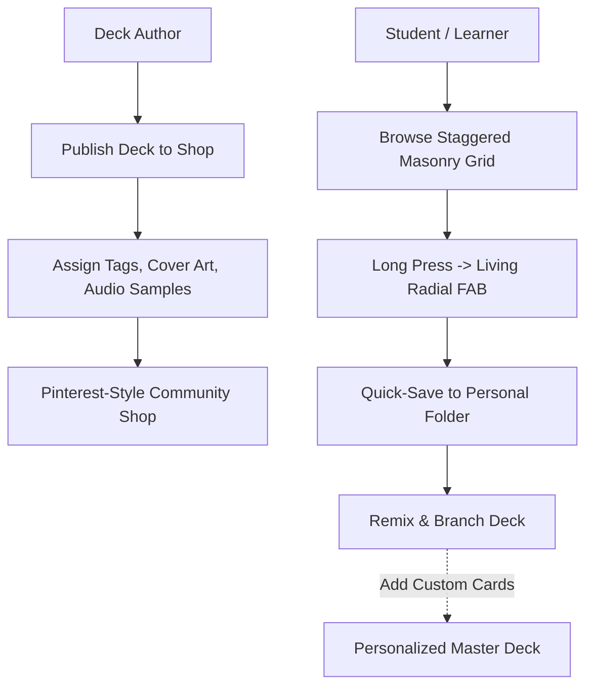

# 💡 Memory Card — Brainstorming & Feature Innovations

> **Parent Hub:** [[Ideas]] | [[Ideas/Future]] | [[Main Work Flow]]  
> **Master Concept:** [[Ideas/Future/Memory Card/brain_dump.md|brain_dump.md]] | [[Ideas/Future/Memory Card/research.md|research.md]]

---

## 🌟 Vision Expansion: From Study Tool to Tactile Addiction

While traditional flashcard apps (Anki, Quizlet) feel like clinical data-entry software, **Memory Card** reimagines knowledge acquisition as an intensely satisfying, emotionally alive, tactile gaming experience.

This document compiles visionary brainstormed features, gamification mechanics, AI-powered accelerators, advanced card types, edge-case resolutions, and creator-economy models.

---

## 🏆 1. Gamification & Neuro-Habit Mechanics



### 1.1 The "Memory Garden" Ambient Biome
- Every Folder is an ecosystem that evolves based on memory stability:
  - **Healthy Recall**: When cards are reviewed on time with low hesitation, the folder grows lush, minimalist vector flora (moss, glowing bonsai branches, geometric crystals).
  - **Memory Decay (Neglect)**: If reviews lapse and the forgetting curve erodes stability, flora gently wilts and sheds leaves, prompting a natural emotional urge to "water" the garden through a quick 2-minute review.

### 1.2 Tactile Card Foil & Mastery Finishes
When a user achieves 100% mastery on a card across 5 successive spaced intervals:
- **Holographic Shimmer**: The card receives a gyroscope-reactive metallic foil border.
- **Obsidian Black Finish**: Reserved for entire completed decks—unlocking a tactile luxury dark theme.
- **Physical Wax Seal**: When completing a deck round, a 3D animated wax seal stamps down with a heavy tactile haptic thud.

### 1.3 60-Second Memory Sprint (Time-Attack Blitz)
- Rapid-fire study mode for high-frequency vocabulary or exam prep.
- Fast-paced audio tempo that dynamically speeds up as the countdown reaches 10 seconds.
- Continuous streak multiplier with glowing particle trails following the user's finger.

### 1.4 Real-Time 1v1 "Memory Duels"
- Synchronous or asynchronous multi-player battle:
  - Both players receive the same 15-card stack.
  - Points awarded for speed + accuracy (swiping correct answers with zero hesitation).
  - Real-time ghost indicator showing your opponent's swipe velocity in the background.

---

## 🤖 2. AI-Powered Authoring & Automation Engine

```
┌─────────────────────────────────────────────────────────────────────────────┐
│                           AI CO-PILOT PIPELINE                              │
├─────────────────────────────────────────────────────────────────────────────┤
│  Raw Input (YouTube URL / Lecture PDF / Web Article / Vocabulary List)     │
│                                    │                                        │
│                                    ▼                                        │
│  [LLM Extraction] ──────────► [Atomic Concept Splitting (1 fact / card)]    │
│                                    │                                        │
│       ┌────────────────────────────┼────────────────────────────┐           │
│       ▼                            ▼                            ▼           │
│ [Smart Mnemonics]         [Phonetic Voice Gen]        [Vector Art Gen]      │
│ Rhymes & Memory Pegs       Multi-accent Speech         Minimalist Glyphs    │
│       └────────────────────────────┼────────────────────────────┘           │
│                                    ▼                                        │
│         [Interactive 6-Tier 3D Deck Ready for Instant Swiping]              │
└─────────────────────────────────────────────────────────────────────────────┘
```

### 2.1 "One-Tap Deck Synthesis"
- **YouTube to Deck**: Paste a video URL $\rightarrow$ extracts transcript $\rightarrow$ identifies key takeaways $\rightarrow$ generates a 20-card deck with timestamps.
- **Camera OCR & Smart Highlight**: Snap a photo of a textbook page $\rightarrow$ tap 5 key sentences $\rightarrow$ instant cloze flashcards generated.
- **Document to Deck**: Drop a PDF syllabus $\rightarrow$ AI categorizes content into nested Folders and Decks automatically.

### 2.2 Neuro-Mnemonic Engine
- If a user fails or hesitates on a card $>3$ times, the AI co-pilot suggests personalized mnemonic devices:
  - *Example*: For German word *"Das Eichhörnchen"* (Squirrel) $\rightarrow$ AI suggests: *"Picture an **oak horn** worn by a squirrel eating nuts."*

### 2.3 On-Device Multi-Accent Phonetic Audio
- Native speech synthesis allowing the user to switch between linguistic accents (e.g., Standard German, Swiss German, Austrian German, or Bavarian).

---

## 🎴 3. Advanced Card Formats & Spatial Interaction Types

Beyond standard text and images, Memory Card can support rich interactive formats:

```
┌─────────────────────────┐  ┌─────────────────────────┐  ┌─────────────────────────┐
│ [Cloze Deletion]        │  │ [Image Occlusion]       │  │ [Audio Blind Test]      │
│                         │  │                         │  │                         │
│ The capital of Germany  │  │   ┌──[ ? ]──┐           │  │      (( 🔊 ))           │
│ is [ Berlin ].          │  │   │ Anatomy │           │  │   "Guten Morgen"        │
│                         │  │   └──[ ? ]──┘           │  │                         │
│ [Tap blank to reveal]   │  │ [Tap mask to unblur]    │  │ [Listen first, swipe]   │
└─────────────────────────┘  └─────────────────────────┘  └─────────────────────────┘
```

1. **Cloze Deletion Cards**: Text with interactive tap-to-reveal blanks. Users tap the blank spot before swiping.
2. **Image Occlusion (Medical / Anatomy / Maps)**: Diagrams with interactive colored tape/masking blocks covering labels. Tapping a mask peels it away with a crisp sticker-peel animation.
3. **Audio-First Blind Testing**: Card front shows only an interactive animated soundwave. Swiping left/right evaluates auditory recognition before revealing the text spelling on the reverse side.
4. **3D Interactive Model Cards**: Embeds interactive, touch-rotatable 3D objects (glTF format) for organic chemistry molecules, engine parts, or historical artifacts.

---

## ✨ 4. Deep Micro-Interactions & Sensory Delights

### 4.1 Gyroscope 3D Depth Parallax
- The 6-tier card stack leverages device tilt sensors (accelerometer & gyroscope):
  - Tilting the phone shifts the layers with realistic multi-plane parallax depth.
  - Light gleams across glossy embossed borders, enhancing physical realism.

### 4.2 Dynamic Ambient Canvas Lighting
- The background canvas dynamically absorbs and reflects the dominant color accent of the active top card:
  - If the card features a warm sunset illustration, the dark canvas softly glows with subtle warm amber ambient gradients.
  - As the card exits on swipe, the lighting seamlessly cross-fades to match the next incoming card.

### 4.3 Interactive Air-Catch & Drag Reversals
- If a user accidentally lets go of a card after a fling, they can **tap or grab the card mid-air** during its exit animation and drag it back to cancel the action.

### 4.4 Fluid Two-Finger Undo Shake
- Accidental swipe? A simple quick device shake or two-finger double tap triggers a reverse-trajectory animation—the swiped card swoops back onto the stack with a rewind sound effect.

---

## 🧩 5. Edge Cases & UX System Solutions

```
┌─────────────────────────────────────────────────────────────────────────────┐
│                          EDGE CASE RESOLUTION MATRIX                        │
├──────────────────────┬─────────────────────────┬────────────────────────────┤
│ Scenario / Edge Case │ Potential Risk          │ Designed UX Resolution     │
├──────────────────────┼─────────────────────────┼────────────────────────────┤
│ Folder holds >3      │ Visual clutter on       │ Dynamic Tab Compression:   │
│ decks                │ peeking tabs            │ Stagger 3 main tabs + mini │
│                      │                         │ "+N" counter pill badge    │
├──────────────────────┼─────────────────────────┼────────────────────────────┤
│ Long-press FAB at    │ Action icons clip       │ Inward Angular Reflection: │
│ extreme screen edge  │ offscreen               │ Re-orient radial fan 180°  │
│                      │                         │ toward screen center       │
├──────────────────────┼─────────────────────────┼────────────────────────────┤
│ User gets distracted │ Distorts reading dwell  │ AFK Timeout Ceiling: Clamp │
│ (AFK for 5 minutes)  │ time & hesitation stats │ max recorded dwell at 25s  │
├──────────────────────┼─────────────────────────┼────────────────────────────┤
│ User has visual /    │ Rotations and wiggles   │ Accessibility Toggle: Flat │
│ vestibular motion    │ cause motion sickness   │ slide-only & fade modes    │
│ sensitivities        │                         │ with zero tilt             │
├──────────────────────┼─────────────────────────┼────────────────────────────┤
│ Large font size /    │ Card text overflows     │ Dynamic Text Autoscaling + │
│ accessibility scale  │ bounding box            │ Expandable Sheet Drawer    │
└──────────────────────┴─────────────────────────┴────────────────────────────┘
```

### 5.1 Solving the ">3 Decks in a Folder" Visual Stack
When a folder contains 4 to 20 decks:
- **Solution — The Fan & Counter Pill**:
  - The first 3 decks are represented by the 3 physical colored tabs.
  - A small, elegantly rounded capsule badge `[+4 more]` nests neatly into the folder spine.
  - Tapping the folder smoothly expands an accordion drawer showing all contained decks without ever cluttering the master side drawer.

---

## 🛍️ 6. Creator Economy & Deck Marketplace



1. **"Git for Flashcards" (Forking & Remixing)**:
   - Users can fork a public community deck (e.g. "JLPT N3 Kanji"), add 10 personal mnemonic cards, and keep the rest linked for upstream improvements.
2. **Curator Verified Badges & Tips**:
   - Master educators and language polyglots can publish verified premium decks with high-fidelity audio, custom illustrations, and curated memory paths.
3. **Smart Deck Bundles**:
   - Creators can bundle multiple related decks under a branded Folder (e.g. "Full Medical Anatomy: Bones, Muscles, Nerves").

---

## 🗺️ 7. Suggested Project Phasing

```
┌─────────────────────────────────────────────────────────────────────────────┐
│                            PHASED ROADMAP PLAN                              │
├─────────────────────────────────────────────────────────────────────────────┤
│ 🏁 Phase 1: Tactile Prototype & Physics Core (Weeks 1–3)                   │
│   • 6-layer 3D card stack gesture engine (rotation, scale, parabolic drift) │
│   • 40% indicator reveal & progressive next-card loader                     │
│   • Conscious side drawer with folder wiggles and inverted color depth      │
│                                                                             │
│ 🚀 Phase 2: Engine & Local Data Architecture (Weeks 4–6)                   │
│   • Local SQLite / relational database schema (Folders -> Decks -> Cards)   │
│   • FSRS-5.0 spaced repetition algorithm integration                        │
│   • Telemetry engine: Dwell tracking, AFK detection, hesitation scoring     │
│   • Web Audio API procedural sound engine & haptics                         │
│                                                                             │
│ 🛍️ Phase 3: Marketplace & Social Ecosystem (Weeks 7–9)                     │
│   • Pinterest 6-row staggered horizontal deck shop                          │
│   • Living reactive collision-aware radial FAB menu                         │
│   • Deck preview modal & save-to-folder workflow                            │
│                                                                             │
│ 🌟 Phase 4: Gamification, AI & Polish (Weeks 10–12)                         │
│   • Memory Garden ambient biome & celebratory win fanfares                  │
│   • AI Deck Co-pilot (YouTube / PDF to cards)                               │
│   • Accessibility, RTL inversion, and multi-device sync                     │
└─────────────────────────────────────────────────────────────────────────────┘
```
