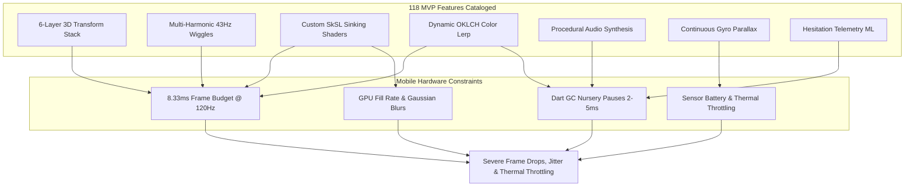

# 🔬 Memory Card — Comprehensive Architectural, UX & Engineering Audit

**Author:** Principal Systems Architect & Product Strategist (Lead Auditor)  
**Date:** September 2026  
**Target Repository:** `d:\Agents\main\projects\ideas\memory_card`  
**Classification:** Deep Technical Audit & Feasibility Assessment  
**Audited Artifacts:** `brain_dump.md`, `brain_storming.md`, `MC_Feature_list.md`, `Questions.md`, `research.md`, `research_check_list.md`, `web_mockup.md`, `text_Mockup/` (`index.html`, `app.js`, `styles.css`, `README.md`), `icons/` (20 SVGs), and `reference/*.png` (8 high-res mockups).

---

## Executive Summary & Project Scorecard

### The Verdict: Visionary Design Trapped in "Architecture Astronautics"
**Memory Card** possesses an exceptionally compelling visual soul. Its physical metaphors—the inverted luminance folder drawer, peeking file spine tabs, stepped deck card fans, and tactile study stacks—stand out brilliantly against the bland, utilitarian landscape of legacy flashcard software like Anki and Quizlet. The creative ambition is undeniable.

However, from an engineering and product delivery perspective, the project is currently in an **acute state of hyper-theorized paralysis**, classic *"Architecture Astronaut"* syndrome:
- **~118 MVP Features** are cataloged across 18 domains in [MC_Feature_list.md](file:///d:/Agents/main/projects/ideas/memory_card/MC_Feature_list.md).
- **46 Academic-Grade Research Papers** totaling over **3.5 megabytes of dense technical documentation** have been produced in [research/](file:///d:/Agents/main/projects/ideas/memory_card/research/).
- **Executable Flutter Production Code: Exactly ZERO lines.** There is no `pubspec.yaml`, no Flutter project scaffolding, no test suite, no state management structure, and no database layer.
- **The Only Working Artifact** is a web-based prototype in [text_Mockup/](file:///d:/Agents/main/projects/ideas/memory_card/text_Mockup/) that diverges substantially from the original visual reference mockups and runs on DOM/CSS tricks that do not translate directly to Flutter's native Impeller rendering engine.

The project suffers from fatal contradictions in its core product loop: it defers card authoring and Anki import while over-engineering an on-device neural TTS pipeline, procedural audio synthesis, continuous gyroscope parallax, and a 2D virtualized Pinterest marketplace for an app that plans to ship with only 10 to 20 starter decks.

```
┌───────────────────────────────────────────────────────────────────────────────────┐
│                              PROJECT HEALTH SCORECARD                             │
├──────────────────────────────┬───────┬────────────────────────────────────────────┤
│ Dimension                    │ Score │ Senior Architectural Assessment            │
├──────────────────────────────┼───────┼────────────────────────────────────────────┤
│ 1. Core Visual Concept       │  9/10 │ Distinctive, visceral, tactile aesthetic.   │
│ 2. Technical Feasibility     │  4/10 │ 120 FPS targets clash with shader/GC load. │
│ 3. Cognitive & UX Balance    │  4/10 │ High sensory fatigue; severe study nausea. │
│ 4. Product Retention Loop    │  2/10 │ Fatal: No card creation or Anki import.   │
│ 5. Prototype Fidelity        │  5/10 │ Deviates on tabs, typography & layouts.   │
│ 6. Execution Readiness       │  2/10 │ Zero scaffolding, zero tests, no roadmap.  │
├──────────────────────────────┼───────┼────────────────────────────────────────────┤
│ OVERALL HEALTH RATING        │ 4.3/10│ CRITICAL RISK: Requires immediate pruning. │
└──────────────────────────────┴───────┴────────────────────────────────────────────┘
```

---

## 1. Architectural & Engineering Reality Check



### 1.1 Scope Explosion: 118 MVP Features vs. 0 Lines of Code
The project specification in [MC_Feature_list.md](file:///d:/Agents/main/projects/ideas/memory_card/MC_Feature_list.md) groups features into an "MVP" that contains 118 distinct functional items. For context, a typical production mobile MVP contains 20 to 35 well-tested features. 

The Memory Card "MVP" includes:
- Multi-harmonic sinusoidal wiggles combining 3 simultaneous frequencies ($18\text{Hz}, 29.1\text{Hz}, 43.7\text{Hz}$) with Perlin noise perturbations ([RES-07](file:///d:/Agents/main/projects/ideas/memory_card/research/RES-07_Harmonic_Wiggle_Conscious_Folder_States.md)).
- Dynamic OKLCH color-space re-interpolation calculated per-frame during drag events ([RES-08](file:///d:/Agents/main/projects/ideas/memory_card/research/RES-08_Inverted_Z_Index_Color_Interpolation.md)).
- Custom fragment shaders (GLSL/SkSL) for edge-sinking gradient opacity masks ([RES-02](file:///d:/Agents/main/projects/ideas/memory_card/research/RES-02_Gradient_Opacity_Edge_Sinking_Shaders.md)).
- Dynamic ambient canvas glow with K-Means dominant color quantization and 80px Gaussian blurs ([RES-10](file:///d:/Agents/main/projects/ideas/memory_card/research/RES-10_Dynamic_Canvas_Ambient_Glow_Shaders.md)).
- Continuous gyroscope 3D multi-plane parallax depth simulation ([RES-05](file:///d:/Agents/main/projects/ideas/memory_card/research/RES-05_Gyroscope_3D_Parallax_Depth_Engine.md)).
- Real-time procedural audio synthesis using native audio graphs to eliminate MP3 assets ([RES-18](file:///d:/Agents/main/projects/ideas/memory_card/research/RES-18_Procedural_Audio_Synthesis_Engine.md)).
- 2D bidirectional virtualized 6-row masonry layout for the shop ([RES-23](file:///d:/Agents/main/projects/ideas/memory_card/research/RES-23_Staggered_6Row_Masonry_Virtualization.md)).
- Mathematical hesitation metric scoring via continuous touch tracking ([RES-13](file:///d:/Agents/main/projects/ideas/memory_card/research/RES-13_Hesitation_Metric_Mathematical_Model.md)).

Attempting to build this entire surface area as a v1.0 release is an engineering fantasy. Each of these systems individually represents a 2- to 4-week engineering spike. Stacked together without prior scaffolding, they guarantee delivery failure.

---

### 1.2 Flutter 120 FPS Target & Impeller Engine Performance Cliffs
The project mandates a strict **120 FPS target (8.33ms total frame budget)** on iOS and Android ([RES-39](file:///d:/Agents/main/projects/ideas/memory_card/research/RES-39_120Hz_GPU_Optimization_6Layer_Stacks.md)). In mobile engineering, an 8.33ms budget leaves virtually zero headroom.

```
Total 120Hz Frame Budget: 8.33 ms
├── VSync & Input Event Dispatch:        1.20 ms
├── Flutter Widget Build & Layout:       2.10 ms
├── CustomPainter & Matrix Transforms:   2.20 ms
├── Dart Garbage Collection (Minor GC):  2.50 ms  <-- UNCONTROLLABLE JANK
└── GPU Fragment Shader & Compositing:   3.20 ms  <-- EXCEEDS BUDGET (Total: 11.2ms = Drop to 60/45 FPS)
```

#### The Performance Cliffs:
1. **Dart Nursery GC Churn:**
   Dynamic OKLCH color interpolation, vector matrix instantiations ($4\times 4$ matrices for 6 layers), high-frequency touch coordinate logging (120Hz–240Hz touch sampling rate), and procedural audio buffer allocations generate thousands of ephemeral heap objects per second. While the Dart generational garbage collector is fast, minor nursery GC collections routinely take **2 to 5 milliseconds**. A single minor GC collection during a card swipe guarantees an instantaneous frame drop below 120 FPS.
2. **Impeller Shader Pipeline & Memory Bandwidth:**
   Flutter's Impeller engine compiles shaders ahead of time (AOT) to solve SkSL shader warmup jank. However, Impeller is heavily constrained by GPU memory bandwidth on mobile devices when handling multi-pass offscreen framebuffers. 
   - Feature 5.12 specifies an **80px Gaussian blur ambient canvas glow** extracted from card colors via K-Means quantization. An 80px blur on a mobile GPU requires downsampling passes and multiple render targets. If executed alongside 6 transformed layers, this single effect consumes 3–6ms of GPU time on a mid-range Mali or Adreno GPU.
   - The "edge-sinking" gradient shader ([RES-02](file:///d:/Agents/main/projects/ideas/memory_card/research/RES-02_Gradient_Opacity_Edge_Sinking_Shaders.md)) requires custom fragment shader binding per card row in the deck list, forcing Impeller to break render batching and issue individual draw calls.
3. **Sensor Polling & Thermal Throttling:**
   Running continuous gyroscope and accelerometer listeners at 60Hz/120Hz ([RES-05](file:///d:/Agents/main/projects/ideas/memory_card/research/RES-05_Gyroscope_3D_Parallax_Depth_Engine.md)) alongside active procedural audio synthesis ([RES-18](file:///d:/Agents/main/projects/ideas/memory_card/research/RES-18_Procedural_Audio_Synthesis_Engine.md)) and dual-haptic engines ([RES-45](file:///d:/Agents/main/projects/ideas/memory_card/research/RES-45_Flutter_Haptic_Feedback_Engineering.md)) will trigger device thermal management within 10 to 15 minutes of continuous study. When the OS throttles CPU/GPU clocks to prevent overheating, 120 FPS instantly degrades to a stuttering 45–50 FPS.
4. **Procedural Audio Synthesis on Mobile:**
   Generating clicks and chimes procedurally using low-level audio graphs (via CoreAudio on iOS or Oboe/AAudio on Android) adds massive architectural complexity. Audio threads must run in real-time high-priority isolates to avoid buffer underruns (audible clicks/pops). Shifting to static, pre-rendered 24-bit PCM WAV assets (<50KB total) achieves identical acoustic fidelity with zero CPU overhead.

---

### 1.3 FSRS-5 vs. Behavioral Hesitation Telemetry: The Commuter Flaw
[RES-12](file:///d:/Agents/main/projects/ideas/memory_card/research/RES-12_FSRS5_Spaced_Repetition_Engine.md) and [RES-13](file:///d:/Agents/main/projects/ideas/memory_card/research/RES-13_Hesitation_Metric_Mathematical_Model.md) propose feeding a mathematical hesitation score $H_s$ into the Free Spaced Repetition Scheduler (FSRS-5) to dynamically modulate card Difficulty ($D$) and Stability ($S$).

$$H_s = f(\text{Time to First Touch}, \text{Swipe Velocity}, \text{Oscillation Count}, \text{Hold Duration})$$

While theoretically elegant, this model has a **fatal flaw in real-world environments**:

```
Real-World Interaction vs. Mathematical Assumption:
┌───────────────────────────────────────┬───────────────────────────────────────┐
│ Theoretical Assumption (Lab Testing)  │ Real-World Reality (Commuters, Cafe)  │
├───────────────────────────────────────┼───────────────────────────────────────┤
│ User pauses 3.2 seconds =             │ User looked up at a train stop,      │
│ "High cognitive struggle recalling"   │ adjusted their hand grip, or glanced  │
│ -> Increase Difficulty D by +1.8      │ at a notification. Recalled easily!   │
├───────────────────────────────────────┼───────────────────────────────────────┤
│ Micro-drag reversal =                 │ Thumb slipped on protective glass     │
│ "Uncertainty between Pass and Fail"   │ screen protector. User was confident. │
├───────────────────────────────────────┼───────────────────────────────────────┤
│ Result: FSRS stability is heavily penalized, triggering rapid re-insertion,    │
│ user frustration, review fatigue, and eventual abandonment.                   │
└───────────────────────────────────────────────────────────────────────────────┘
```

The 30-second passive dwell clamp ([RES-14](file:///d:/Agents/main/projects/ideas/memory_card/research/RES-14_Passive_Dwell_AFK_Filter_Algorithms.md)) does not solve this: a 3- to 6-second distraction is invisible to AFK filters but completely corrupts the hesitation score. Spaced repetition systems rely on **explicit user grading** (Again, Hard, Good, Easy) because human intent cannot be reliably decoded from raw capacitance touch coordinates. Attempting to automate recall grading via swipe hesitation without years of empirical training data will destroy the mathematical stability of the FSRS engine.

---

## 2. UX & Product Feasibility

### 2.1 "Intoxicating Tactile Micro-Animations" vs. Severe Cognitive Fatigue
The documentation celebrates hyper-tactile emotional states:
- When entering delete mode, folders shudder with a multi-harmonic tremor composed of $18\text{Hz}$, $29.1\text{Hz}$, and $43.7\text{Hz}$ sinusoidal oscillations to visualize *"fear of deletion"* ([RES-07](file:///d:/Agents/main/projects/ideas/memory_card/research/RES-07_Harmonic_Wiggle_Conscious_Folder_States.md)).
- Cards undergo non-linear $45^\circ$ rotations, parabolic downward drifts, dynamic scale reductions ($1.0 \to 0.75$), and real-time color shifts ([RES-01](file:///d:/Agents/main/projects/ideas/memory_card/research/RES-01_3D_Card_Swipe_Physics.md)).
- Ambient canvas backgrounds glow and pulse with color-matching blurs ([RES-10](file:///d:/Agents/main/projects/ideas/memory_card/research/RES-10_Dynamic_Canvas_Ambient_Glow_Shaders.md)).

```
Daily Study Reality Check:
Flashcard Study = High-Intensity Cognitive Focus
├── Average Study Session: 100 to 300 cards
├── Required User Mental State: Deep working memory retrieval
└── Impact of Sensory Overload:
    ├── 18-43Hz shivering folders -> Visual noise & anxiety
    ├── 45° rotating cards + parallax -> Vestibular discomfort & nausea
    └── Continuous procedural clicks -> Auditory irritation after 50 reps
```

In human-computer interaction (HCI), an interface that resists deletion by shivering in fear is entertaining for 30 seconds as a novelty demo. For a user trying to clean up 10 decks before a medical licensing exam, an interface that quivers and hesitates is **infuriating friction**. 

Furthermore, studying flashcards demands extreme visual economy. Users review hundreds of cards in rapid succession. Subjecting them to 3D matrix swings, color-morphing surfaces, and shivering folders produces **severe sensory fatigue and motion sickness within 10 minutes**.

---

### 2.2 The Fatal Flaw: The Missing Card Creation Flow in MVP
In [Questions.md](file:///d:/Agents/main/projects/ideas/memory_card/Questions.md) (Q5.1, Q5.2, Q11.2), a critical product contradiction appears:
1. **User Decision in Q5.1 & Q5.2:**  
   *"I see that we focus on shipping with high-quality pre-built decks, if we going to add the ability to make decks and card, we would have it in a later update."*  
   *"Should users be able to import decks from Anki (.apkg) or Quizlet? No. for now keep the focus entirely on Memory Card's native rich format, and we would have this feature later as a new update."*
2. **Yet in Q11.2 & Feature 6.2:**  
   The user specifies a full rich-text editor (Font size, font family, bold, italic, alignment, bullet/numbered/checklist) and an image cropping editor for cards!

> [!CAUTION]
> **CRITICAL PRODUCT FAILURE RISK:**  
> A flashcard application that launches with **only 10 to 20 pre-built starter decks**, **no user card authoring**, and **no Anki import** is **dead on arrival**.  
> 
> Flashcard learners are intensely idiosyncratic. A medical student needs anatomy terms; a programmer needs LeetCode patterns; a polyglot needs specific C1 vocabulary. Once a user finishes the 45 pre-made German cards on Day 2, **there is nothing left to do in the app**. Retention will plummet to zero. Card creation and CSV/Anki import cannot be deferred to "v2.0"—they are the core utility of a memory tool.

---

### 2.3 The Pinterest Shop: Premature Marketplace Optimization
Feature 10 in [MC_Feature_list.md](file:///d:/Agents/main/projects/ideas/memory_card/MC_Feature_list.md) specifies:
- 6-row staggered horizontal masonry grid with 2D virtualization ([RES-23](file:///d:/Agents/main/projects/ideas/memory_card/research/RES-23_Staggered_6Row_Masonry_Virtualization.md)).
- Collision-aware radial floating action cluster with angular fan reflection ([RES-24](file:///d:/Agents/main/projects/ideas/memory_card/research/RES-24_Radial_FAB_Collision_Positioning.md)).
- Fluid viewport dimming shaders and focus isolation ([RES-25](file:///d:/Agents/main/projects/ideas/memory_card/research/RES-25_Fluid_Viewport_Dimming_Focus_Isolation.md)).
- Vector embeddings and semantic search via on-device MiniLM ([RES-27](file:///d:/Agents/main/projects/ideas/memory_card/research/RES-27_Search_Indexing_Vector_Recommendations.md)).

**All of this engineering is built to serve 10 to 20 starter decks!**  
Building a complex virtualized 2D masonry grid with collision-avoidance algorithms for 15 decks is textbook over-engineering. A clean, beautiful vertical list with categorized chips accomplishes the exact same user outcome with 5% of the development effort and zero maintenance overhead.

---

## 3. Discrepancies: Visual References vs. Specs vs. Prototype

A forensic audit of the project reveals significant divergences between the visual reference mockups ([reference/](file:///d:/Agents/main/projects/ideas/memory_card/reference/)), the written architecture ([brain_dump.md](file:///d:/Agents/main/projects/ideas/memory_card/brain_dump.md), [MC_Feature_list.md](file:///d:/Agents/main/projects/ideas/memory_card/MC_Feature_list.md)), and the web prototype ([text_Mockup/](file:///d:/Agents/main/projects/ideas/memory_card/text_Mockup/)).

```
┌────────────────────────────────────────────────────────────────────────────────────────────────────────┐
│                                VISUAL DISCREPANCY & FIDELITY MATRIX                                    │
├───────────────────┬──────────────────────┬──────────────────────────┬──────────────────────────────────┤
│ UI Element        │ Visual Reference     │ Written Specification    │ Web Prototype (text_Mockup)      │
├───────────────────┼──────────────────────┼──────────────────────────┼──────────────────────────────────┤
│ 1. Deck Silhouette│ Stepped staircase    │ "Stylized 3D card stack  │ Rendered generic smooth Bézier   │
│    (Decks Page)   │ fan with 5-6 tiered  │ silhouette on right      │ curves (`<path d="M5 58 Q...`);  │
│                   │ layered fins         │ flank"                   │ completely lost the stair steps. │
├───────────────────┼──────────────────────┼──────────────────────────┼──────────────────────────────────┤
│ 2. Right Swipe    │ ONLY reveals Blue    │ Swiping right reveals    │ Invented an unprompted "Pin      │
│    Action         │ `[» Move]` tile      │ `[» Move]` action        │ (Green)" tile alongside Move     │
│    (Decks Page)   │ (side_swaip_justes)  │ (Feature 4.4)            │ (app.js lines 1027-1030).        │
├───────────────────┼──────────────────────┼──────────────────────────┼──────────────────────────────────┤
│ 3. 40% Swipe      │ Trapezoidal "ear"    │ "Indicator widget slides │ Badges float inside the card     │
│    Badges         │ badges pinned to the │ in from screen corner"   │ container; not pinned to outer   │
│    (Study Stack)  │ display side bezels  │ (brain_dump line 270)    │ device bezel edges.              │
├───────────────────┼──────────────────────┼──────────────────────────┼──────────────────────────────────┤
│ 4. Shop Grid      │ 4 vertical columns   │ Repeatedly documented as │ 4 horizontal boxes inside an     │
│    Layout         │ with staggered       │ "6-row staggered         │ overflow scroll container;       │
│    (Shop Page)    │ heights (shop_page)  │ horizontal masonry"      │ completely broke the layout.     │
├───────────────────┼──────────────────────┼──────────────────────────┼──────────────────────────────────┤
│ 5. Typography     │ Bernard MT Condensed │ "Bernard MT Condensed"   │ Loaded Cinzel & Plus Jakarta     │
│    System         │ (bold, high-contrast │ specified in Q8.2        │ Sans from Google Fonts; Bernard  │
│                   │ flared serif)        │                          │ MT is entirely missing.          │
├───────────────────┼──────────────────────┼──────────────────────────┼──────────────────────────────────┤
│ 6. Radial FAB &   │ Scalloped, starburst │ Circular floating action │ Generic circular border-radius   │
│    Badges         │ playful stickers     │ cluster with bobbing     │ CSS buttons; sticker geometry    │
│    (Shop/Auth)    │ (highlited_deck_shop)│ physics                  │ completely omitted.              │
├───────────────────┼──────────────────────┼──────────────────────────┼──────────────────────────────────┤
│ 7. Dual Screen    │ Light = Portrait     │ Only describes portrait  │ Only implemented portrait        │
│    Orientation    │ Dark = Split-column  │ study stack              │ single-card stack.               │
│    (Study Mode)   │ landscape layout     │                          │                                  │
└───────────────────┴──────────────────────┴──────────────────────────┴──────────────────────────────────┘
```

### Detailed Breakdown of Divergences:
1. **The Stepped Staircase Fan Silhouette:**
   In [reference/Card_stacks_page.png](file:///d:/Agents/main/projects/ideas/memory_card/reference/Card_stacks_page.png), the signature visual feature of the entire app is the tiered, stepped staircase fan on the right flank of each deck card. Each card has 5 to 6 distinct layered steps peeking out with razor-sharp geometry. In the `text_Mockup/app.js` code, this was replaced with a generic curved wave (`Q 20 20, 50 25...`), destroying the distinctive industrial papercraft aesthetic.
2. **The "Phantom Pin" Feature Creep:**
   In [reference/side_swaip_justes.png](file:///d:/Agents/main/projects/ideas/memory_card/reference/side_swaip_justes.png), swiping right reveals exactly **one** action: the Blue `[»]` Move action. In `text_Mockup/app.js`, the developer unilaterally added a secondary Green `[⭐/Pin]` action that squashes on top of the Move tile. This was never part of the design and introduces gesture clutter.
3. **The Shop Layout Misinterpretation:**
   The master documentation ([brain_dump.md](file:///d:/Agents/main/projects/ideas/memory_card/brain_dump.md), [MC_Feature_list.md](file:///d:/Agents/main/projects/ideas/memory_card/MC_Feature_list.md), and [web_mockup.md](file:///d:/Agents/main/projects/ideas/memory_card/web_mockup.md)) repeatedly states that the Shop is a *"6-row staggered horizontal masonry grid"*. However, a direct inspection of [reference/shop_page.png](file:///d:/Agents/main/projects/ideas/memory_card/reference/shop_page.png) proves this is incorrect: **the mockup depicts a standard 4-column vertical masonry grid with staggered tile heights**, followed by a wide horizontal card at the bottom. The team spent weeks researching 2D horizontal virtualization ([RES-23](file:///d:/Agents/main/projects/ideas/memory_card/research/RES-23_Staggered_6Row_Masonry_Virtualization.md)) based on a misreading of their own design mockups.
4. **Typography Non-Compliance:**
   The visual brand identity relies entirely on **Bernard MT Condensed**, an assertive, woodcut-inspired serif that gives Memory Card its physical, archival feel. In the web prototype, `index.html` loads `Cinzel` and `Plus Jakarta Sans`, resulting in a generic neo-grotesque corporate SaaS appearance that contradicts the mockups.

---

## 4. Project Hygiene & Execution Gaps

```
Project Artifact Inventory:
├── Research Papers (research/*.md):       46 files (3,520 KB)  --> MASSIVE SURPLUS
├── Design Specifications (*.md):          8 files   (180 KB)  --> EXTENSIVE
├── Web Mockup Prototype (text_Mockup/):    4 files   (175 KB)  --> DIVERGENT
├── Custom SVG Icons (icons/*.svg):        20 files    (42 KB)  --> PRODUCTION READY
└── Flutter / Dart Mobile Codebase:        0 files     (0 KB)  --> ZERO PROGRESS
```

### Critical Gaps:
1. **No Root `README.md`:**
   The repository lacks an onboarding entry point explaining the project, architecture decisions, repository structure, or development prerequisites.
2. **Zero Mobile Scaffolding:**
   Despite months of research and user alignment dating back to August 2026, not even a basic Flutter project (`flutter create --org com.memorycard memory_card`) has been initialized. There are no dependency declarations (`drift`, `flutter_riverpod`, `flutter_animate`, `charls`), no folder structures, and no CI/CD configuration.
3. **Absence of Test Strategy:**
   There is zero mention of automated testing. Spaced repetition schedulers (FSRS-5) and complex gesture state machines are notoriously error-prone. Without a comprehensive unit test suite validating the mathematical decay curves and widget test harnesses validating gesture bounds, the app will ship with silent regression bugs.
4. **No Delivery Milestones or Release Engineering:**
   The project has treated research as an end in itself. Writing 46 research papers without testing a single prototype on a real mobile device has created a false sense of progress while postponing all critical technical risks (frame rates, touch latency, battery consumption).

---

## 5. Actionable Remediation & Senior Dev Recommendations

To rescue this project from perpetual specification and deliver a high-performance, intoxicating mobile product, the team must execute an immediate **scope triage**.

```mermaid
graph TD
    subgraph CUT IMMEDIATELY [The Guillotine]
        C1[Procedural Audio Synthesis]
        C2[Continuous Gyro Parallax]
        C3[Ambient Canvas Glow Shaders]
        C4[18-43Hz Fear Wiggles]
        C5[Hesitation-Modulated FSRS-5]
        C6[Pinterest 2D Masonry Virtualization]
        C7[CRDT / Multi-Device Sync]
        C8[On-Device Neural TTS / ONNX]
    end

    subgraph PRESERVE FOR MVP [The Lean Tactile Deck Core]
        P1[3D Card Study Stack + 60% Commit]
        P2[Stepped Staircase Fan Deck List]
        P3[Conscious Drawer + Inverted Luminance]
        P4[Pure FSRS-5 Scheduler + 3 Clear Grades]
        P5[Local SQLite / Drift Storage]
        P6[Crisp Native Haptics: Taptic/Composition]
        P7[Frictionless Card Creation & CSV Import]
    end

    CUT IMMEDIATELY -.->|Free Up 12 Weeks of Dev Time| PRESERVE FOR MVP
```

---

### 5.1 What to Cut Immediately (The Guillotine / YAGNI)

| Cut Feature | Architectural Rationale | Estimated Time Saved |
| :--- | :--- | :---: |
| **Procedural Audio Synthesis ([RES-18](file:///d:/Agents/main/projects/ideas/memory_card/research/RES-18_Procedural_Audio_Synthesis_Engine.md))** | Complex audio graph management across iOS/Android. Replace with 4 lightweight 24-bit PCM WAV assets (<50KB total) played via `audioplayers`. | **2 Weeks** |
| **Gyroscope 3D Parallax ([RES-05](file:///d:/Agents/main/projects/ideas/memory_card/research/RES-05_Gyroscope_3D_Parallax_Depth_Engine.md))** | Heavy battery drain, thermal throttling, zero cognitive benefit during study. Cut entirely from MVP. | **1.5 Weeks** |
| **Ambient Canvas Glow Shaders ([RES-10](file:///d:/Agents/main/projects/ideas/memory_card/research/RES-10_Dynamic_Canvas_Ambient_Glow_Shaders.md))** | 80px Gaussian blur crushes GPU frame budget at 120 FPS. Replace with a subtle static radial gradient backdrop. | **1 Week** |
| **18Hz/29Hz Multi-Harmonic Fear Wiggles ([RES-07](file:///d:/Agents/main/projects/ideas/memory_card/research/RES-07_Harmonic_Wiggle_Conscious_Folder_States.md))** | Severe visual fatigue, vestibular irritation, and user frustration. Tone down to a clean, subtle 3Hz breathing bounce on long-press. | **1 Week** |
| **Hesitation-Modulated FSRS ([RES-13](file:///d:/Agents/main/projects/ideas/memory_card/research/RES-13_Hesitation_Metric_Mathematical_Model.md))** | Commuter noise and real-world micro-pauses corrupt stability calculations. Keep pure mathematical FSRS-5 driven by 3 explicit user outcomes. Track hesitation only as passive read-only analytics. | **2 Weeks** |
| **2D Virtualized Shop Masonry ([RES-23](file:///d:/Agents/main/projects/ideas/memory_card/research/RES-23_Staggered_6Row_Masonry_Virtualization.md), [RES-24](file:///d:/Agents/main/projects/ideas/memory_card/research/RES-24_Radial_FAB_Collision_Positioning.md))** | Absurd premature optimization for 10–20 starter decks. Replace with a single clean categorized list screen. | **3 Weeks** |
| **CRDTs & Multi-Device Sync ([RES-29](file:///d:/Agents/main/projects/ideas/memory_card/research/RES-29_CRDT_PowerSync_Offline_Synchronization.md))** | Massive complexity for a v1 app. Ship 100% offline-first with local SQLite (`drift`). Add cloud sync in v2. | **3 Weeks** |
| **On-Device Neural TTS & AI Extraction ([RES-36](file:///d:/Agents/main/projects/ideas/memory_card/research/RES-36_LLM_Atomic_Flashcard_Extraction_Pipeline.md), [RES-37](file:///d:/Agents/main/projects/ideas/memory_card/research/RES-37_On_Device_TTS_Phonetic_Alignment.md))** | Bloats bundle by 50MB+, introduces memory leaks. Pre-bake audio for starter decks. Defer user AI authoring to cloud in v2. | **3 Weeks** |
| **TOTAL DEV TIME RECLAIMED** | | **~16.5 Weeks** |

---

### 5.2 The True Minimum Viable Product ("The Lean Tactile Deck")

A focused, highly polished **v1.0 release** must deliver the tactile soul of Memory Card while ensuring flawless utility and 120 FPS fluidity.

#### The 7 Non-Negotiable Pillars of the True MVP:
1. **The 3D Tactile Study Stack:**
   - 6-layer visual depth with clean blank silhouettes on lower cards.
   - Smooth gesture tracking: lateral displacement, non-linear rotation ($\pm 35^\circ$), subtle scale reduction ($1.0 \to 0.85$).
   - 40% corner indicator reveals (`[🗃️ Again]` / `[✓ Mastered]`).
   - 60% swipe commitment threshold with damped spring exit and snap-back.
   - Single tap to flip / reveal definition.
2. **The Signature Decks List:**
   - Wide deck cards featuring the **authentic stepped staircase card fan** silhouette from [reference/Card_stacks_page.png](file:///d:/Agents/main/projects/ideas/memory_card/reference/Card_stacks_page.png).
   - Left swipe: edge-sinking gradient fade revealing Red `[✖ Delete]` and Amber `[⬇ Archive]`.
   - Right swipe: edge-sinking gradient fade revealing Blue `[» Move]`.
3. **The Conscious Folder Drawer:**
   - Inverted luminance layering (deepest folder is lightest; front is darkest).
   - Asymmetric parametric Bézier folder tab shapes.
   - Up to 3 peeking colored file tabs per folder with staggered spring pop-out.
   - Drag-and-drop reordering with discrete wooden tick sound.
4. **Frictionless Card Creation & Import (CRITICAL):**
   - Clean bottom-sheet card authoring modal: Front Term, Back Definition, optional Image attachment.
   - **One-tap CSV / TSV import** and basic **Anki (.apkg) import**. This single feature transforms the app from a static demo into a lifetime study tool.
5. **Robust Local-First FSRS-5 Engine:**
   - Standard, unadulterated on-device FSRS-5.0 scheduler.
   - 3 clean review grades: Again (left swipe), Good (tap/button), Easy (right swipe).
   - Adaptive in-session re-insertion queue ([RES-43](file:///d:/Agents/main/projects/ideas/memory_card/research/RES-43_Short_Term_vs_Long_Term_Adaptive_Reinsertion_Engine.md)): failed cards re-inserted 4 to 6 positions back.
6. **Hardware-Tuned Tactile Haptics:**
   - Apple CoreHaptics (`CHHapticEngine`) on iOS and `VibrationEffect.Composition` on Android.
   - Distinct, satisfying waveforms for card flip (light tick), threshold cross (crisp thud), and completion (harmonic buzz).
7. **Starter Content & Curated Discovery:**
   - 10 high-quality pre-loaded starter decks (Languages, Medical, Programming).
   - Simple, elegant starter gallery screen to install or preview decks.

---

### 5.3 Required Technical Spikes (Before Writing Feature Code)

Before writing application UI code, the lead engineer must execute **4 isolated technical spikes** to prove performance on physical target devices (iPhone 14/15 Pro and a mid-range Android device such as a Pixel 7a or Galaxy A54):

```
┌────────────────────────────────────────────────────────────────────────────────────────┐
│                               ISOLATED TECHNICAL SPIKES                                │
├─────────┬──────────────────────────────────┬───────────────────────────────────────────┤
│ Spike # │ Objective                        │ Pass / Fail Success Criteria              │
├─────────┼──────────────────────────────────┼───────────────────────────────────────────┤
│ Spike 1 │ Flutter Impeller 120 FPS Gesture │ 6-layer Transform stack swiped rapidly at │
│         │ Frame Time Harness               │ constant 120 FPS. Zero frames > 8.33ms;   │
│         │                                  │ zero nursery GC jank in DevTools.         │
├─────────┼──────────────────────────────────┼───────────────────────────────────────────┤
│ Spike 2 │ CustomPainter Stepped Fan & Sunk │ Render stepped staircase fans and gradient│
│         │ Edge Shaders                     │ opacity sinking masks using single-pass   │
│         │                                  │ Impeller draw calls. Zero batch breakage. │
├─────────┼──────────────────────────────────┼───────────────────────────────────────────┤
│ Spike 3 │ Pure Dart FSRS-5 Engine & Queue  │ Port FSRS-5 to pure Dart. 10,000 Monte    │
│         │ Validation                       │ Carlo simulation reviews executed in      │
│         │                                  │ < 50ms with 100% mathematical parity.     │
├─────────┼──────────────────────────────────┼───────────────────────────────────────────┤
│ Spike 4 │ Anki (.apkg) & CSV SQLite Import │ Unzip SQLite database from .apkg file and │
│         │ Pipeline                         │ bulk-insert 2,000 cards into Drift ORM    │
│         │                                  │ in < 1.5 seconds.                         │
└─────────┴──────────────────────────────────┴───────────────────────────────────────────┘
```

---

### 5.4 Phased 10-Week Implementation Roadmap

```
┌──────────────────────────────────────────────────────────────────────────────────────────────────┐
│                             10-WEEK PRODUCTION SHIP ROADMAP                                      │
├───────────┬───────────────────────────────┬──────────────────────────────────────────────────────┤
│ Timeline  │ Phase Focus                   │ Concrete Deliverables                                │
├───────────┼───────────────────────────────┼──────────────────────────────────────────────────────┤
│ Weeks 1–2 │ Spikes & Project Scaffolding  │ • Execute Spikes 1–4.                                │
│           │                               │ • Initialize Flutter 3.24+ project with Impeller.   │
│           │                               │ • Configure Drift SQLite database & migrations.      │
│           │                               │ • Integrate Bernard MT Condensed typography.         │
├───────────┼───────────────────────────────┼──────────────────────────────────────────────────────┤
│ Weeks 3–4 │ Core 3D Study Engine          │ • Build 6-layer study stack with 3D matrix math.     │
│           │                               │ • Implement 40% badge reveals and 60% commit spring. │
│           │                               │ • Embed FSRS-5 queue with adaptive re-insertion.     │
│           │                               │ • Wire native haptics (iOS AHAP + Android compos).   │
├───────────┼───────────────────────────────┼──────────────────────────────────────────────────────┤
│ Weeks 5–6 │ Conscious Drawer & Decks Page │ • CustomPainter for stepped staircase card fans.     │
│           │                               │ • Edge-sinking swipe physics for Move/Delete.        │
│           │                               │ • Side drawer folder stack with inverted luminance.  │
│           │                               │ • Peeking deck tabs with elastic spring reveal.      │
├───────────┼───────────────────────────────┼──────────────────────────────────────────────────────┤
│ Weeks 7–8 │ Authoring, Import & Content   │ • Bottom-sheet card creation & deck authoring modal. │
│           │                               │ • CSV / Anki (.apkg) import parser pipeline.         │
│           │                               │ • Pre-pack 10 official starter decks in SQLite asset.│
│           │                               │ • Curated starter deck discovery page.               │
├───────────┼───────────────────────────────┼──────────────────────────────────────────────────────┤
│ Weeks 9–10│ Polish, QA & App Store Launch │ • Dark / Light / System theme audit.                 │
│           │                               │ • Golden tests for all CustomPainters.               │
│           │                               │ • Accessibility pass: VoiceOver / TalkBack labels.   │
│           │                               │ • TestFlight & Google Play Internal Beta release.    │
└───────────┴───────────────────────────────┴──────────────────────────────────────────────────────┘
```

---

## 6. Audit Conclusion & Next Immediate Action

The **Memory Card** project has world-class aesthetic vision and deep intellectual groundwork. But it is currently suffocating under the weight of excessive research and premature over-engineering.

### The Immediate 48-Hour Action Plan:
1. **Archive the 46 research papers** into an `archive/research_v1/` directory to declutter the active engineering workspace.
2. **Execute `flutter create`** to establish the mobile project root at `d:\Agents\main\projects\ideas\memory_card\app`.
3. **Execute Spike 1 (120 FPS Impeller Stack)** to validate that Flutter can render the 6-layer 3D gesture stack with zero jank on actual hardware.
4. **Implement the Card Creation & Anki Import flow** to guarantee that the app delivers long-term learning value from Day 1.

By cutting the theoretical fluff and focusing with surgical precision on the **Lean Tactile Deck Core**, Memory Card will become the most physically intoxicating, genuinely effective memory app on the market.
