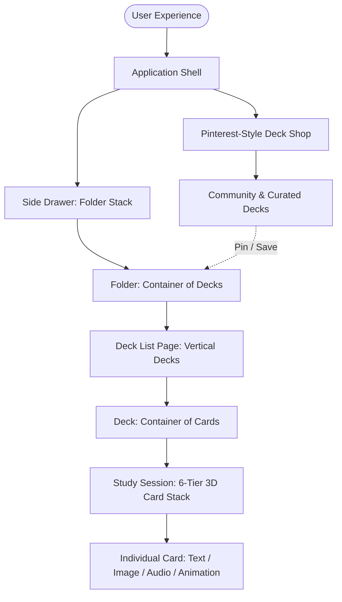
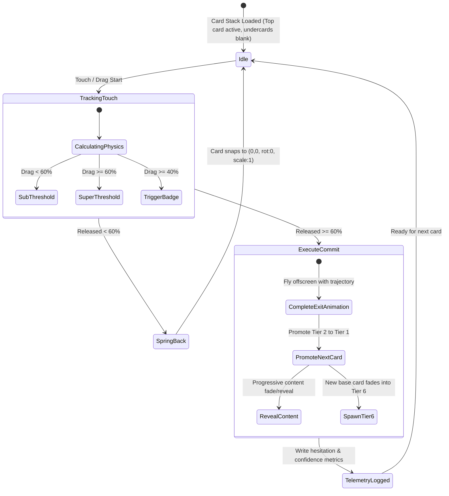
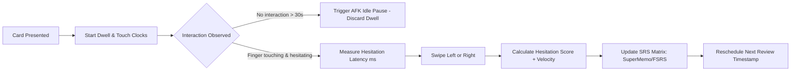

# 🧠 Memory Card — Complete Master Brain Dump

> **Parent Hub:** [[Ideas]] | [[Ideas/Future]] | [[Main Work Flow]]  
> **Associated Visuals:** [[Ideas/Future/Memory Card/reference/|Reference Mockups]] | [[Ideas/Future/Memory Card/icons/|Icons Library]] | [[Ideas/Future/Memory Card/icons list.md|Icons List]]

---

## 🌟 1. Core Vision & Philosophy

**Memory Card** is a hyper-tactile, micro-animated, spaced-repetition memory & learning application built on one central thesis:  
*A user enters with the goal of improving their memory or mastering a topic (e.g., German Basics), but gets deeply hooked by the intoxicating tactile UI, micro-animations, and emotional design that turns daily study into a dopamine-rich ritual.*

### Key Pillars
1. **Intelligent Spaced Repetition (The Repeated Method)**: Smart scheduling using hesitation detection, dwell times, and confidence scoring to calculate optimal review intervals.
2. **Tactile, Visceral UI/UX**: Interfaces that feel physically alive, conscious, responsive, and weighted.
3. **Subtle Micro-Animations & State Machines**: Seamless transitions where cards shrink, rotate, sink into backgrounds, and folders display emotional states (excitement, fear of deletion).
4. **Emotional Celebration of Wins**: Visceral audio-visual payoffs when completing sets, decks, and streaks.
5. **Granular Behavioral Telemetry**: Passive tracking of hesitation score, read time, AFK detection, swipe velocity, and review outcomes.
6. **Hierarchical Tactile Storage**: An intuitive mental model structured as **Side Drawer (Folders) $\rightarrow$ Folder View (Decks) $\rightarrow$ Study Mode (Card Stacks)**.
7. **Social Discovery (Pinterest-Inspired Shop)**: Multi-row horizontal browsable marketplace with floating reactive FAB action menus.

---

## 🗂️ 2. Architectural Hierarchy & Storage System

The application organizes all content through a clean, nested physical metaphor:



### Data Schema & Behavioral Metrics Collected

#### A. Folder Entity
- `folder_id`: Unique identifier (UUID).
- `name`: Folder display title (e.g., "Languages", "Words", "Medical", "Archive").
- `color_shade_level`: Visual depth indexing for lightness-to-darkness gradation.
- `deck_ids`: Ordered array of contained deck UUIDs.
- `deck_count`: Number of active decks held.
- `created_at` / `updated_at`: Timestamps.

#### B. Deck Entity
- `deck_id`: Unique identifier.
- `folder_parent_id`: ID of parent folder.
- `name`: Title of deck (e.g., "German Basics", "Neuroscience Terminology").
- `creator_name`: Author or curator name.
- `description`: Overview and learning scope.
- `visual_asset`: Cover thumbnail or banner illustration.
- `amount_of_original_cards`: Total count of authored cards in deck.
- `card_ids`: Ordered array of card UUIDs.
- `times_opened`: Total session opens.
- `total_time_spent`: Cumulative active study duration.
- `full_sets_completed`: Number of times the entire deck was mastered in a full loop.
- `tags`: Classification keywords for discovery and filtering.

#### C. Card Entity
- `card_id`: Unique identifier.
- `deck_parent_id`: ID of parent deck.
- `content`:
  - `front_content`: Text, markdown, image URI, audio URI, animation Lottie/Rive payload.
  - `back_content`: Solution, definition, audio phonetics, translation, visual reveal.
- `time_spent_reading`: Dwell time in milliseconds (with AFK auto-pause detection).
- `times_swiped_left`: Count of "Don't Remember / Show More Often" actions.
- `times_swiped_right`: Count of "Remembered / Show Less Often" actions.
- `user_hesitation_score`: Calculated metric based on initial touch latency, swipe velocity, and finger hovering before commitment.
- `confidence_score`: Dynamic algorithm score determining future spaced review scheduling.
- `state`: Current Leitner/spaced-repetition bucket (e.g., New, Learning, Review, Mastered).

---

## 🎨 3. Detailed UI Screens & Micro-Interaction Specifications

*(Grounding based on design reference images: `side_drwer.png`, `Card_stacks_page.png`, `Cards_page.png`, `side_swaip_justes.png`, `shop_page.png`, `highlited_deck_shop.png`, `Log_Sign_pages.png`, `icons.png`)*

```
┌────────────────────────────────────────────────────────────────────────────┐
│                             REFERENCE MAPPING                              │
├─────────────────────────┬──────────────────────────────────────────────────┤
│ Reference Asset         │ Core Feature Mapped                              │
├─────────────────────────┼──────────────────────────────────────────────────┤
│ side_drwer.png          │ Skewed folder stack with peeking file tabs       │
│ Card_stacks_page.png    │ Vertical deck list with tiered right-side stacks │
│ side_swaip_justes.png   │ Edge-sinking deck swiping with action buttons    │
│ Cards_page.png          │ 6-layer 3D card stack study interface            │
│ shop_page.png           │ 6-row staggered Pinterest masonry grid           │
│ highlited_deck_shop.png │ Reactive radial FAB menu over dimmed backdrop    │
│ Log_Sign_pages.png      │ Tactile credit-card-style login/auth cards       │
│ icons.png / icons/      │ 20 custom glyphs for navigation and actions      │
└─────────────────────────┴──────────────────────────────────────────────────┘
```

---

### 📂 Screen 1: The Conscious Side Drawer (Folder Stack)

```
┌────────────────────────────────────────┐
│ [Folder Icon]                 [⚙ Gear] │
│ ┌────────────────────────────────────┐ │
│ │ New ?             [■ Blue][■ Orange]│ │  <- Top visual: Lightest tint
│ ├────────────────────────────────────┤ │
│ │ Something         [■ Red][■ Yellow]│ │
│ ├────────────────────────────────────┤ │
│ │ Language                           │ │  <- Darker tint
│ ├────────────────────────────────────┤ │
│ │ Words                              │ │
│ ├────────────────────────────────────┤ │
│ │ Archive                            │ │  <- Deepest tint
│ │                                    │ │
│ └────────────────────────────────────┘ │
│ [Fade to base background]              │
│                               [+ Folder]│
└────────────────────────────────────────┘
```

#### Visual Structure
- **Offset Stack**: Folders are stacked on top of each other with a distinct vertical tab offset.
- **Inverted Depth Illusion**: The last folder in array order sits visually on top, while the first folder sits deep behind, yet colored lightest. As you move downward through the folder list, colors transition progressively from light tones to deep, rich dark tones.
- **Peeking File Tabs (Max 3)**: Selecting an active folder animates up to 3 colored file tabs protruding from the folder spine. These tabs represent child decks with staggered bouncy vertical motion. When a folder holds $>3$ decks, an overflow badge or subtle stack compression is rendered.

#### Gestures & Micro-Interactions
1. **Hold & Drag Reordering (Alive Colors)**:
   - When the user drags a folder upward: it visibly shifts deeper in the stack hierarchy and transitions its background to a lighter tint.
   - When dragged downward: it shifts higher in physical layer appearance and deepens to a darker hue.
2. **Emotional "Conscious" States**:
   - **Delete Mode (Trash/Delete Icon clicked)**: All folders perform a sequence zoom-out-zoom-in pulse, then enter a continuous gentle ambient wiggle. Selecting a specific folder to delete triggers an exaggerated recoil zoom and a high-frequency nervous wiggle—*visualizing that the folder fears deletion*.
   - **Create / Edit Folder Dialog**: When the modal opens, background folders wiggle with an eager, buoyant bounce—*expressing excitement and welcoming new content*.
   - **Folder Deselection**: Reverses the protruding tab motion with an elastic snapping retraction.

---

### 📑 Screen 2: Decks List Page (Vertical Deck Cards)

```
┌────────────────────────────────────────┐
│ [Stack Icon]                    [⋮ Menu]│
│                                        │
│ ┌───────────────────────────[ ▰ ▰ ▰ ]┐ │
│ │ Languages                 [ Stack ]│ │
│ └────────────────────────────────────┘ │
│ ┌───────────────────────────[ ▰ ▰ ▰ ]┐ │
│ │ Words                     [ Stack ]│ │
│ └────────────────────────────────────┘ │
│ ┌───────────────────────────[ ▰ ▰ ▰ ]┐ │
│ │ To Remember               [ Stack ]│ │
│ └────────────────────────────────────┘ │
│ ┌───────┬───┬───┐                      │
│ │ Remeb │ ✖ │ ⬇ │                      │  <- Left Swipe Action Reveals
│ └───────┴───┴───┘                      │
│   [»»] ┌─────────────────────────────┐ │  <- Right Swipe Move Trigger
│        │ Words                       │ │
│        └─────────────────────────────┘ │
│ [Top/Bottom Edge Gradient Fade Out]    │
│ ────────────────────────────────────── │
│ [🏠 Home]       [ ⬡ + ]       [🛍️ Shop] │
└────────────────────────────────────────┘
```

#### Visual Layout
- Vertical list of wide horizontal deck cards. Each card displays deck title, creator metadata, and a stylized 3D layered card-stack silhouette on its right flank.
- **Boundary Fade**: Top and bottom list bounds do not hard-clip; decks smoothly fade into the background color as they scroll out of view.

#### Interactive Swipe Gestures & Edge Sinking Physics
1. **Left Swipe (Delete / Action Reveal)**:
   - As swiped left, the opposite side of the card does not exit screen borders rigidly. Instead, it **sinks into the background** using an adaptive gradient opacity mask that blends with the ambient canvas.
   - A red `[✖ Delete]` action block grows smoothly from the right margin.
   - Secondary extended swipe reveals an amber/orange `[⬇ Archive]` action tile.
2. **Right Swipe (Move to Folder)**:
   - Swiping right reveals a blue `[» Move]` tile on the left edge.
3. **Threshold & Spring Overshoot**:
   - **35% Threshold**: Swiping past 35% locks the action open upon finger release; swiping $<35\%$ snaps the card back to zero.
   - **Overshoot & Squash Reaction**: When released past the threshold, the revealed action block springs outward with a slight width overshoot. When the action block contacts the deck, the deck undergoes a subtle horizontal compression (squash) before settling at equilibrium.
4. **Long Press & Drag**:
   - Long pressing any deck lifts it with a drop-shadow bloom, allowing drag-and-drop reordering.

---

### 🎴 Screen 3: Card Study Session (6-Tier Stack & State Machine)

```
┌────────────────────────────────────────┐
│ [Stack Icon]                    [⋮ Menu]│
│                                        │
│         ░░░░░░░░░░░░░░░░░░░░░          │  <- Layer 6 (Faded into canvas)
│        ▒▒▒▒▒▒▒▒▒▒▒▒▒▒▒▒▒▒▒▒▒▒▒         │  <- Layer 5
│       ▓▓▓▓▓▓▓▓▓▓▓▓▓▓▓▓▓▓▓▓▓▓▓▓▓        │  <- Layer 4
│      ███████████████████████████       │  <- Layer 3
│     █████████████████████████████      │  <- Layer 2
│    ┌─────────────────────────────┐     │
│    │ Title Name                  │     │  <- Layer 1: Top Active Card
│    │                             │     │
│    │ Words, Words, Words...      │     │
│    │ [ Media / Image Area ]      │     │
│    │                             │     │
│    └─────────────────────────────┘     │
│                                        │
│  [🗃️ Box]                     [✓ Done] │  <- 40% Swipe Indicator Badges
│  (Review More)             (Mastered)  │
│                                        │
│ ────────────────────────────────────── │
│ [🏠 Home]       [ ⬡ + ]       [🛍️ Shop] │
└────────────────────────────────────────┘
```

#### Visual Depth: 6-Tier Depth Stack
- The deck is presented as a physical stack of **6 visible card layers**.
- Lower cards are staggered in scale and vertical offset, with background-blending color shifts giving the visual illusion of cards emerging from deep canvas space.
- **Blank Under-Cards**: Cards beneath the top active card are completely blank silhouettes. They do not render content until they are promoted to the active layer.

#### The 3-Dimensional Swipe Physics & State Machine
The core swipe interaction orchestrates three continuous parameters tied to touch displacement:
1. **Lateral Displacement $(X, Y)$**: Card tracks finger movement with a subtle downward parabolic drift as it leaves center.
2. **Adaptive Scale Reduction**: Card smoothly shrinks up to **$25\%$** $(Scale: 1.0 \rightarrow 0.75)$ at maximum displacement.
3. **Dynamic Rotation**: Card rotates smoothly up to **$45^\circ$** (positive for right swipe, negative for left swipe).



#### Key Threshold Rules
- **60% Commitment Threshold**: Releasing the card at $\ge 60\%$ swipe distance commits the action and triggers complete exit. Releasing at $\le 59\%$ runs a spring snap-back animation to reset position.
- **40% Indicator Reveal**: At $40\%$ swipe displacement, an indicator widget slides in from the screen corner:
  - **Left Swipe ($\leftarrow$)**: 2-card offset stack with `[🗃️ Box / Down Arrow]` icon (*"Don't know — Show more often"*).
  - **Right Swipe ($\rightarrow$)**: 2-card offset stack with `[✓ Checkmark]` icon (*"Mastered — Show less often"*).
- **Progressive Reveal of Next Card**: As the top card is swiped past $40\%$, the blank second-tier card transitions in color and progressively fades in its title and media, acting as a real-time visual loader and satisfying transition.

---

### 🛍️ Screen 4: The Pinterest-Style Deck Shop & Reactive FAB

```
┌────────────────────────────────────────┐
│ [Stack Icon]                    [⋮ Menu]│
│ ┌───────────────────────┐ ┌──────────┐ │
│ │ 🔍 Search decks...    │ │ ⚞ Filter │ │
│ └───────────────────────┘ └──────────┘ │
│                                        │
│  ┌───┐ ┌───┐ ┌───┐ ┌───┐ ┌───┐ ┌───┐   │  <- Staggered Masonry Rows
│  │   │ │   │ │   │ │   │ │   │ │   │   │     Horizontal Scrollable
│  │ 1 │ │ 2 │ │ 3 │ │ 4 │ │ 5 │ │ 6 │   │
│  │   │ └───┘ │   │ │   │ └───┘ │   │   │
│  └───┘ ┌───┐ └───┘ └───┘ ┌───┐ └───┘   │
│        │   │             │   │         │
│        └───┘             └───┘         │
│ ────────────────────────────────────── │
│ [🏠 Home]       [ ⬡ + ]       [🛍️ Shop] │
└────────────────────────────────────────┘
```

#### Visual Structure
- Search bar with adjacent `[⚞ Filter]` button at the top.
- Central area consists of **6 staggered rows of card tiles**, allowing continuous horizontal panning to browse curated and community decks.

#### Long-Press Reactive FAB Interaction
- **Dimmed Ambient Focus**: Long-pressing a deck card dims the entire viewport except the chosen card.
- **Floating Action Cluster**: A radial cluster of floating action badges pops up:
  1. `[📌 Pin]`: Pin deck to personal shop favorites.
  2. `[✈️ Share]`: Generate shareable link/QR code.
  3. `[🔍 Search Similar]`: Find related decks with matching tags/content.
  4. `[💾 Save]`: Quick-save directly to the user's latest active folder.
- **Living Floating Motion**: The FAB options do not remain static; they carry a continuous subtle organic floating bobbing motion.
- **Edge Collision Avoidance**: The FAB cluster position is dynamically computed relative to screen bounds. If the user long-presses a card at the extreme right edge, the action cluster adapts its layout inward so no buttons clip outside viewport edges.

#### Deck Preview Modal (`deck_shop_selected`)
- Clicking any shop card opens a bottom-sheet / modal featuring:
  - Mini swipeable card preview stack (interactive sample view).
  - Metadata block: Author, total card count, rating, description, and tags.
  - "Similar Decks" recommendations below.

---

### 🔐 Screen 5: Tactile Login & Onboarding (Credit Card Metaphor)

```
┌────────────────────────────────────────┐
│ [Stack Icon]                   [☀️ Sun]│
│                                        │
│    \                                   │
│     \  Curved Decorative Sweep         │
│      \                                 │
│                                        │
│ ┌────────────────────────────────────┐ │
│ │ 🎴                          [Icon] │ │  <- Embossed tactile card
│ │                                    │ │
│ │ Card Holder Name                   │ │
│ │ XXXX XXXX XXXX XXXX                │ │
│ └────────────────────────────────────┘ │
│                                        │
│      Don't Have a Card ? Sign in       │
│                                        │
│    [ (G) Google ]   [ 🎴 Auth ]   [ 🍎 Apple ]
└────────────────────────────────────────┘
```
- Interactive embossed "Credit / Membership Card" design for user profile, authentication, and onboarding.
- Smooth theme toggle button `[☀️ Sun]` at top right.
- One-touch federated OAuth (`Google`, `Apple`, and custom `Memory Card Pass`).

---

### 🧭 Screen 6: Navigation Shell (Top Header & Bottom Bar)

#### Top Header
- **Left**: Multi-card app glyph `[logoDarkMode.svg / logoLightMode.svg]` — tap opens the Side Drawer.
- **Right**: 3-dot burger menu `[burggerDotes.svg]` — opens dropdown with Settings, Theme Switcher, and Account.

#### Bottom Bar
- **Left**: `[home.svg]` (Return to Active Decks).
- **Center**: Prominent diamond-shaped floating `[+ Create]` button (Create new Folder, Deck, or Card).
- **Right**: `[shop.svg]` (Pinterest Deck Marketplace).

---

## 🔬 4. Telemetry, Hesitation Scoring & Spaced Repetition Engine



### Behavioral Metrics Engine
1. **Dwell Time & AFK Filter**: Starts the millisecond the card top-layer is revealed. If no touch or motion occurs within 30 seconds, AFK detection clamps the recorded dwell time to prevent skewing learning stats.
2. **Hesitation Score $(H_s)$**:
   $$H_s = f(\text{Time to first touch}, \text{Swipe oscillation count}, \text{Drag velocity}, \text{Hold duration})$$
   A user who drags a card right, stops, hesitates near the 35% mark, and then pulls it left has high hesitation, triggering higher review frequency even if they eventually swipe right.
3. **Confidence Score $(C_s)$**:
   Combines historical swipe ratios with recent hesitation scores to dynamically place the card into the optimal spaced repetition bucket (e.g. review in 4 hours, 1 day, 3 days, 10 days, 30 days).

---

## 🔊 5. Audio Engineering & Tactile Soundscape

Sound is a primary dimension of the application's emotional connection:

1. **Folder Dragging Tick**: Ultra-subtle wooden/paper mechanical clicks that pitch up as folders are dragged deeper into darker layers.
2. **Swipe Whoosh & Weight**: Pitch-modulated aerodynamic whoosh matching swipe velocity.
3. **Action Snap Feedback**: Crisp tactile thud when a card crosses the 60% commitment threshold.
4. **Emotional Folder Chimes**:
   - High-pitch rapid tremolo / flutter when folders enter delete-fear mode.
   - Bright, resonant chord progression on create-folder excitement.
5. **Win Celebration Flourish**: Dynamic ascending harmonic chord with layered haptic motor buzz when completing a deck study round.

---

## 🎯 6. Complete Icon Asset Manifest

Mapped directly from [[Ideas/Future/Memory Card/icons/|icons/]] directory:

| Icon Filename | Glyph Visual | Role in Application |
| :--- | :--- | :--- |
| `apple.svg` | Apple Silhouette | Apple OAuth Sign-in |
| `google.svg` | Google Colored 'G' | Google OAuth Sign-in |
| `logoLightMode.svg` / `logoDarkMode.svg` | 3-Card Fan Stack | Main Brand Mark & Drawer Trigger |
| `folder.svg` | Folder with Plus / Tab | Folder Directory & New Folder Action |
| `home.svg` | House Glyph | Bottom Navigation: Active Deck View |
| `shop.svg` | Storefront Awning | Bottom Navigation: Community Deck Shop |
| `burggerDotes.svg` | 3 Vertical Dots | Top Header Overflow Settings Menu |
| `settings.svg` | 6-Tooth Cog | App & Engine Settings |
| `sun.svg` | Radiant Sun Glyph | Dark / Light Mode Toggle |
| `search.svg` | Magnifying Glass | Shop Deck Search |
| `filter.svg` | Horizontal Sliders | Shop Tag & Category Filter |
| `box.svg` | Archive Box with Down Arrow | Swipe Left: "Review More Often" Badge |
| `done.svg` | Circular Checkmark | Swipe Right: "Mastered / Review Less" Badge |
| `delete.svg` | Bold 'X' Glyph | Deck Swipe: Delete Deck |
| `archive.svg` | Down Arrow into Box | Deck Swipe: Archive Deck |
| `move.svg` | Double Chevron `>>` | Deck Swipe: Move Deck to Another Folder |
| `pin.svg` | Pushpin | Shop Long-Press: Pin Deck |
| `share.svg` | Paper Plane / Share Arrow | Shop Long-Press: Share Deck |
| `save.svg` | Ribbon Bookmark | Shop Long-Press: Quick-Save to Folder |

---

## 🚀 7. Roadmap & Next Steps

1. Conduct comprehensive technical and cognitive research $\rightarrow$ [[research|Research & Technical Feasibility Plan]].
2. Explore gamification, AI generation, and UX expansions $\rightarrow$ [[brain_storming|Brainstorming & Feature Innovations]].
3. Finalize tech stack evaluation (Flutter vs React Native + Skia vs Web Canvas).
4. Build interactive prototype for the 6-layer swipe state machine and conscious side drawer.
