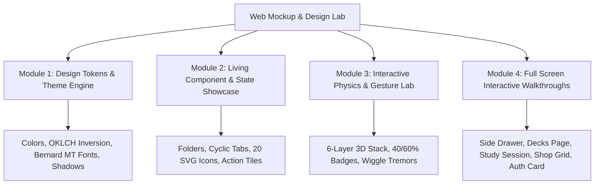

# 🎨 Memory Card — Web Mockup & Living Design System Specification

> **Parent Hub:** [[Ideas]] | [[Ideas/Future]] | [[Main Work Flow]]  
> **Core Blueprints:** [[Ideas/Future/Memory Card/MC_Feature_list.md|MC_Feature_list.md]] | [[Ideas/Future/Memory Card/brain_dump.md|brain_dump.md]] | [[Ideas/Future/Memory Card/Questions.md|Questions.md]]  
> **Visual Reference Assets:** [[Ideas/Future/Memory Card/reference/|Reference Mockups]] | [[Ideas/Future/Memory Card/icons list.md|Icons List]]

---

## 🌟 1. What is the Web Mockup?

The **Web Mockup** (`web_mockup.html` / interactive artifact) is an interactive, single-page **Living Design System & High-Fidelity Prototype Lab** built with modern HTML5, CSS3 (Custom Properties & Grid/Flexbox), and Vanilla JavaScript.

It functions as both:
1. **The Visual Source of Truth**: A panoramic design board presenting the exact color palettes, typography hierarchies, Bézier curves, component states, and icon sets.
2. **The Functional Gesture Sandbox**: A real-time playable simulator of the core physics (6-layer 3D swipe mechanics, conscious folder wiggles, edge-sinking cards, and radial FAB menus).

---

## 🚀 2. Why Are We Using a Web-Based Mockup?

| Objective | Why Web Artifact Wins | Compared to Native Flutter Mockup |
|---|---|---|
| **⚡ Zero Latency Iteration** | Instant 1-second browser preview with live reload. | Eliminates Android emulator boot times, Gradle build syncs, and SDK setup overhead. |
| **🔍 Panoramic Design Token Inspector** | View and test all design tokens, color scales, and states side-by-side on a desktop canvas. | Mobile emulators restrict view to a single 390×844 viewport. |
| **🧪 Live Math & Shader Calibration** | Tweak Bézier control points, spring stiffness ($\zeta, \omega_n$), and rotation curves using live UI sliders. | Tweak-and-rebuild cycles in compiled code are 10× slower. |
| **📋 1:1 Flutter Code Readiness** | Includes instant "Copy Flutter Dart Token" buttons for every color, curve, and component. | Once finalized, token export to `AppColors.dart` and `AppTheme.dart` is effortless. |

---

## 🧩 3. What the Web Mockup Contains & Shows

The web mockup is organized into **4 structured modules**:

---

### 🎨 Module 1: Design Tokens & Theme Engine
* **Color System**:
  - **Light Theme**: Background (`#F8F9FA`), Surface Card (`#FFFFFF`), Text Primary (`#1A1A1A`), Inverted Folder 0 (`#1E1E1E`).
  - **Dark Theme**: Background (`#121212`), Surface Card (`#1E1E1E`), Text Primary (`#FFFFFF`), Inverted Folder 0 (`#FFFFFF`).
  - **Cyclic Tab Accents**: Blue (`#5B9DFF`), Yellow/Orange (`#FFB85B`), Coral Red (`#E55B5B`).
  - **6-Tier Profile Shaders**: Bronze (`#CD7F32`), Silver (`#E0E0E0`), Gold (`#FFD700`), Emerald (`#50C878`), Diamond (`#B9F2FF`), Obsidian (`#1A1A1A` with holographic sheen).
* **Typography Hierarchy**:
  - Primary UI Font: **Bernard MT Condensed** (Headings, titles, folder labels, actions).
  - Body / Card Text: Clean geometric sans-serif (Inter / System font) for high legibility.
* **Elevation & Shadow Tokens**: Layer offsets, drop shadow blooms, and ambient glow values.

---

### 🧱 Module 2: Living Component & State Showcase
* **Folder Silhouettes**: Interactive SVG/Canvas rendering of the parametric Bézier folder curve *(see [[Ideas/Future/Memory Card/research/RES-44_Flutter_Conscious_Folder_Drawer_Engine.md|RES-44]])*.
* **Deck Tabs**: Visualizing the 3 cyclic permutations ($[B, Y, R] \to [Y, R, B] \to [R, B, Y]$) with peeking staggered pill geometries.
* **Complete 20-Icon Matrix**: Interactive gallery of all 20 custom SVG glyphs mapped in [[Ideas/Future/Memory Card/icons list.md|Icons List]].
* **Swipe Action Tiles**: Red `[✖ Delete]`, Amber `[⬇ Archive]`, Blue `[» Move]`, and Green `[✓ Done]`.
* **State Gallery**: Default, Hover, Active, Disabled, Loading, Error, and Selected states.

---

### 🕹️ Module 3: Interactive Physics & Gesture Sandbox
* **The 6-Layer 3D Swipe Engine**:
  - Draggable top card tracking finger displacement $(X, Y)$.
  - Simultaneous scale reduction ($1.0 \to 0.75$) and rotation ($\pm 45^\circ$) *(see [[Ideas/Future/Memory Card/research/RES-01_3D_Card_Swipe_Physics.md|RES-01]])*.
  - $40\%$ threshold indicator badge slide-in (`[🗃️ Box]` / `[✓ Done]`).
  - $60\%$ commit trigger with offscreen trajectory and Tier 2 $\to$ 1 progressive promotion *(see [[Ideas/Future/Memory Card/research/RES-15_Active_Recall_Progressive_Revelation.md|RES-15]])*.
* **Conscious Folder States**:
  - Toggle **Delete Mode (Fear)** to view the multi-harmonic high-frequency wiggle tremor ($18\text{Hz}, 29.1\text{Hz}$) *(see [[Ideas/Future/Memory Card/research/RES-07_Harmonic_Wiggle_Conscious_Folder_States.md|RES-07]])*.
  - Toggle **Create Mode (Excitement)** to view the buoyant spring bounce.
  - Drag-and-drop folder reordering with OKLCH dynamic luminance re-shading *(see [[Ideas/Future/Memory Card/research/RES-08_Inverted_Z_Index_Color_Interpolation.md|RES-08]])*.
* **Card Reveal Modes**: Interactive switcher between **3D Flip**, **Color Transform Reveal**, and **No Flip (Front Only)** *(see [[Ideas/Future/Memory Card/Questions.md#q113--the-research-covers-both-tap-to-flip-and-a-dedicated-reveal-icon-on-the-card-itself-when-the-card-is-revealedflipped-should-the-back-of-the-card-be-a-continuation-of-the-same-card-visual-or-a-completely-distinct-second-card-design|Questions.md Q11.3]])*.

---

### 📱 Module 4: Screen Walkthrough & Flow Mockups
Interactive mobile viewport frames (390×844) previewing each core screen:
1. **Screen 1 — Conscious Side Drawer**: Skewed folder stack with bottom gradient fade and `[+ Folder]` trigger *(matches `side_drwer.png` in [[Ideas/Future/Memory Card/reference/|reference/]])*.
2. **Screen 2 — Decks List Page**: Vertical cards with right-side 3D tiered stack glyphs, edge-sinking swipe actions, and squash collisions *(matches `Card_stacks_page.png` & `side_swaip_justes.png`)*.
3. **Screen 3 — 3D Card Study Session**: Full 6-layer study stack with ambient dynamic glow and confidence badge overlays *(matches `Cards_page.png`)*.
4. **Screen 4 — Pinterest Deck Shop**: 6-row staggered horizontal masonry grid with long-press reactive floating radial FAB *(matches `shop_page.png` & `highlited_deck_shop.png`)*.
5. **Screen 5 — Tactile Auth & Profile**: Embossed membership card with dynamic CMS material shader preview *(matches `Log_Sign_pages.png`)*.

---

## 🔗 4. Master Specification Reference Map

To build and maintain the web mockup, reference the exact specifications across the project files:

| Mockup Feature / Component | Authoritative Spec Note / Research Paper | Primary Asset Reference |
|---|---|---|
| **3D Card Swipe Physics & Matrix Transforms** | [[Ideas/Future/Memory Card/research/RES-01_3D_Card_Swipe_Physics.md|RES-01]] | `Cards_page.png` |
| **Edge-Sinking Opacity Gradient Masks** | [[Ideas/Future/Memory Card/research/RES-02_Gradient_Opacity_Edge_Sinking_Shaders.md|RES-02]] | `side_swaip_justes.png` |
| **Action Squash & Stretch Collision Dynamics** | [[Ideas/Future/Memory Card/research/RES-03_Squash_Stretch_Collision_Dynamics.md|RES-03]] | `side_swaip_justes.png` |
| **Conscious Folder Bézier Paths & 3-Color Permutations** | [[Ideas/Future/Memory Card/research/RES-44_Flutter_Conscious_Folder_Drawer_Engine.md|RES-44]] | `side_drwer.png` |
| **Multi-Harmonic Emotional Wiggles (Fear/Joy)** | [[Ideas/Future/Memory Card/research/RES-07_Harmonic_Wiggle_Conscious_Folder_States.md|RES-07]] | `side_drwer.png` |
| **Inverted Z-Index Luminance Interpolation** | [[Ideas/Future/Memory Card/research/RES-08_Inverted_Z_Index_Color_Interpolation.md|RES-08]] | `side_drwer.png` |
| **Dynamic Ambient Backdrop Glow Shaders** | [[Ideas/Future/Memory Card/research/RES-10_Dynamic_Canvas_Ambient_Glow_Shaders.md|RES-10]] | `Cards_page.png` |
| **Radial Collision-Aware Floating Action Buttons (FAB)** | [[Ideas/Future/Memory Card/research/RES-24_Radial_FAB_Collision_Positioning.md|RES-24]] & [[Ideas/Future/Memory Card/research/RES-25_Fluid_Viewport_Dimming_Focus_Isolation.md|RES-25]] | `highlited_deck_shop.png` |
| **6-Row Staggered Shop Masonry Virtualization** | [[Ideas/Future/Memory Card/research/RES-23_Staggered_6Row_Masonry_Virtualization.md|RES-23]] | `shop_page.png` |
| **Composite Mastery Score (CMS) & Profile Card Shaders** | [[Ideas/Future/Memory Card/research/FES-46.md|FES-46]] | `Log_Sign_pages.png` |
| **Complete MVP Feature Scope** | [[Ideas/Future/Memory Card/MC_Feature_list.md|MC_Feature_list.md]] | Master Project Scope |
| **User Decisions & Preferences** | [[Ideas/Future/Memory Card/Questions.md|Questions.md]] | Locked Specifications |

---

## 🛠️ 5. Next Step: Building the Web Mockup Artifact

With this specification established:
1. The web mockup will be authored as a self-contained, responsive HTML/CSS/JS file.
2. It can be opened directly in your browser for immediate interactive testing and visual validation.
3. Once approved, the exact tokens and CSS/JS parameters will be exported directly into Flutter Dart code (`AppColors.dart`, `AppTheme.dart`, `CustomFolderPainter.dart`, `CardStackGestureController.dart`).
