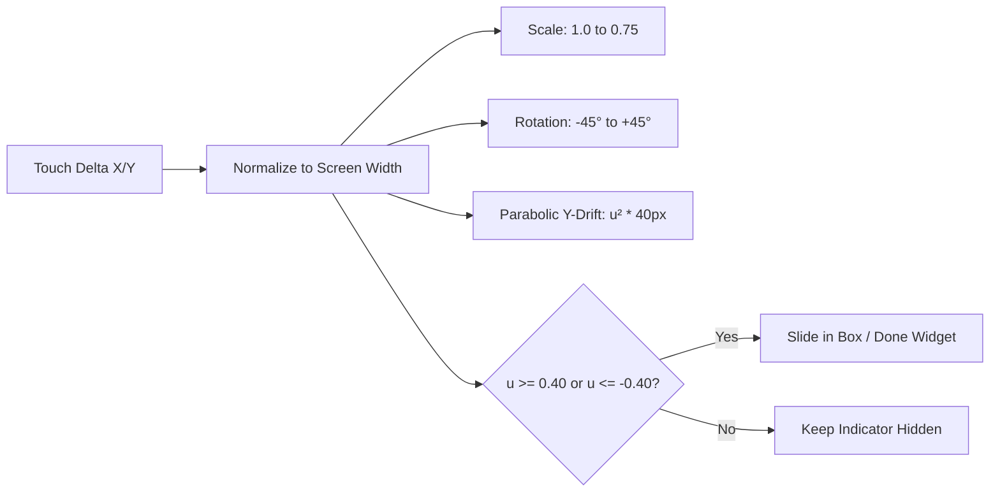
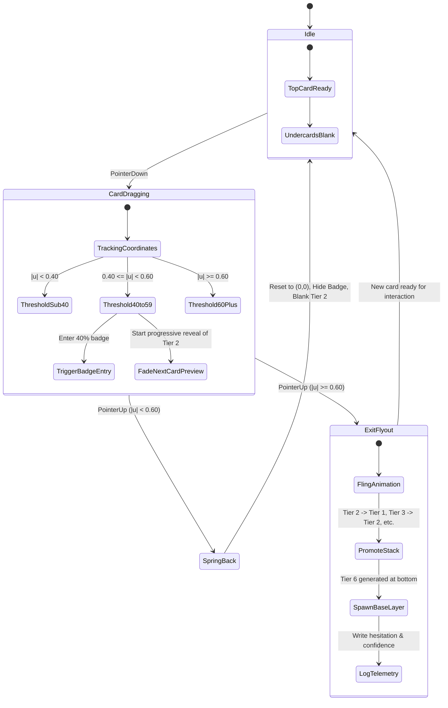
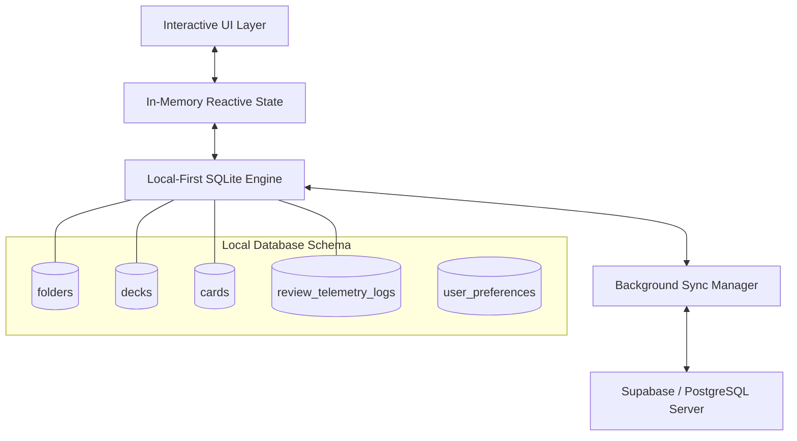

# 🔬 Memory Card — Deep Research & Technical Feasibility Blueprint

> **Parent Hub:** [[Ideas]] | [[Ideas/Future]] | [[Main Work Flow]]  
> **Master Concept:** [[Ideas/Future/Memory Card/brain_dump.md|brain_dump.md]] | [[Ideas/Future/Memory Card/brain_storming.md|brain_storming.md]]

---

## 🎯 Executive Summary

This document presents the comprehensive technical and cognitive research agenda for the **Memory Card** project. It systematically evaluates the physics models, memory science, offline storage architectures, audio engineering, emotional micro-interaction mechanics, state machine architectures, and telemetry scoring needed to deliver a world-class, habit-forming spaced-repetition application.

```mermaid
graph TD
    subgraph Cognitive Layer
        SRS[Spaced Repetition: FSRS-5 vs SM-2]
        Recall[Active Recall & Blank Undercards]
        Hesitation[Hesitation & Dwell Analytics]
    end
    
    subgraph Tactile & Physics Layer
        SwipePhysics[2D Spring & Drag Mechanics]
        EdgeSink[Gradient Alpha Sinking Shaders]
        StateMachine[XState Parallel Timelines]
        ConsciousAnim[Living Emotion Engines: Wiggle & Recoil]
    end
    
    subgraph Platform & Data Layer
        LocalFirst[Local-First SQLite / CRDT Sync]
        AudioSynth[Web Audio Procedural Earcons]
        Multiplatform[Flutter vs React Native Skia vs Web]
    end
    
    Cognitive Layer --> Tactile & Physics Layer
    Tactile & Physics Layer --> Platform & Data Layer
```

---

## 🧠 1. Human Memorization Systems & Cognitive Science

### 1.1 The Evolution of Spaced Repetition Algorithms

To maximize learning velocity, Memory Card must move beyond simplistic fixed-interval schedules.

```
┌─────────────────────────────────────────────────────────────────────────────┐
│                    SPACED REPETITION ALGORITHM COMPARISON                   │
├──────────────┬─────────────┬─────────────┬──────────────┬───────────────────┤
│ Algorithm    │ Complexity  │ Memory Type │ Compute Cost │ Behavioral Inputs │
├──────────────┼─────────────┼─────────────┼──────────────┼───────────────────┤
│ Leitner Box  │ Very Low    │ Discrete    │ $O(1)$       │ Binary (Pass/Fail)│
│ SuperMemo-2  │ Low         │ Continuous  │ $O(1)$       │ 0–5 Rating        │
│ SuperMemo-18 │ Very High   │ Continuous  │ High (Cloud) │ Multi-variate     │
│ FSRS-5.0     │ Moderate    │ Continuous  │ $O(1)$ Local │ Dwell, Interval,  │
│ (Recommended)│             │ DSR Model   │ Optimization │ Hesitation Score  │
└──────────────┴─────────────┴─────────────┴──────────────┴───────────────────┘
```

#### The Free Spaced Repetition Scheduler (FSRS-5.0) Model
FSRS is based on the **DSR Model** (Difficulty, Stability, Retrievability):
1. **Retrievability ($R$)**: Probability of recalling a memory at time $t$:
   $$R(t) = \left(1 + F \cdot \frac{t}{S}\right)^{-w}$$
   where $S$ is memory stability (days), and $F$ is the forgetting factor.
2. **Stability ($S$)**: Days required for $R$ to fall from 100% to 90%.
3. **Difficulty ($D$)**: Inherent complexity of the card ($1 \le D \le 10$).
4. **Behavioral Hesitation Integration**:
   Traditional FSRS uses discrete grades (Again, Hard, Good, Easy). Memory Card will **dynamically compute the grade** using:
   - Swipe direction (Left = Again/Hard, Right = Good/Easy).
   - Real-time **Hesitation Metric ($H_s$)** to scale difficulty $D$ and stability $S$.

### 1.2 Cognitive Psychology Principles

#### A. Active Recall & Blank Undercards
- **Testing Effect (Roediger & Karpicke)**: Passive recognition (seeing answer prematurely) produces the illusion of competence.
- **Why blank undercards matter**: In Memory Card, cards 2 through 6 in the stack remain completely blank silhouettes until the active top card is committed. This prevents pre-attentive cognitive leakage and ensures 100% retrieval effort on the top item.

#### B. Cognitive Load Theory & Visual Clutter Prevention
- Working memory can hold only $4 \pm 1$ chunks (Cowan's limit).
- The folder drawer limits peeking tabs to **3 max**, maintaining visual clarity while communicating depth without cognitive overwhelm.

#### C. Dual-Coding Theory (Paivio) & Multi-Modal Retention
- Memory retention increases up to **$2.34\times$** when verbal information (logogens) is reinforced by congruent visual and auditory representations (imagens).
- Detailed cognitive modeling, FSRS stability scaling, and the automated Card Complexity Index (CCI) algorithm are defined in **[[Ideas/Future/Memory Card/research/RES-16_Multi_Modal_Dual_Coding_Retention.md|RES-16: Multi-Modal Dual-Coding Memory Retention Analysis]]**.
- Cards natively support atomic propositional schemas, phonetic audio clips, vector symbols, and micro-animations.

#### D. Dual-Store Memory Dynamics & Adaptive In-Session Re-Insertion
- **The $N=1$ Phonological Echo Fallacy**: Immediate re-testing ($N=1$) allows learners to answer correctly via passive reverberation in the phonological loop / working memory ($\tau_{1/2} \approx 15\text{--}30\text{s}$), producing zero synaptic LTP and a dangerous illusion of competence.
- **Adaptive Spacing at Optimal Forgetting Threshold ($R^* \approx 0.80\text{--}0.88$)**: Memory Card employs a Dual-Store Architecture (Tier 1 working ring buffer $W \in [5, 7]$ vs Tier 2 long-term queue) where lapsed cards are dynamically re-inserted at distance $N^* = f(C, H_s, S, D, L_{\text{session}}, W_{\text{active}}) \ge 2$, forcing active hippocampal pattern completion and maximizing long-term potentiation.
- Complete cognitive proofs, multivariate formulas, and production-ready Dart engine are documented in **[[Ideas/Future/Memory Card/research/RES-43_Short_Term_vs_Long_Term_Adaptive_Reinsertion_Engine.md|RES-43: Short-Term vs Long-Term Memory Dynamics & Adaptive In-Session Card Re-Insertion Engine]]**.

---

## 🎴 2. Card Swipe Physics, Gestures & State Machine Architecture

### 2.1 The Mathematical Model of the 3D Swipe

When the user drags the top card with displacement vector $(\Delta x, \Delta y)$:

$$\text{Normalized Displacement } u = \frac{\Delta x}{W_{\text{viewport}}}$$

```
                           Lateral Drag (Δx)
      ← Left (Review Again)                   Right (Mastered) →
   ┌─────────────────────────────────────────────────────────────┐
   │ u ∈ [-1.0, 0.0]                             u ∈ [0.0, +1.0] │
   ├─────────────────────────────────────────────────────────────┤
   │ Rotation: θ = u × 45°                       Rotation: θ = u × 45°
   │ Scale: s = 1.0 - (|u| × 0.25)               Scale: s = 1.0 - (|u| × 0.25)
   │ Y-Drift: Δy_offset = (u² × 40px)            Y-Drift: Δy_offset = (u² × 40px)
   │ Indicator: Box Badge (u ≤ -0.40)            Indicator: Done Badge (u ≥ +0.40)
   │ Commit Threshold: |u| ≥ 0.60                Commit Threshold: |u| ≥ 0.60
   └─────────────────────────────────────────────────────────────┘
```



### 2.2 Edge Sinking Physics (Deck List Swipe)

In the Deck List page, swiping a card causes the opposing trailing edge to **sink into the canvas** rather than translating offscreen rigidly:

```
[ Screen Left Edge ]                                [ Screen Right Edge ]
┌───────────────────────────────┬────────────────────────────────────────┐
│ Trailing Edge                 │ Leading Edge                           │
│ • Mask: Linear Gradient Alpha │ • Translates freely                    │
│ • Scale-Z: -15px perspective  │ • Reveals Action Button:               │
│ • Background Color Interpolate│   [✖ Delete] at 35%                    │
│                               │   [⬇ Archive] at 70%                   │
└───────────────────────────────┴────────────────────────────────────────┘
```

#### Shader / Masking Implementation
- An opacity mask `mask-image: linear-gradient(to right, transparent 0%, black 25%, black 100%)` activates proportionally to $|\Delta x|$.
- As the swipe deepens, the color of the trailing edge interpolates toward `theme.background_canvas` using OKLAB color mixing.

### 2.3 Spring Dampening & Overshoot Reaction

When an action button opens past the $35\%$ threshold:
1. The button block overshoots its target width by $+12\%$.
2. The deck card receives an impulse vector, squashing its inner edge horizontally by $8\%$ ($ScaleX: 0.92, ScaleY: 1.02$).
3. A damped harmonic spring returns both elements to resting equilibrium:
   $$x(t) = e^{-\zeta \omega_n t} \left(A \cos(\omega_d t) + B \sin(\omega_d t)\right)$$
   where damping ratio $\zeta = 0.72$ (snappy, sub-critical bounce) and natural frequency $\omega_n = 28 \text{ rad/s}$.

### 2.4 State Machine Formalization (XState / Statechart)



---

## 📂 3. The Conscious Side Drawer & Emotional Micro-Animations

> **Master Architecture Papers:**
> - [[Ideas/Future/Memory Card/research/RES-44_Flutter_Conscious_Folder_Drawer_Engine.md|RES-44: Flutter Conscious Folder Drawer Engine — Inverted Z-Index Geometry, 3-Color Deck Tab Permutations & Living Tactile Micro-Interactions]]
> - [[Ideas/Future/Memory Card/research/RES-07_Harmonic_Wiggle_Conscious_Folder_States.md|RES-07: Organic Multi-Harmonic Wiggle Physics for Conscious Folder States]]
> - [[Ideas/Future/Memory Card/research/RES-08_Inverted_Z_Index_Color_Interpolation.md|RES-08: Inverted Z-Index Layering with Real-Time Lightness-to-Darkness Color Interpolation]]
> - [[Ideas/Future/Memory Card/research/RES-09_Peeking_Deck_Spine_Tabs_Animation.md|RES-09: Peeking Deck Spine Tabs Animation & Staggered Accordion Expansion]]

### 3.1 Inverted Layer & Color Tone Gradient Engine

In the folder stack drawer:
- **Visual Order**: Folder $N$ (bottom of list) is rendered at highest Z-index; Folder $1$ (top of list) is at deepest Z-index.
- **Color Progression**: The color palette uses an HSL/OKLCH lightness ramp:
  $$L_i = L_{\text{base\_light}} - \left(\frac{i}{N-1}\right) \cdot (L_{\text{base\_light}} - L_{\text{base\_dark}})$$
  *Example*: In Dark Mode, Top folder $= 45\%$ Lightness, Bottom folder $= 18\%$ Lightness.
- **Drag Reordering Color Interpolation**:
  As a folder is dragged along the Y-axis, its target lightness dynamically interpolates in real time, giving immediate tactile confirmation of its changing hierarchical depth.

### 3.2 Emotional Animation State Engines

#### A. The "Fear of Deletion" Wiggle
When the user taps the trash icon:
1. **Pulse Phase**: Folders run a sequential stagger scale pulse $(1.0 \rightarrow 0.94 \rightarrow 1.0)$ with $40\text{ms}$ delay per item.
2. **Ambient Wiggle**: Continuous multi-harmonic angular oscillation:
   $$\theta(t) = A_1 \sin(2\pi f_1 t) + A_2 \cos(2\pi f_2 t)$$
   where $A_1 = 1.2^\circ, f_1 = 3.5\text{Hz}, A_2 = 0.6^\circ, f_2 = 7.1\text{Hz}$ (organic, non-linear trembling).
3. **Selected Target Escalation**: When a specific folder is targeted for deletion:
   - Amplitude triples: $A_1 = 3.8^\circ, f_1 = 12\text{Hz}$.
   - Scale contracts: $Scale = 0.91$.
   - Shadow shrinks, conveying physical tension and fear.

#### B. The "Excitement" Bounce
When the Create/Edit Folder modal is triggered:
- Background folders execute an asynchronous sinusoidal vertical float with phase offsets:
  $$y_i(t) = 6\text{px} \cdot \sin(2\pi (1.8\text{Hz}) t + \phi_i)$$
  conveying buoyant, enthusiastic readiness.

---

## 🛍️ 4. Pinterest-Style Shop Architecture & Reactive FAB

### 4.1 Staggered 6-Row Masonry Layout

> **Full Research Paper:** [[Ideas/Future/Memory Card/research/RES-23_Staggered_6Row_Masonry_Virtualization.md|RES-23: Staggered 6-Row Masonry Layout with Bidirectional Virtualization]]

```
Row 1: [ Card 1 (w:140) ] [ Card 7 (w:180) ] [ Card 13 (w:120) ] ...
Row 2: [ Card 2 (w:190) ] [ Card 8 (w:130) ] [ Card 14 (w:160) ] ...
Row 3: [ Card 3 (w:130) ] [ Card 9 (w:160) ] [ Card 15 (w:140) ] ...
Row 4: [ Card 4 (w:160) ] [ Card 10 (w:140) ] [ Card 16 (w:190) ] ...
Row 5: [ Card 5 (w:180) ] [ Card 11 (w:150) ] [ Card 17 (w:130) ] ...
Row 6: [ Card 6 (w:120) ] [ Card 12 (w:170) ] [ Card 18 (w:150) ] ...
```
- Horizontal bidirectional virtualization: Renders only cards visible within $X_{\text{viewport}} \pm 300\text{px}$.
- Staggered card widths and aspect ratios create a rhythmic Pinterest aesthetic.
- Pre-computed spatial layout index guarantees $O(\log N)$ range search and 120 FPS frame stability across $2,000+$ community decks.

### 4.2 Reactive Collision-Aware Radial FAB Algorithm

When long-pressing a card at coordinate $(x_c, y_c)$ with radius $R = 80\text{px}$:

```
                              [ Screen Top ]
   ┌─────────────────────────────────────────────────────────────┐
   │                                                             │
   │   Card at Left Edge               Card at Right Edge        │
   │   ┌───┐   (Pin)                   (Pin)   ┌───┐             │
   │   │ C │ (Share)                   (Share) │ C │             │
   │   └───┘ (Search)                 (Search) └───┘             │
   │          (Save)                   (Save)                    │
   │   -> Fan-out: 0° to 90°           -> Fan-out: 90° to 180°   │
   │                                                             │
   └─────────────────────────────────────────────────────────────┘
```

#### Collision Avoidance Math
```typescript
interface Point { x: number; y: number; }
interface Viewport { width: number; height: number; margin: number; }

function computeFABPositions(center: Point, vp: Viewport): Point[] {
  const actions = ['pin', 'share', 'search', 'save'];
  const radius = 85; // Distance from touch center
  
  // Determine base angular range based on proximity to edges
  let startAngle = -Math.PI / 2; // Default: top semicircle
  let endAngle = Math.PI / 2;
  
  if (center.x > vp.width - (radius + vp.margin)) {
    // Too close to right edge -> orient toward left
    startAngle = Math.PI * 0.6;
    endAngle = Math.PI * 1.4;
  } else if (center.x < radius + vp.margin) {
    // Too close to left edge -> orient toward right
    startAngle = -Math.PI * 0.4;
    endAngle = Math.PI * 0.4;
  }
  
  return actions.map((_, i) => {
    const angle = startAngle + (i / (actions.length - 1)) * (endAngle - startAngle);
    return {
      x: center.x + radius * Math.cos(angle),
      y: center.y + radius * Math.sin(angle)
    };
  });
}
```

---

## 🔊 5. Audio Engineering & Interactive Earcon Taxonomy

```
┌────────────────────────────────────────────────────────────────────────────┐
│                        EARCON & SOUND DESIGN MATRIX                        │
├─────────────────────┬──────────────┬─────────────┬─────────────────────────┤
│ Interaction Event   │ Synthesis    │ Frequency   │ Emotional Quality       │
├─────────────────────┼──────────────┼─────────────┼─────────────────────────┤
│ Folder Drag Tick    │ Granular Res │ 800-1400 Hz │ Tactile wooden notch    │
│ Card Swipe Drag     │ Pink Noise   │ 200-800 Hz  │ Aerodynamic whoosh      │
│ 40% Badge Slide-In  │ Sine Marimba │ 520 Hz (C5) │ Gentle tactile notch    │
│ 60% Swipe Commit    │ Low Impulse  │ 90 Hz       │ Weighted mechanical thud│
│ Delete-Fear Wiggle  │ FM Modulated │ 2.4-3.2 kHz │ Anxious high tremor     │
│ Create Excitement   │ Triad Arp    │ Cmaj7 chord │ Uplifting harmonic bell │
│ Deck Round Mastered │ 5-Note Chord │ Major Penta │ Dopamine win fanfare    │
└─────────────────────┴──────────────┴─────────────┴─────────────────────────┘
```

### 5.1 Zero-Bundle-Size Procedural Synthesis Architecture

Rather than downloading multi-megabyte MP3 files, sound effects will be procedurally synthesized on-the-fly using the **Web Audio API / Native AudioGraph**:

```javascript
class TactileAudioEngine {
  constructor() {
    this.ctx = new (window.AudioContext || window.webkitAudioContext)();
  }
  
  playMechanicalTick(depthLevel) {
    const osc = this.ctx.createOscillator();
    const gain = this.ctx.createGain();
    
    // Pitch scales with folder depth level (darker = deeper pitch)
    const baseFreq = 1200 - (depthLevel * 120);
    osc.frequency.setValueAtTime(baseFreq, this.ctx.currentTime);
    osc.frequency.exponentialRampToValueAtTime(80, this.ctx.currentTime + 0.025);
    
    gain.gain.setValueAtTime(0.15, this.ctx.currentTime);
    gain.gain.exponentialRampToValueAtTime(0.001, this.ctx.currentTime + 0.025);
    
    osc.connect(gain);
    gain.connect(this.ctx.destination);
    osc.start();
    osc.stop(this.ctx.currentTime + 0.025);
  }
  
  playSpatialSwipe(velocity, panX) {
    const panner = this.ctx.createStereoPanner ? this.ctx.createStereoPanner() : null;
    if (panner) panner.pan.value = Math.max(-1, Math.min(1, panX));
    // Modulate noise buffer filter cutoff with drag velocity...
  }
}
```

---

## 📊 6. Behavioral Telemetry, Hesitation Scoring & ML Modeling

### 6.1 Dwell Time & AFK Filter Algorithm

```
User Viewport Focus
       │
       ▼
[Card Promoted to Tier 1] ───► Start Dwell Clock ($T_0 = \text{now}$)
       │
       ├─── No touch event within 25.0s ───► Flag AFK State (Freeze Clock at 25s)
       ├─── App minimized / Tab blurred ───► Suspend Clock
       └─── Touch Ingested ($T_1$) ────────► Record Active Reading Dwell ($\Delta t = T_1 - T_0$)
```

### 6.2 The Unified Hesitation Metric ($H_s$)

The hesitation score ranges from $0.0$ (instant, effortless mastery) to $1.0$ (extreme doubt / struggle):

$$H_s = \alpha \cdot \min\left(1, \frac{T_{\text{first\_touch}}}{4.0\text{s}}\right) + \beta \cdot \min\left(1, \frac{N_{\text{reversals}}}{3}\right) + \gamma \cdot \left(1 - \min\left(1, \frac{V_{\text{final}}}{V_{\text{target}}}\right)\right)$$

Where:
- $T_{\text{first\_touch}}$: Latency from card reveal to initial finger contact.
- $N_{\text{reversals}}$: Number of times swipe direction changed (dragging left, then right, then left).
- $V_{\text{final}}$: Exit fling velocity at finger release.
- Weights: $\alpha = 0.40, \beta = 0.35, \gamma = 0.25$.

#### Spaced Repetition Feedback Loop
- If $H_s \ge 0.65$, even if the user swiped **Right (Mastered)**, the system classifies the trial as a **"Struggle Retention"** and schedules the next review 3x sooner than a low-hesitation swipe.

---

## 💾 7. Storage Systems & Offline-First Data Architecture



### 7.1 Relational Schema Specification

```sql
CREATE TABLE folders (
    folder_id TEXT PRIMARY KEY,
    name TEXT NOT NULL,
    color_shade_level INTEGER DEFAULT 1,
    sort_order INTEGER NOT NULL,
    created_at INTEGER NOT NULL,
    updated_at INTEGER NOT NULL,
    is_deleted INTEGER DEFAULT 0
);

CREATE TABLE decks (
    deck_id TEXT PRIMARY KEY,
    folder_id TEXT NOT NULL REFERENCES folders(folder_id) ON DELETE CASCADE,
    name TEXT NOT NULL,
    creator_name TEXT NOT NULL,
    description TEXT,
    visual_asset_uri TEXT,
    amount_of_original_cards INTEGER DEFAULT 0,
    times_opened INTEGER DEFAULT 0,
    total_time_spent_ms INTEGER DEFAULT 0,
    full_sets_completed INTEGER DEFAULT 0,
    sort_order INTEGER NOT NULL,
    created_at INTEGER NOT NULL,
    updated_at INTEGER NOT NULL,
    is_archived INTEGER DEFAULT 0,
    is_deleted INTEGER DEFAULT 0
);

CREATE TABLE cards (
    card_id TEXT PRIMARY KEY,
    deck_id TEXT NOT NULL REFERENCES decks(deck_id) ON DELETE CASCADE,
    front_type TEXT NOT NULL CHECK(front_type IN ('text', 'image', 'audio', 'animation', 'composite')),
    front_payload TEXT NOT NULL, -- JSON formatted content
    back_payload TEXT NOT NULL,  -- JSON formatted content
    times_swiped_left INTEGER DEFAULT 0,
    times_swiped_right INTEGER DEFAULT 0,
    cumulative_dwell_ms INTEGER DEFAULT 0,
    hesitation_score REAL DEFAULT 0.0,
    confidence_score REAL DEFAULT 0.0,
    stability REAL DEFAULT 0.0,    -- FSRS parameter
    difficulty REAL DEFAULT 5.0,   -- FSRS parameter
    scheduled_review_timestamp INTEGER NOT NULL,
    sort_order INTEGER NOT NULL,
    is_deleted INTEGER DEFAULT 0
);

CREATE TABLE review_telemetry_logs (
    log_id TEXT PRIMARY KEY,
    card_id TEXT NOT NULL REFERENCES cards(card_id),
    session_id TEXT NOT NULL,
    direction TEXT NOT NULL CHECK(direction IN ('left', 'right')),
    dwell_ms INTEGER NOT NULL,
    hesitation_score REAL NOT NULL,
    calculated_interval_days REAL NOT NULL,
    timestamp INTEGER NOT NULL
);
```

> **Deep Research Reference:** Detailed 14-day sliding window compaction lifecycle, Delta-ZigZag Varint stream compression, online Welford aggregation, and Differential Privacy Laplace mechanisms are fully specified in **[[Ideas/Future/Memory Card/research/RES-31_Telemetry_Aggregation_Log_Compaction.md|RES-31: Telemetry Aggregation, Log Compaction & On-Device Privacy Storage]]**.

---

## 🛠️ 8. Tech Stack Evaluation & Benchmark

```
┌─────────────────────────────────────────────────────────────────────────────┐
│                       PLATFORM EVALUATION SCORECARD                         │
├────────────────────┬───────────┬──────────────┬──────────────┬──────────────┤
│ Metric (1-10)      │ Flutter   │ React Native │ Web (Vite +  │ Native       │
│                    │ Impeller  │ + Skia + RNGH│ Framer/GSAP) │ (Swift/Metal)│
├────────────────────┼───────────┼──────────────┼──────────────┼──────────────┤
│ 120fps Gesture Fed │ 9.5       │ 9.0          │ 8.5          │ 10.0         │
│ Custom Shaders     │ 9.5       │ 9.0          │ 8.5 (WebGL)  │ 10.0         │
│ Multiplatform Reach│ 9.5       │ 9.0          │ 10.0         │ 2.0 (iOS)    │
│ Local SQLite Perf  │ 9.0       │ 9.0 (Nitro)  │ 8.0 (WASM-SQ)│ 10.0         │
│ Procedural Audio   │ 8.5       │ 8.0          │ 10.0 (WebAud)│ 9.5          │
│ Dev Speed & Hooks  │ 9.0       │ 9.5          │ 9.5          │ 6.0          │
├────────────────────┼───────────┼──────────────┼──────────────┼──────────────┤
│ Overall Fit        │ 9.1 / 10  │ 8.9 / 10     │ 8.9 / 10     │ 7.9 / 10     │
└────────────────────┴───────────┴──────────────┴──────────────┴──────────────┤
│ Primary Rec: Flutter (Impeller) OR React Native (Skia + Reanimated 3)       │
└─────────────────────────────────────────────────────────────────────────────┘
```

---

## ♿ 9. Accessibility, Motion Preference & Inclusion

1. **Reduced Motion Mode (`prefers-reduced-motion`)**:
   - Replaces 45° dynamic rotation and wiggles with a clean, low-latency 200ms opacity cross-fade.
2. **Right-To-Left (RTL) Localization**:
   - For Arabic, Hebrew, Persian, and Urdu locales, swipe direction semantics dynamically invert:
     - Swipe Left ($\leftarrow$) $\rightarrow$ *Mastered* (Progressive/Forward)
     - Swipe Right ($\rightarrow$) $\rightarrow$ *Review Again* (Regressive/Backward)
     - Action buttons, undercard peek offsets, and side drawer spine tabs invert anchor axes.
   - Fully mathematically formalized and implemented in **[[Ideas/Future/Memory Card/research/RES-40_RTL_Swipe_Semantic_Inversion.md|RES-40: Full Right-to-Left (RTL) Swipe Semantic Inversion for Arabic & Hebrew]]**.
3. **Screen Reader Accessibility**:
   - Semantic accessibility labels on all 6 tiers (`Card 1 of 45 in German Basics`).
   - Non-visual review buttons (`Mark as Mastered`, `Mark for Review`) accessible via keyboard shortcuts or assistive touch.
   - Comprehensive blueprint formalized in **[[Ideas/Future/Memory Card/research/RES-41_Screen_Reader_Reduced_Motion_Accessibility.md|RES-41: Screen Reader Spatial Accessibility & Reduced Motion Graceful Degradation]]**.
4. **Dynamic Type & Extreme Accessibility Autoscaling**:
   - Non-linear logarithmic transfer curves supporting up to 312% iOS Dynamic Type and 200% Android non-linear font scaling.
   - Zero-truncation guarantee with binary search auto-shrink sizing, auto-wrapping folder titles, and expandable bottom-sheet reading drawers for high-density cards.
   - Enforced $48 \times 48\text{dp}$ touch target safety bounds (WCAG 2.2 AAA).
   - Fully mathematically formalized and cross-platform implemented in **[[Ideas/Future/Memory Card/research/RES-42_Dynamic_Type_Autoscaling_Architecture.md|RES-42: Dynamic Type Autoscaling & Extreme Accessibility Layout Scaling Architecture]]**.

---

## 🎛️ 10. Haptic Feedback Engineering

### 10.1 Flutter Haptic API & Cross-Platform Architecture

> **Full Research Paper:** [[Ideas/Future/Memory Card/research/RES-45_Flutter_Haptic_Feedback_Engineering.md|RES-45: Flutter Haptic Feedback Engineering — Mechanoreceptor Science, Platform APIs, Waveform Design & Application Mapping]]

The neuroscience, hardware landscape, and complete cross-platform architecture for haptic feedback in Flutter:

1. **Mechanoreceptor Science**: Four classes of glabrous skin receptors (Meissner FA-I 1-50 Hz, Merkel SA-I 0.3-3 Hz, Pacinian FA-II 40-400 Hz, Ruffini SA-II skin stretch) establish the physiological basis for frequency choice. Pacinian corpuscles peak at ~250 Hz — matching iPhone Taptic Engine and Android LRA resonance frequencies.

2. **Hardware Landscape**: ERM (50-150 Hz, 40-120ms ramp-up, budget Android) vs LRA (fast start/stop, 150-200 Hz, mid-to-high Android) vs Apple Taptic Engine v1-v4 (DSP-shaped waveforms, <5ms latency, 50-300+ Hz via CHHapticEngine).

3. **Flutter HapticFeedback Class** (5 methods: `lightImpact`, `mediumImpact`, `heavyImpact`, `selectionClick`, `vibrate`): Cross-platform but limited. iOS maps to `UIImpactFeedbackGenerator`; Android maps to `HapticFeedbackConstants`.

4. **iOS UIKit MethodChannel Bridge**: Full `UIImpactFeedbackGenerator` (.light/.medium/.heavy/.soft/.rigid), `UINotificationFeedbackGenerator` (.success/.warning/.error), `UISelectionFeedbackGenerator`. Pre-warmed generators reduce latency from ~70ms to <5ms.

5. **Android VibrationEffect.Composition MethodChannel Bridge**: 9 primitives (CLICK, TICK, THUD, POP, RISE, SPIN, SLOW_RISE, QUICK_RISE, QUICK_FALL) with per-primitive scale and delay. API 26+ waveform fallback. Full capability detection at runtime.

6. **CHHapticEngine / AHAP** (iOS 13+): JSON-format `.ahap` files with `HapticTransient`, `HapticContinuous`, and `ParameterCurve` envelopes for Intensity and Sharpness. Complete patterns for card swipe commit, deck graduation crescendo, session complete triumph, folder tremor.

7. **Layered HapticService Architecture**:
   - `HapticEvent` sealed class (15 event types: `CardSwipeCommitRight`, `DeckGraduation`, `FolderTremorStart`, etc.)
   - `HapticEventDispatcher` with 50ms throttle, 15% battery guard, accessibility flag, reduced-mode downgrading
   - `IOSHapticService` → CHHapticEngine + UIKit
   - `AndroidHapticService` → VibrationEffect.Composition + waveform fallback
   - `FallbackHapticService` → HapticFeedback.*

8. **Six Waveform Archetypes**: Click (5ms, sharpness 1.0), Tick (4ms, sharpness 1.0), Thud (40ms, sharpness 0.1), Pop (20ms, sharpness 0.6), Rumble (200ms continuous, sharpness 0.15), Crescendo (400ms rising 0.1→1.0). Each documented in both AHAP JSON and Kotlin `VibrationEffect`.

9. **Audio-Haptic Synchronization**: MLE integration model; parallel `unawaited()` dispatch maintains the ±20ms binding window required for crossmodal perceptual enhancement (+20-40% perceived intensity).

---

## 🎮 11. Mobile Gamification, Behavioral Psychology & Sustainable Retention

### 11.1 The Science of Sustainable Engagement

> **Full Research Paper:** [[projects/ideas/memory_card/docs/research/FES-46_Mobile_Gamification_Behavioral_Psychology_And_Sustainable_Retention_Architecture|FES-46 / RES-46: Mobile Gamification, Behavioral Psychology & Sustainable Habit Progression Systems]]

1. **The Fall of Naive PBL & Overjustification Effect**: Extrinsic reward hoarding (points, vanity badges, global leaderboards) crowds out intrinsic motivation (Deci & Ryan Self-Determination Theory). Gamification succeeds when built on **Competence, Autonomy, and Relatedness**, maintaining an 80/20 White-Hat to Black-Hat Octalysis ratio.

2. **Soft Streaks & Grace Shield Architecture**: Eliminates Post-Streak Depression (PSD) where 70%+ of users abandon an app after losing a long streak. Implements 2 monthly auto-replenishing Grace Shields and a 48-hour "Frozen Embers" surge recovery mechanism.

3. **Composite Mastery Score (CMS) Formula**:
   $$\text{CMS} = 10 \cdot M_{cards} + 2500 \cdot \bar{R}^2 + 400 \cdot \ln(1 + \text{Streak}) + 150 \cdot D_{completed}$$
   Governs non-linear progression across 6 luxury shader tiers (*Bronze, Silver, Gold, Emerald, Diamond, Obsidian Black*), prioritizing retention quality over mindless repetition.

4. **Dunbar-Sized Competition & Ghost Duels**: Solves unwinnable global leaderboards by scoping social competition to 30-user localized cohorts and asynchronous ghost duels.

5. **Living Ambient Biomes (Memory Garden)**: Scheduled for V2 using GPU Skia canvas shaders to visualize long-term memory stability without guilt-based punitive mechanics.


