# 🧠 Memory Card — Hyper-Tactile Spaced-Repetition Platform

**Memory Card** is a mobile-first spaced-repetition memory application designed for iOS and Android. Built on the conviction that memorization shouldn't feel like a grueling chore, it wraps the scientifically proven **FSRS-5** cognitive scheduling engine in an intoxicating, tactile UI with micro-animated "conscious" states, physical spatial layering, and visceral audio-haptic feedback.

> [!success] 2026-10-22 — The app is built
> **Memory Card v1.0** (Flutter) lives in `app/`: every designed screen, the repetition engine ([[RES-48_Engine_v2]]), onboarding, 56 decks. Local-only, Android APK; see `app/README.md` to install or build it. The rest of this hub describes the design programme that led here.

> [!note] Where this page fits
> This is the design-programme hub, kept for the project notes. The public front page is the repository's `README.md`.
> The roadmap below was written before the app existed: the Flutter app (planned for Version 4.0) was pulled forward
> and is now at **v1.4.1** in `app/`. [[Status|Current Status]] and [[progress|Progress]] have the current state, and
> [[Roadmap|Roadmap]] the original plan.
>
> Version 1.0 (research and prototype) produced 46 research papers and the web lab (`text_Mockup/`). Version 2.0 was
> the design finalization: closing the visual gaps found by [[idea_Audit|the architectural audit]], the resizable
> phone testing canvas, and locking the design tokens.

---

## Primary Objective

The intended daily study journey is:

1. **Open Memory Card**: Greeted by the clean, minimal header and active folders.
2. **Access Conscious Drawer**: Fluidly browse skewed folder stacks with inverted OKLCH luminance and peeking cyclic deck tabs.
3. **Select a Stepped Deck**: Choose a deck featuring 4–5 layered staircase card fans and edge-sinking swipe actions.
4. **Enter 3D Study Session**: Interact with a 6-layer 3D card stack; tap to reveal definition and mnemonics.
5. **Tactile Swipe Decision**: Swipe left (Review Again) or swipe right (Mastered) across calibrated 40%/60% gesture thresholds.
6. **Adaptive Rescheduling**: Passive dwell time and FSRS-5 calculate optimal memory stability intervals.
7. **Visceral Victory Payoff**: Celebrate completed sets with sound fanfares and streak momentum.

```mermaid
flowchart LR
    Open[Open Memory Card] --> Drawer[Conscious Drawer: Select Folder]
    Drawer --> Decks[Decks List: Choose Stepped Deck]
    Decks --> Study[6-Layer 3D Study Stack]
    Study --> Recall[Active Recall: Tap to Reveal]
    Recall --> Swipe[Tactile Swipe: Review vs Master]
    Swipe --> Scheduled[FSRS-5 Dynamic Rescheduling]
    Scheduled --> Celebrate[Completion Fanfare & Streak]
```



---

## Current Capability Truth

| Classification | Count | Summary |
|---|:---:|---|
| **Verified (Research & Math)** | 46 | All mathematical models (3D card transforms, FSRS-5 DSR equations, OKLCH lerp, damped spring harmonic equations) are formally solved in `research/`. |
| **Prototype (Living Design Lab)** | 6 | 6-layer 3D card stack sandbox, 5 mobile phone walkthrough screens, procedural Web Audio synthesis, Bézier folder silhouette, and OKLCH depth sliders in `text_Mockup/`. |
| **In Progress (Version 2.0)** | 4 | Git repository initialization, `feature_checklist.md`, resizable phone frame controller, and visual reference discrepancy remediation. |
| **Planned (Version 3.0)** | 4 | Physical mechanical click WAV library (<50KB), low-power gyroscope 3D parallax, ambient backdrop glow shaders, and 6-tier membership profile shaders. |
| **Future (Version 4.0)** | 6 | Flutter Impeller 120 FPS native project, local-first SQLite persistence (`drift`), native FSRS-5 Dart engine, frictionless card editor, 1-tap Anki import, and App Store release. |

---

## Architecture & Directory Structure

```
memory_card/
├── README.md                 # Public front page: what it is, download, install, build
├── Roadmap.md                # 4-version execution plan (V1 Done, V2 Active, V3 Lab, V4 Build)
├── Status.md                 # Current operational state & active checkpoint
├── progress.md               # Chronological verified outcomes & decision log
├── feature_checklist.md      # Feature verification ledger & retest controls
│
├── app/                      # The Flutter app (v1.4.1): lib/, Android widgets in android/, tests
├── content/                  # Deck sources (text, haiku, picture decks) and where every picture came from
├── docs/
│   ├── project-hub.md        # This page
│   ├── Audit/                # idea_Audit.md and audit v2
│   ├── original/             # MC_Feature_list, brain_dump, brain_storming, icons list, web_mockup
│   ├── other/                # Questions.md (locked decisions), research notes
│   ├── research/             # 48 research papers (RES-01 to RES-48, FES-46)
│   ├── design/               # The design canvas sources
│   ├── marketing/            # Promo video plan
│   └── screenshots/          # Screens of the mockup and of the app
├── fonts/                    # Bernard MT Condensed and notes on every font used
├── icons/                    # 20 raw production SVG icon definitions
├── prototype/                # The playable web prototype built before the app
├── promo/                    # HyperFrames promo videos (sources, not renders)
├── reference/                # 8 high-resolution visual source-of-truth mockups
├── text_Mockup/              # Self-contained living design system & gesture laboratory
└── tools/                    # Catalog builder, image kit, sound and texture generators, release script
```

---

## Running the Living Mockup & Gesture Lab

The living design system and interactive prototype run directly in any modern desktop browser (Chrome, Edge, Firefox, Safari) with **zero compilation or emulator overhead**:

```powershell
# Double-click text_Mockup/index.html or launch via PowerShell:
Start-Process "d:\Agents\main\projects\ideas\memory_card\text_Mockup\index.html"
```

### What You Can Test Today in the Mockup:
1. **🎨 Design Tokens & Themes**: Real-time Dark/Light theme switching, $\mathbb{Z}_3$ cyclic tab palettes, and OKLCH folder luminance.
2. **🧱 Living Components**: Parametric Bézier folder silhouettes, custom SVG glyph matrix, and action tiles.
3. **🕹️ 3D Gesture Sandbox**: Live 6-layer draggable card stack with lateral rotation, scale reduction, 40% badge thresholds, and 60% fling exits.
4. **📱 Mobile Screen Walkthroughs**: Previews of the Conscious Side Drawer, Decks List, Study Session, Pinterest Shop, and Membership Card.
5. **📋 Flutter Exporter**: One-click copying of generated Dart color palettes and custom painters.

---

## Core Planning & Authority Documents

- **[[Roadmap|Product Roadmap]]**: Single source of truth for planned milestones across Versions 1.0 to 4.0.
- **[[Status|Current Status]]**: Real-time snapshot of the active checkpoint, work in progress, and safety policies.
- **[[progress|Progress Log]]**: Evidence-backed chronological record of all completed outcomes.
- **[[feature_checklist|Feature Checklist]]**: Itemized reverification ledger for testing visual and functional components.
- **[[idea_Audit|Architectural Audit]]**: Uncompromising critique of 120 FPS mobile constraints, cognitive fatigue risks, and Day-2 retention solutions.
