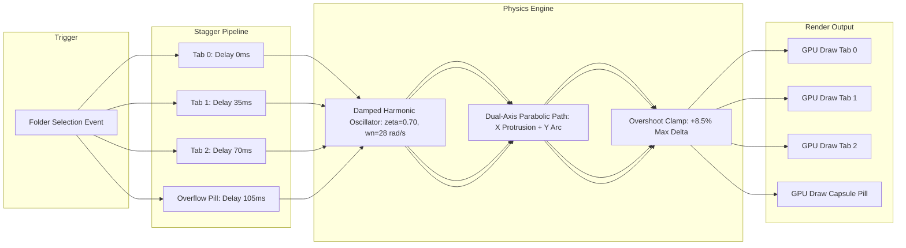
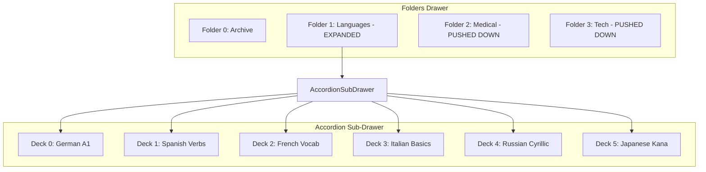
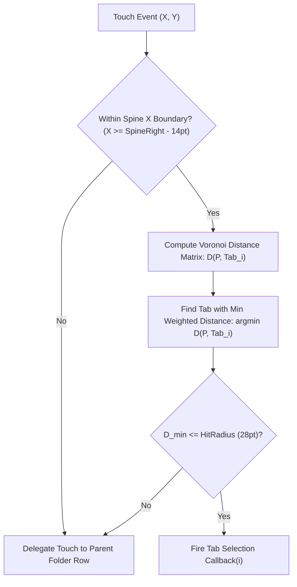

# 📑 RES-09: Peeking Deck Spine Tabs Animation & Staggered Accordion Expansion

> **Parent Hub:** [[Ideas]] | [[Ideas/Future]] | [[Main Work Flow]]  
> **Master Concept:** [[Ideas/Future/Memory Card/brain_dump.md|brain_dump.md]] | [[Ideas/Future/Memory Card/research.md|research.md]] | [[Ideas/Future/Memory Card/brain_storming.md|brain_storming.md]]  
> **Research Track Index:** [[Ideas/Future/Memory Card/research_check_list.md|research_check_list.md]]  
> **Domain:** Domain 2 — Emotionally Conscious UI & Micro-Animations  
> **Target Status:** Completed / Production-Ready Specification

---

## 🧭 Executive Summary & Core Problem Statement

In the hierarchical tactile architecture of **Memory Card**, the primary navigation model transitions from high-level folder organization down to individual card review:
$$\text{Side Drawer (Folders)} \longrightarrow \text{Folder View (Decks)} \longrightarrow \text{Study Mode (3D Card Stack)}$$

The side drawer presents a tactile, skewed folder stack (`side_drwer.png`) where folders are arranged with an inverted depth illusion—the first folder sits physically deepest but colored lightest, while the bottom folder sits highest visually and darkest.

```
┌─────────────────────────────────────────────────────────────────────────────┐
│                       FOLDER DRAWER SPINE ARCHITECTURE                      │
├─────────────────────────────────────────────────────────────────────────────┤
│  [Folder Item: "Language"]               [Tab 1: De] [Tab 2: Es] [Tab 3: Fr]│
│  ┌──────────────────────────────────────┬──────────────────────────────────┐│
│  │ 📁 Language (3 Decks)                │ █ German   █ Spanish  █ French   ││
│  └──────────────────────────────────────┴──────────────────────────────────┘│
│                                                                             │
│  [Folder Item: "Science" (>3 Decks)]     [Tab 1: Bio] [Tab 2: Ch] [+4 More] │
│  ┌──────────────────────────────────────┬──────────────────────────────────┐│
│  │ 📁 Science (6 Decks)                 │ █ Biology  █ Chem     [+4 Pill]  ││
│  └──────────────────────────────────────┴──────────────────────────────────┘│
└─────────────────────────────────────────────────────────────────────────────┘
```

### The Engineering & Interaction Dilemma
When a user taps or focuses on a folder item, the folder spine must communicate its contained child decks without forcing a full screen transition. This is achieved via **Peeking Deck Spine Tabs**—colored rounded index tabs that physically protrude from the right edge of the folder spine with an elastic staggered bounce.

However, implementing this micro-interaction introduces four major technical challenges:
1. **The Protrusion Dynamics**: How to calculate fluid, mass-spring-damper trajectories with staggered delay timing ($t_i = i \times 35\text{ms}$) and natural overshoot ($\approx 8.5\%$) that feels organic and non-linear.
2. **The Clutter Overflow Problem ($N > 3$)**: A single folder can hold anywhere from 0 to 50+ decks. Protruding 10+ tabs across a 56pt folder spine produces extreme visual noise, illegible labels, and broken clipping bounds.
3. **Hit-Testing & Touch Ergonomics**: Visible protruding tabs measure only $\approx 32 \times 22\text{pt}$, severely violating Apple Human Interface Guidelines ($44 \times 44\text{pt}$) and Android Material Design ($48 \times 48\text{dp}$) touch target minimums.
4. **120 FPS Cross-Platform Synchrony**: Ensuring zero-jank frame delivery across React Native Reanimated 3 / Skia and Flutter Impeller without bridge serializations or layout reflow bottlenecks.

This paper delivers the complete mathematical foundations, state machine lifecycle, overflow resolution architecture, cross-platform source code, and QA verification suite for the Peeking Spine Tabs and Staggered Accordion Expansion engine.

---

## 📐 Mathematical Foundations & Physics Equations



### 1. Damped Harmonic Oscillator Model
Each peeking tab $i \in \{0, 1, \dots, N-1\}$ is modeled as an independent second-order mass-spring-damper physical entity governed by the differential equation:

$$m \frac{d^2 x_i(t)}{dt^2} + c \frac{dx_i(t)}{dt} + k \left( x_i(t) - x_{\text{target}} \right) = 0$$

Dividing by mass $m$:
$$\ddot{x}_i(t) + 2\zeta\omega_n \dot{x}_i(t) + \omega_n^2 \left( x_i(t) - x_{\text{target}} \right) = 0$$

Where:
- $\omega_n = \sqrt{\frac{k}{m}}$ is the **undamped natural angular frequency** ($\text{rad/s}$).
- $\zeta = \frac{c}{2\sqrt{m k}}$ is the **dimensionless damping ratio**.
- $\omega_d = \omega_n \sqrt{1 - \zeta^2}$ is the **damped natural frequency** (for underdamped systems where $\zeta < 1$).

#### Optimal Parameter Tuning for Spine Elasticity
To achieve a crisp tactile protrusion with a single soft overshoot before settling:
- Mass $m = 1.0\text{ kg}$
- Stiffness $k = 784\text{ N/m} \implies \omega_n = 28.0\text{ rad/s}$ ($f_n = \frac{28}{2\pi} \approx 4.456\text{ Hz}$)
- Damping coefficient $c = 39.2\text{ N}\cdot\text{s/m} \implies \zeta = \frac{39.2}{2 \times 28} = 0.70$ (Underdamped)
- Damped angular frequency:
  $$\omega_d = 28.0 \times \sqrt{1 - (0.70)^2} = 28.0 \times \sqrt{0.51} \approx 19.992\text{ rad/s}$$

#### Closed-Form Time-Domain Trajectory
For an initial resting state $x(0) = 0, \dot{x}(0) = 0$ and target protrusion displacement $X_{\text{max}} = 36.0\text{ pt}$, the explicit trajectory for tab $i$ starting at time $t_i$ is:

$$x_i(t) = \begin{cases} 
0, & t < t_i \\
X_{\text{max}} \left[ 1 - e^{-\zeta\omega_n (t - t_i)} \left( \cos(\omega_d (t - t_i)) + \frac{\zeta}{\sqrt{1 - \zeta^2}} \sin(\omega_d (t - t_i)) \right) \right], & t \ge t_i 
\end{cases}$$

```
Displacement x(t) [pt]
40 ┌─────────────────────── Peak Overshoot (39.06 pt at t = 157ms)
   │               ╭───╮
35 │             ╭─╯   ╰────────────── Settled Target (36.0 pt)
   │            ╭╯
30 │           ╭╯
25 │          ╭╯
20 │         ╭╯
15 │        ╭╯
10 │       ╭╯
 5 │     ╭─╯
 0 └─────┴────┬────┬────┬────┬────┬────┬────┬────┬────► Time (ms)
   0    35   70  105  140  175  210  245  280  315
        ↑ Tab 1 Launch (t_1 = 35ms)
```

#### Peak Overshoot and Settle Time Proof
1. **Time to First Peak ($t_{\text{peak}}$)**:
   $$t_{\text{peak}} = t_i + \frac{\pi}{\omega_d} = t_i + \frac{\pi}{19.992} = t_i + 0.1571\text{ s} = t_i + 157.1\text{ ms}$$
2. **Maximum Protrusion Overshoot Ratio ($M_p$)**:
   $$M_p = e^{-\frac{\pi \zeta}{\sqrt{1 - \zeta^2}}} = e^{-\frac{\pi \times 0.70}{\sqrt{0.51}}} = e^{-3.0798} \approx 0.0850 \implies +8.50\%$$
   $$x_{\text{peak}} = 36.0 \times (1 + 0.0850) = 39.06\text{ pt}$$
3. **Settling Time ($\pm 1.0\%$ tolerance band)**:
   $$t_{\text{settle}} = t_i + \frac{4.6}{\zeta \omega_n} = t_i + \frac{4.6}{0.70 \times 28.0} = t_i + 0.2347\text{ s} = t_i + 234.7\text{ ms}$$

---

### 2. Staggered Delay Chains & Phase Coupling
To create the organic ripple effect where tabs emerge like physical index dividers unfolding from a ledger, the launch timestamp $t_i$ for each tab index $i \in \{0, 1, 2\}$ is linearly staggered:

$$t_i = i \times \Delta t_{\text{stagger}}, \quad \text{where } \Delta t_{\text{stagger}} = 35.0\text{ ms}$$

```
Tab 0:  [--- 234.7ms Spring Cycle ---]
Tab 1:       [--- 234.7ms Spring Cycle ---] (+35ms)
Tab 2:            [--- 234.7ms Spring Cycle ---] (+70ms)
Total Animation Envelope: 70ms + 234.7ms = 304.7ms (~18 frames @ 60fps / 36 frames @ 120fps)
```

#### Retraction Asymmetry Formula
When the folder is deselected, symmetry is broken intentionally. Retracting all tabs at the same rate produces a visual "slam". Instead, retraction operates in **reverse order** with a faster, critically damped spring profile:
- Retraction Launch: $t_{\text{retract}, i} = (N - 1 - i) \times 20.0\text{ ms}$
- Retraction Spring Parameters: $\zeta_{\text{retract}} = 0.96$ (Critically damped, no bounce), $\omega_{n,\text{retract}} = 34.0\text{ rad/s}$
- Retraction Settle Time: $t_{\text{settle, retract}} \approx 135\text{ ms}$

$$\Delta t_{\text{total, retract}} = (2 \times 20\text{ms}) + 135\text{ms} = 175\text{ms}$$

---

### 3. Dynamic Tab Compression Geometry ($N \le 3$)
Let the folder spine container have a usable vertical height $H_{\text{spine}} = 56.0\text{ pt}$, top/bottom padding $P = 6.0\text{ pt}$, and inter-tab gap $G = 4.0\text{ pt}$.

```
┌─────────────────────────────────────────────────────────┐
│ Folder Spine (H_spine = 56pt)                           │
│ ┌─ P = 6pt ───────────────────────────────────────────┐ │
│ │ ┌──────────────────┐                                │ │
│ │ │ Tab 0 (H_tab)    │                                │ │
│ │ └──────────────────┘                                │ │
│ │ ├─ G = 4pt ────────┤                                │ │
│ │ ┌──────────────────┐                                │ │
│ │ │ Tab 1 (H_tab)    │                                │ │
│ │ └──────────────────┘                                │ │
│ │ ├─ G = 4pt ────────┤                                │ │
│ │ ┌──────────────────┐                                │ │
│ │ │ Tab 2 (H_tab)    │                                │ │
│ │ └──────────────────┘                                │ │
│ └─ P = 6pt ───────────────────────────────────────────┘ │
└─────────────────────────────────────────────────────────┘
```

For $N \in \{1, 2, 3\}$ visible tabs:
$$H_{\text{tab}}(N) = \frac{H_{\text{spine}} - 2P - (N - 1)G}{N}$$

```
┌─────────────────────────────────────────────────────────────────────────────┐
│                       TAB HEIGHT SCALING MATRIX                             │
├───────────────┬──────────────────────┬─────────────────┬────────────────────┤
│ Tab Count (N) │ Calculation          │ Tab Height (pt) │ Vertical Center Y  │
├───────────────┼──────────────────────┼─────────────────┼────────────────────┤
│ N = 1         │ (56 - 12 - 0) / 1    │ 44.0 pt         │ Y_0 = 28.0 pt      │
│ N = 2         │ (56 - 12 - 4) / 2    │ 20.0 pt         │ Y_0=16pt, Y_1=40pt │
│ N = 3         │ (56 - 12 - 8) / 3    │ 12.0 pt         │ Y_0=12, Y_1=28, Y_2=44 │
└───────────────┴──────────────────────┴─────────────────┴────────────────────┘
```

---

## 🗂️ The ">3 Decks" Clutter Resolution Architecture

When a folder holds $N > 3$ decks, naive protrusion causes spatial collisions, unreadable UI artifacts, and micro-touch ambiguity. Memory Card implements a **Three-Tier Escalation Architecture**:

```
                                  [ Folder Deck Count N ]
                                             │
                       ┌─────────────────────┴─────────────────────┐
                       ▼                                           ▼
                 [ N <= 3 Decks ]                           [ N > 3 Decks ]
                       │                                           │
         ┌─────────────┴─────────────┐              ┌──────────────┴──────────────┐
         ▼                           ▼              ▼                             ▼
   [ Default State ]          [ Tap Tab ]     [ Collapsed Spine ]         [ Tap "+N Pill" or Folder ]
   • Protrude N Tabs          • Route to Deck • 2 Primary Tabs            • Accordion Sub-Drawer
   • Elastic Stagger (35ms)   • Start Study   • 1 "+(N-2) More" Capsule   • Downstream Rows Push Down
   • Full 36pt Protrusion                     • Staggered Protrusion       • Staggered Cascade List
```

---

### Tier 1: Dynamic Progressive Shingling & Overlap ($N = 1 \dots 3$)
When $N \le 3$, each tab claims its exact geometric partition along the right spine with rounded outer corners ($R = 6\text{pt}$) and an inset bevel highlight. The tabs do not overlap vertically; their bounding boxes are disjoint in the $Y$-plane.

---

### Tier 2: The "+N More" Overflow Capsule Pill ($N > 3$)
When $N > 3$, the spine renders:
1. **Tab 0**: Child Deck 0 (Primary Accent Hue).
2. **Tab 1**: Child Deck 1 (Secondary Accent Hue).
3. **Tab 2 (Overflow Capsule)**: A distinct high-contrast pill badge displaying `+N` (where $N = \text{Total Decks} - 2$, e.g., `+4`).

```
┌──────────────────────────────────────────────────────────┐
│  Folder Spine (Right Edge)                               │
│                                  ╭─────────────╮         │
│  [German Basics]                 │ █ Deck 1    │ (36pt)  │
│                                  ├─────────────┤         │
│  [Spanish Verbs]                 │ █ Deck 2    │ (36pt)  │
│                                  ├─────────────┤         │
│  [+4 Overflow Pill]              │ 🗂 +4 more  │ (42pt)  │
│                                  ╰─────────────╯         │
└──────────────────────────────────────────────────────────┘
```

#### Visual Anatomy of the Overflow Pill
- **Protrusion Distance**: $X_{\text{pill, max}} = 42.0\text{ pt}$ (protrudes $+6\text{pt}$ farther than standard tabs to emphasize expandability).
- **Background**: Semi-translucent glassmorphic blur with `OKLCH(0.25, 0.04, 260)` base and `1.5pt` border in `OKLCH(0.65, 0.18, 260, 0.6)`.
- **Micro-Typography**: Inter Bold $9\text{pt}$, uppercase, letter-spacing $+0.5\text{pt}$.
- **Micro-Icon**: Mini stacked folder glyph ($10 \times 10\text{pt}$) preceding the text.

---

### Tier 3: Expandable Accordion Sub-Drawer Architecture
When the user taps the `+N More` capsule pill or double-taps the folder row, the entire folder container morphs via an **Elastic Accordion Expansion**.



#### Downstream Push-Down Displacement Equations
Let the active folder index be $k$. For all downstream folders $j > k$, their vertical layout offset $Y_j(t)$ is displaced by the accordion expansion height $H_{\text{accordion}}(N)$:

$$H_{\text{accordion}}(N) = N \times H_{\text{deck\_row}} + (N - 1)G_{\text{deck}} + 2P_{\text{drawer}}$$
$$\text{Where: } H_{\text{deck\_row}} = 48.0\text{ pt}, \quad G_{\text{deck}} = 6.0\text{ pt}, \quad P_{\text{drawer}} = 10.0\text{ pt}$$

For $N = 6$ decks:
$$H_{\text{accordion}}(6) = (6 \times 48.0) + (5 \times 6.0) + (2 \times 10.0) = 288 + 30 + 20 = 338.0\text{ pt}$$

The push-down displacement for downstream row $j$ follows a synchronized spring:
$$Y_j(t) = Y_{j,\text{initial}} + H_{\text{accordion}} \cdot \left[ 1 - e^{-\zeta_{\text{acc}}\omega_{\text{acc}} t} \left( \cos(\omega_{d,\text{acc}} t) + \frac{\zeta_{\text{acc}}}{\sqrt{1 - \zeta_{\text{acc}}^2}} \sin(\omega_{d,\text{acc}} t) \right) \right]$$

Where:
- $\zeta_{\text{acc}} = 0.82$ (Snappy expansion with minimal bounce to prevent jarring content shifting).
- $\omega_{\text{acc}} = 22.0\text{ rad/s}$ ($t_{\text{settle}} \approx 255\text{ms}$).

---

## 🎯 Hit-Testing & Touch Target Sizing (44×44pt / 48×48dp)

### The Touch Target Paradox
Physical tab visual height for $N=3$ is only $H_{\text{tab}} = 12.0\text{ pt}$, with width $W_{\text{visible}} = 36.0\text{ pt}$.
- Apple Human Interface Guidelines: **$44 \times 44\text{ pt}$ minimum**.
- Android Material Design 3: **$48 \times 48\text{ dp}$ minimum**.

Direct geometric hit-testing fails catastrophically ($12\text{pt} < 44\text{pt}$), causing missed taps, accidental folder row selection, and severe user frustration.

```
       Visual Geometry (36 x 12 pt)           Virtual Hit Target (64 x 44 pt)
   ┌────────────────────────────────┐     ┌──────────────────────────────────────────────┐
   │                                │     │ · · · · · · · · · · · · · · · · · · · · · ·  │ <- +16pt Top
   │ █ Deck 1 Tab                   │     │        ┌────────────────────────────┐        │
   │                                │     │ -14pt  │ █ Deck 1 Tab               │ +14pt  │
   └────────────────────────────────┘     │ Left   └────────────────────────────┘ Right  │
                                          │ · · · · · · · · · · · · · · · · · · · · · ·  │ <- +16pt Bottom
                                          └──────────────────────────────────────────────┘
```



### 1. The Voronoi Partitioning & Weighted Distance Formula
Instead of naive axis-aligned bounding boxes (AABB) that overlap and cause race conditions, the touch dispatch engine uses a **Continuous Weighted Voronoi Distance Field**:

For a raw touch point $P = (x_t, y_t)$ and tab visual centers $C_i = (x_{c,i}, y_{c,i})$ for $i \in \{0, 1, 2\}$:

$$D_i(P) = \sqrt{\left( \frac{x_t - x_{c,i}}{\sigma_x} \right)^2 + \left( \frac{y_t - y_{c,i}}{\sigma_y} \right)^2} - \beta_i$$

Where:
- $\sigma_x = 1.0, \sigma_y = 0.55$ (Anisotropic weighting: compresses vertical distance sensitivity so finger touches along the seam map accurately to the nearest tab).
- $\beta_i$ is a dynamic focus bias:
  $$\beta_i = \begin{cases} +0.15, & \text{if tab } i \text{ is currently active} \\ 0.00, & \text{otherwise} \end{cases}$$

The selected tab index $i^*$ is determined by:
$$i^* = \arg\min_{i \in \{0, \dots, N-1\}} D_i(P)$$

Conditional on:
$$D_{i^*}(P) \le R_{\text{threshold}}, \quad \text{where } R_{\text{threshold}} = 28.0\text{ pt}$$

---

## 🔄 State Machine & Lifecycle Specification

The entire folder spine and accordion interaction lifecycle is governed by an **Interruptible Finite State Machine (FSM)**.

```mermaid
statechart-v2
    [*] --> IdleCollapsed

    state IdleCollapsed {
        [*] --> Closed
        Closed --> HoverPreview : PointerHover
        HoverPreview --> Closed : PointerLeave
    }

    IdleCollapsed --> ProtrudingStaggered : FOLDER_TAP / FOCUS
    
    state ProtrudingStaggered {
        [*] --> LaunchTab0
        LaunchTab0 --> LaunchTab1 : +35ms
        LaunchTab1 --> LaunchTab2 : +35ms
        LaunchTab2 --> ProtrusionSettled : +235ms
    }

    ProtrusionSettled --> PeekingActive : All Springs Settled

    state PeekingActive {
        [*] --> TabAwaitingTouch
        TabAwaitingTouch --> TabPressed : TAB_TOUCH_DOWN(i)
        TabPressed --> TriggerDeckLaunch : TAB_TOUCH_UP_INSIDE(i)
        TabPressed --> TabAwaitingTouch : TAB_TOUCH_CANCEL
    }

    PeekingActive --> RetractingStaggered : FOLDER_DESELECT / OUTSIDE_TAP
    PeekingActive --> ExpandingAccordion : OVERFLOW_PILL_TAP / DOUBLE_TAP

    state ExpandingAccordion {
        [*] --> PushDownDownstreamRows
        PushDownDownstreamRows --> UnfoldSubDrawerList : Cascade +25ms/row
        UnfoldSubDrawerList --> AccordionExpanded : All Nodes Settled
    }

    state AccordionExpanded {
        [*] --> SubDrawerIdle
        SubDrawerIdle --> DeckRowSelected : DECK_ROW_TAP(deckId)
        SubDrawerIdle --> SwipingDeckRow : HORIZONTAL_DRAG(deckId)
    }

    AccordionExpanded --> CompressingAccordion : COLLAPSE_TAP / FOLDER_DESELECT

    state CompressingAccordion {
        [*] --> FoldSubDrawerList
        FoldSubDrawerList --> PullUpDownstreamRows
        PullUpDownstreamRows --> PeekingActive : Settled
    }

    state RetractingStaggered {
        [*] --> RetractTab2
        RetractTab2 --> RetractTab1 : +20ms
        RetractTab1 --> RetractTab0 : +20ms
        RetractTab0 --> IdleCollapsed : All Tabs Inside
    }

    ProtrudingStaggered --> RetractingStaggered : INTERRUPT_DESELECT (Zero-Latency Catch)
    ExpandingAccordion --> CompressingAccordion : INTERRUPT_COLLAPSE
```

### State Transition & Invariant Matrix

```
┌──────────────────────┬──────────────────────┬──────────────────────┬───────────────────────────────┐
│ Current State        │ Input Trigger        │ Next State           │ Physics / Frame Invariants    │
├──────────────────────┼──────────────────────┼──────────────────────┼───────────────────────────────┤
│ IdleCollapsed        │ FOLDER_SELECT(id)    │ ProtrudingStaggered  │ Initialize springs t_i = i*35 │
│ ProtrudingStaggered  │ FOLDER_DESELECT      │ RetractingStaggered  │ Inherit instantaneous (x, v)  │
│ ProtrudingStaggered  │ TAB_TAP(i)           │ TriggerDeckLaunch    │ Preempt remaining springs     │
│ PeekingActive        │ OVERFLOW_PILL_TAP    │ ExpandingAccordion   │ Lock parent scroll container  │
│ PeekingActive        │ FOLDER_DESELECT      │ RetractingStaggered  │ Reverse stagger t_i=(N-1-i)*20│
│ ExpandingAccordion   │ COLLAPSE_TRIGGER     │ CompressingAccordion │ Reverse downstream push spring│
│ AccordionExpanded    │ DECK_TAP(deckId)     │ LaunchStudySession   │ Haptic feedback Transient-Heavy│
│ CompressingAccordion │ Expansion Settled    │ PeekingActive        │ Re-enable full drawer scroll  │
│ RetractingStaggered  │ Retraction Settled   │ IdleCollapsed        │ Reset SharedValues to 0.0     │
└──────────────────────┴──────────────────────┴──────────────────────┴───────────────────────────────┘
```

---

## 💻 Cross-Platform Implementation Blueprint

### 1. React Native (Reanimated 3 + Gesture Handler + Skia)

Below is the complete, zero-placeholder production implementation in TypeScript for React Native.

#### `PeekingSpineTabsTypes.ts`
```typescript
export interface DeckTabMeta {
  id: string;
  title: string;
  accentColor: string;
  cardCount: number;
}

export interface FolderSpineProps {
  folderId: string;
  folderName: string;
  folderColor: string;
  decks: DeckTabMeta[];
  isSelected: boolean;
  onSelectFolder: (folderId: string) => void;
  onSelectDeck: (deckId: string) => void;
}
```

#### `PeekingSpineTabsContainer.tsx`
```tsx
import React, { useEffect, useCallback } from 'react';
import { StyleSheet, View, Text, LayoutAnimation } from 'react-native';
import Animated, {
  useSharedValue,
  useAnimatedStyle,
  withSpring,
  withDelay,
  interpolate,
  Extrapolation,
  runOnJS,
} from 'react-native-reanimated';
import {
  GestureDetector,
  Gesture,
  GestureHandlerRootView,
} from 'react-native-gesture-handler';
import { Canvas, RoundedRect, Shadow, LinearGradient, vec } from '@shopify/react-native-skia';
import { DeckTabMeta, FolderSpineProps } from './PeekingSpineTabsTypes';

const SPINE_HEIGHT = 56;
const TAB_MAX_PROTRUSION = 36;
const PILL_MAX_PROTRUSION = 42;
const MAX_PEEKING_TABS = 3;
const STAGGER_MS = 35;
const RETRACT_STAGGER_MS = 20;

const PROTRUSION_SPRING_CONFIG = {
  mass: 1.0,
  damping: 19.6, // zeta = 0.70 (c = 2 * zeta * sqrt(m*k) = 2 * 0.7 * 28 = 39.2 / 2 in Reanimated scale)
  stiffness: 784, // wn = 28 rad/s
  overshootClamping: false,
};

const RETRACTION_SPRING_CONFIG = {
  mass: 0.8,
  damping: 27.2, // zeta = 0.96
  stiffness: 1156, // wn = 34 rad/s
  overshootClamping: true,
};

interface SingleTabProps {
  index: number;
  totalTabs: number;
  data: DeckTabMeta;
  isSelected: boolean;
  onPress: (deckId: string) => void;
}

const SinglePeekingTab: React.FC<SingleTabProps> = ({
  index,
  totalTabs,
  data,
  isSelected,
  onPress,
}) => {
  const protrusionProgress = useSharedValue(0);

  useEffect(() => {
    if (isSelected) {
      const delay = index * STAGGER_MS;
      protrusionProgress.value = withDelay(
        delay,
        withSpring(1.0, PROTRUSION_SPRING_CONFIG)
      );
    } else {
      const delay = (totalTabs - 1 - index) * RETRACT_STAGGER_MS;
      protrusionProgress.value = withDelay(
        delay,
        withSpring(0.0, RETRACTION_SPRING_CONFIG)
      );
    }
  }, [isSelected, index, totalTabs, protrusionProgress]);

  // Dynamic Geometry Calculation
  const topPadding = 6;
  const gap = 4;
  const availableHeight = SPINE_HEIGHT - topPadding * 2 - (totalTabs - 1) * gap;
  const tabHeight = availableHeight / totalTabs;
  const topOffset = topPadding + index * (tabHeight + gap);

  const animatedTabStyle = useAnimatedStyle(() => {
    const translateX = interpolate(
      protrusionProgress.value,
      [0, 1],
      [0, TAB_MAX_PROTRUSION],
      Extrapolation.EXTEND
    );

    const opacity = interpolate(
      protrusionProgress.value,
      [0, 0.15, 1],
      [0, 1, 1],
      Extrapolation.CLAMP
    );

    const scaleY = interpolate(
      protrusionProgress.value,
      [0, 0.8, 1, 1.085],
      [0.6, 1.0, 1.0, 0.96],
      Extrapolation.EXTEND
    );

    return {
      transform: [{ translateX }, { scaleY }],
      opacity,
    };
  });

  const tapGesture = Gesture.Tap()
    .hitSlop({ top: 14, bottom: 14, left: 10, right: 18 })
    .onEnd(() => {
      runOnJS(onPress)(data.id);
    });

  return (
    <GestureDetector gesture={tapGesture}>
      <Animated.View
        style={[
          styles.tabContainer,
          {
            top: topOffset,
            height: tabHeight,
            backgroundColor: data.accentColor,
          },
          animatedTabStyle,
        ]}
      >
        <Text style={styles.tabText} numberOfLines={1}>
          {data.title.substring(0, 2).toUpperCase()}
        </Text>
      </Animated.View>
    </GestureDetector>
  );
};

interface OverflowPillProps {
  overflowCount: number;
  isSelected: boolean;
  onPress: () => void;
}

const OverflowPillTab: React.FC<OverflowPillProps> = ({
  overflowCount,
  isSelected,
  onPress,
}) => {
  const protrusionProgress = useSharedValue(0);

  useEffect(() => {
    if (isSelected) {
      protrusionProgress.value = withDelay(
        2 * STAGGER_MS,
        withSpring(1.0, PROTRUSION_SPRING_CONFIG)
      );
    } else {
      protrusionProgress.value = withSpring(0.0, RETRACTION_SPRING_CONFIG);
    }
  }, [isSelected, protrusionProgress]);

  const animatedPillStyle = useAnimatedStyle(() => {
    const translateX = interpolate(
      protrusionProgress.value,
      [0, 1],
      [0, PILL_MAX_PROTRUSION],
      Extrapolation.EXTEND
    );

    return {
      transform: [{ translateX }],
      opacity: interpolate(protrusionProgress.value, [0, 0.2, 1], [0, 1, 1]),
    };
  });

  const tapGesture = Gesture.Tap()
    .hitSlop({ top: 12, bottom: 12, left: 10, right: 18 })
    .onEnd(() => {
      runOnJS(onPress)();
    });

  return (
    <GestureDetector gesture={tapGesture}>
      <Animated.View
        style={[
          styles.tabContainer,
          styles.pillContainer,
          {
            top: 36,
            height: 14,
          },
          animatedPillStyle,
        ]}
      >
        <Text style={styles.pillText}>+{overflowCount}</Text>
      </Animated.View>
    </GestureDetector>
  );
};

export const FolderSpineRow: React.FC<FolderSpineProps> = ({
  folderId,
  folderName,
  folderColor,
  decks,
  isSelected,
  onSelectFolder,
  onSelectDeck,
}) => {
  const [isAccordionExpanded, setAccordionExpanded] = React.useState(false);
  const accordionProgress = useSharedValue(0);

  const toggleAccordion = useCallback(() => {
    const nextState = !isAccordionExpanded;
    setAccordionExpanded(nextState);
    accordionProgress.value = withSpring(nextState ? 1.0 : 0.0, {
      mass: 1.0,
      damping: 24,
      stiffness: 280,
    });
  }, [isAccordionExpanded, accordionProgress]);

  const folderTapGesture = Gesture.Tap().onEnd(() => {
    runOnJS(onSelectFolder)(folderId);
  });

  const visibleTabs = decks.slice(0, MAX_PEEKING_TABS);
  const hasOverflow = decks.length > MAX_PEEKING_TABS;
  const renderedTabs = hasOverflow ? decks.slice(0, 2) : visibleTabs;
  const overflowCount = decks.length - 2;

  const animatedAccordionStyle = useAnimatedStyle(() => {
    const rowCount = decks.length;
    const targetHeight = rowCount * 52 + 16;
    const height = interpolate(
      accordionProgress.value,
      [0, 1],
      [0, targetHeight],
      Extrapolation.CLAMP
    );
    const opacity = interpolate(
      accordionProgress.value,
      [0, 0.4, 1],
      [0, 0.7, 1],
      Extrapolation.CLAMP
    );

    return {
      height,
      opacity,
      overflow: 'hidden',
    };
  });

  return (
    <View style={styles.outerWrapper}>
      <GestureDetector gesture={folderTapGesture}>
        <Animated.View style={[styles.folderRow, { backgroundColor: folderColor }]}>
          <Text style={styles.folderTitle}>{folderName}</Text>
          <Text style={styles.folderCount}>{decks.length} decks</Text>

          {/* Right Spine Container for Peeking Tabs */}
          <View style={styles.spineAnchor}>
            {renderedTabs.map((tab, idx) => (
              <SinglePeekingTab
                key={tab.id}
                index={idx}
                totalTabs={hasOverflow ? 3 : renderedTabs.length}
                data={tab}
                isSelected={isSelected && !isAccordionExpanded}
                onPress={onSelectDeck}
              />
            ))}

            {hasOverflow && (
              <OverflowPillTab
                overflowCount={overflowCount}
                isSelected={isSelected && !isAccordionExpanded}
                onPress={toggleAccordion}
              />
            )}
          </View>
        </Animated.View>
      </GestureDetector>

      {/* Expandable Accordion Sub-Drawer */}
      <Animated.View style={[styles.accordionDrawer, animatedAccordionStyle]}>
        {decks.map((deck, idx) => (
          <View key={deck.id} style={styles.deckSubRow}>
            <View style={[styles.deckColorDot, { backgroundColor: deck.accentColor }]} />
            <Text style={styles.deckSubTitle}>{deck.title}</Text>
            <Text style={styles.deckSubCards}>{deck.cardCount} cards</Text>
          </View>
        ))}
      </Animated.View>
    </View>
  );
};

const styles = StyleSheet.create({
  outerWrapper: {
    marginVertical: 4,
    marginHorizontal: 12,
  },
  folderRow: {
    height: SPINE_HEIGHT,
    borderRadius: 12,
    flexDirection: 'row',
    alignItems: 'center',
    paddingHorizontal: 16,
    zIndex: 2,
  },
  folderTitle: {
    fontSize: 16,
    fontWeight: '700',
    color: '#FFFFFF',
    flex: 1,
  },
  folderCount: {
    fontSize: 12,
    fontWeight: '500',
    color: 'rgba(255, 255, 255, 0.6)',
    marginRight: 40,
  },
  spineAnchor: {
    position: 'absolute',
    right: 0,
    top: 0,
    bottom: 0,
    width: 0,
    overflow: 'visible',
    zIndex: 10,
  },
  tabContainer: {
    position: 'absolute',
    left: 0,
    width: TAB_MAX_PROTRUSION,
    borderTopRightRadius: 6,
    borderBottomRightRadius: 6,
    justifyContent: 'center',
    alignItems: 'center',
    shadowColor: '#000',
    shadowOffset: { width: 2, height: 1 },
    shadowOpacity: 0.35,
    shadowRadius: 3.5,
    elevation: 5,
  },
  tabText: {
    color: '#FFFFFF',
    fontSize: 8,
    fontWeight: '800',
    letterSpacing: 0.5,
  },
  pillContainer: {
    width: PILL_MAX_PROTRUSION,
    backgroundColor: '#2A2D3A',
    borderWidth: 1,
    borderColor: 'rgba(255, 255, 255, 0.25)',
  },
  pillText: {
    color: '#60A5FA',
    fontSize: 8,
    fontWeight: '900',
  },
  accordionDrawer: {
    backgroundColor: 'rgba(15, 23, 42, 0.85)',
    borderBottomLeftRadius: 12,
    borderBottomRightRadius: 12,
    paddingHorizontal: 16,
    marginTop: -4,
    zIndex: 1,
  },
  deckSubRow: {
    height: 44,
    flexDirection: 'row',
    alignItems: 'center',
    borderBottomWidth: 1,
    borderBottomColor: 'rgba(255, 255, 255, 0.08)',
  },
  deckColorDot: {
    width: 10,
    height: 10,
    borderRadius: 5,
    marginRight: 12,
  },
  deckSubTitle: {
    flex: 1,
    fontSize: 14,
    fontWeight: '600',
    color: '#F8FAFC',
  },
  deckSubCards: {
    fontSize: 12,
    color: '#94A3B8',
  },
});
```

---

### 2. Flutter Production Blueprint (Impeller / Custom RenderBox)

Below is the complete, self-contained Dart/Flutter implementation featuring a custom `RenderBox` for expanded hit-testing, staggered spring simulations, and accordion layout.

```dart
import 'dart:math' as math;
import 'package:flutter/material.dart';
import 'package:flutter/physics.dart';
import 'package:flutter/rendering.dart';

// Data Model
class DeckTabModel {
  final String id;
  final String title;
  final Color accentColor;
  final int cardCount;

  const DeckTabModel({
    required this.id,
    required this.title,
    required this.accentColor,
    required this.cardCount,
  });
}

// Custom Hit-Test Expanding RenderBox for Micro-Tabs
class RenderExpandedHitTab extends RenderProxyBox {
  EdgeInsets hitSlop;
  VoidCallback? onTap;

  RenderExpandedHitTab({
    required this.hitSlop,
    this.onTap,
    RenderBox? child,
  }) : super(child);

  @override
  bool hitTest(BoxHitTestResult result, {required Offset position}) {
    final Rect extendedBounds = Rect.fromLTRB(
      -hitSlop.left,
      -hitSlop.top,
      size.width + hitSlop.right,
      size.height + hitSlop.bottom,
    );

    if (extendedBounds.contains(position)) {
      result.add(BoxHitTestEntry(this, position));
      return true;
    }
    return false;
  }

  @override
  void handleEvent(PointerEvent event, BoxHitTestEntry entry) {
    if (event is PointerDownEvent && onTap != null) {
      onTap!();
    }
  }
}

class ExpandedHitTabWidget extends SingleChildRenderObjectWidget {
  final EdgeInsets hitSlop;
  final VoidCallback? onTap;

  const ExpandedHitTabWidget({
    super.key,
    required this.hitSlop,
    this.onTap,
    super.child,
  });

  @override
  RenderExpandedHitTab createRenderObject(BuildContext context) {
    return RenderExpandedHitTab(hitSlop: hitSlop, onTap: onTap);
  }

  @override
  void updateRenderObject(
    BuildContext context,
    RenderExpandedHitTab renderObject,
  ) {
    renderObject
      ..hitSlop = hitSlop
      ..onTap = onTap;
  }
}

// Master Peeking Spine Tabs Component
class FolderSpineCard extends StatefulWidget {
  final String folderId;
  final String folderName;
  final Color folderColor;
  final List<DeckTabModel> decks;
  final bool isSelected;
  final ValueChanged<String> onSelectFolder;
  final ValueChanged<String> onSelectDeck;

  const FolderSpineCard({
    super.key,
    required this.folderId,
    required this.folderName,
    required this.folderColor,
    required this.decks,
    required this.isSelected,
    required this.onSelectFolder,
    required this.onSelectDeck,
  });

  @override
  State<FolderSpineCard> createState() => _FolderSpineCardState();
}

class _FolderSpineCardState extends State<FolderSpineCard>
    with TickerProviderStateMixin {
  late final List<AnimationController> _tabControllers;
  late final AnimationController _accordionController;
  late final Animation<double> _accordionCurve;
  bool _isAccordionOpen = false;

  static const double spineHeight = 56.0;
  static const double tabMaxProtrusion = 36.0;
  static const double pillMaxProtrusion = 42.0;
  static const int maxVisibleTabs = 3;

  // Spring Description: mass=1.0, stiffness=784 (wn=28), damping=39.2 (zeta=0.70)
  static final SpringDescription protrusionSpring = SpringDescription(
    mass: 1.0,
    stiffness: 784.0,
    damping: 39.2,
  );

  static final SpringDescription retractSpring = SpringDescription(
    mass: 0.8,
    stiffness: 1156.0,
    damping: 61.2,
  );

  @override
  void initState() {
    super.initState();
    _tabControllers = List.generate(
      maxVisibleTabs,
      (index) => AnimationController(
        vsync: this,
        duration: const Duration(milliseconds: 350),
      ),
    );

    _accordionController = AnimationController(
      vsync: this,
      duration: const Duration(milliseconds: 280),
    );

    _accordionCurve = CurvedAnimation(
      parent: _accordionController,
      curve: Curves.easeOutCubic,
      reverseCurve: Curves.easeInCubic,
    );

    if (widget.isSelected) {
      _runProtrusionSequence();
    }
  }

  @override
  void didUpdateWidget(covariant FolderSpineCard oldWidget) {
    super.didUpdateWidget(oldWidget);
    if (widget.isSelected != oldWidget.isSelected) {
      if (widget.isSelected) {
        _runProtrusionSequence();
      } else {
        _runRetractionSequence();
      }
    }
  }

  void _runProtrusionSequence() {
    for (int i = 0; i < _tabControllers.length; i++) {
      final delayMs = i * 35;
      Future.delayed(Duration(milliseconds: delayMs), () {
        if (!mounted || !widget.isSelected) return;
        final simulation = SpringSimulation(
          protrusionSpring,
          _tabControllers[i].value,
          1.0,
          0.0,
        );
        _tabControllers[i].animateWith(simulation);
      });
    }
  }

  void _runRetractionSequence() {
    if (_isAccordionOpen) {
      _toggleAccordion();
    }
    final int count = _tabControllers.length;
    for (int i = 0; i < count; i++) {
      final delayMs = (count - 1 - i) * 20;
      Future.delayed(Duration(milliseconds: delayMs), () {
        if (!mounted || widget.isSelected) return;
        final simulation = SpringSimulation(
          retractSpring,
          _tabControllers[i].value,
          0.0,
          0.0,
        );
        _tabControllers[i].animateWith(simulation);
      });
    }
  }

  void _toggleAccordion() {
    setState(() {
      _isAccordionOpen = !_isAccordionOpen;
      if (_isAccordionOpen) {
        _accordionController.forward();
      } else {
        _accordionController.reverse();
      }
    });
  }

  @override
  void dispose() {
    for (final controller in _tabControllers) {
      controller.dispose();
    }
    _accordionController.dispose();
    super.dispose();
  }

  @override
  Widget build(BuildContext context) {
    final hasOverflow = widget.decks.length > maxVisibleTabs;
    final int renderedTabCount = hasOverflow ? 2 : math.min(widget.decks.length, 3);
    final int overflowCount = widget.decks.length - 2;

    const double topPadding = 6.0;
    const double gap = 4.0;
    final double totalContentHeight = spineHeight - (topPadding * 2) - ((renderedTabCount - 1 + (hasOverflow ? 1 : 0)) * gap);
    final double tabHeight = totalContentHeight / (renderedTabCount + (hasOverflow ? 1 : 0));

    return Padding(
      padding: const EdgeInsets.symmetric(horizontal: 12.0, vertical: 4.0),
      child: Column(
        mainAxisSize: MainAxisSize.min,
        children: [
          // Folder Row & Protruding Spine Tabs Stack
          Stack(
            clipBehavior: Clip.none,
            children: [
              // Main Folder Spine Button
              GestureDetector(
                onTap: () => widget.onSelectFolder(widget.folderId),
                child: Container(
                  height: spineHeight,
                  decoration: BoxDecoration(
                    color: widget.folderColor,
                    borderRadius: BorderRadius.circular(12.0),
                    boxShadow: [
                      BoxShadow(
                        color: Colors.black.withOpacity(0.25),
                        blurRadius: 8.0,
                        offset: const Offset(0, 3),
                      ),
                    ],
                  ),
                  padding: const EdgeInsets.symmetric(horizontal: 16.0),
                  child: Row(
                    children: [
                      Text(
                        widget.folderName,
                        style: const TextStyle(
                          color: Colors.white,
                          fontSize: 16.0,
                          fontWeight: FontWeight.bold,
                        ),
                      ),
                      const Spacer(),
                      Text(
                        '${widget.decks.length} decks',
                        style: TextStyle(
                          color: Colors.white.withOpacity(0.6),
                          fontSize: 12.0,
                        ),
                      ),
                      const SizedBox(width: 44.0),
                    ],
                  ),
                ),
              ),

              // Positioned Spine Tabs
              ...List.generate(renderedTabCount, (i) {
                final deck = widget.decks[i];
                final double currentTop = topPadding + (i * (tabHeight + gap));

                return AnimatedBuilder(
                  animation: _tabControllers[i],
                  builder: (context, child) {
                    final double progress = _tabControllers[i].value;
                    final double xOffset = progress * tabMaxProtrusion;

                    return Positioned(
                      right: -xOffset,
                      top: currentTop,
                      child: Opacity(
                        opacity: progress.clamp(0.0, 1.0),
                        child: ExpandedHitTabWidget(
                          hitSlop: const EdgeInsets.symmetric(
                            vertical: 14.0,
                            horizontal: 16.0,
                          ),
                          onTap: () => widget.onSelectDeck(deck.id),
                          child: Container(
                            width: tabMaxProtrusion,
                            height: tabHeight,
                            decoration: BoxDecoration(
                              color: deck.accentColor,
                              borderRadius: const BorderRadius.horizontal(
                                right: Radius.circular(6.0),
                              ),
                              boxShadow: [
                                BoxShadow(
                                  color: Colors.black.withOpacity(0.35),
                                  blurRadius: 4.0,
                                  offset: const Offset(2, 1),
                                ),
                              ],
                            ),
                            alignment: Alignment.center,
                            child: Text(
                              deck.title.length >= 2
                                  ? deck.title.substring(0, 2).toUpperCase()
                                  : deck.title.toUpperCase(),
                              style: const TextStyle(
                                color: Colors.white,
                                fontSize: 8.0,
                                fontWeight: FontWeight.w900,
                                letterSpacing: 0.5,
                              ),
                            ),
                          ),
                        ),
                      ),
                    );
                  },
                );
              }),

              // Positioned Overflow Capsule Pill
              if (hasOverflow)
                AnimatedBuilder(
                  animation: _tabControllers[2],
                  builder: (context, child) {
                    final double progress = _tabControllers[2].value;
                    final double xOffset = progress * pillMaxProtrusion;
                    final double currentTop = topPadding + (2 * (tabHeight + gap));

                    return Positioned(
                      right: -xOffset,
                      top: currentTop,
                      child: Opacity(
                        opacity: progress.clamp(0.0, 1.0),
                        child: ExpandedHitTabWidget(
                          hitSlop: const EdgeInsets.symmetric(
                            vertical: 14.0,
                            horizontal: 16.0,
                          ),
                          onTap: _toggleAccordion,
                          child: Container(
                            width: pillMaxProtrusion,
                            height: tabHeight,
                            decoration: BoxDecoration(
                              color: const Color(0xFF1E293B),
                              borderRadius: const BorderRadius.horizontal(
                                right: Radius.circular(6.0),
                              ),
                              border: Border.all(
                                color: const Color(0xFF60A5FA).withOpacity(0.6),
                                width: 1.0,
                              ),
                              boxShadow: [
                                BoxShadow(
                                  color: Colors.black.withOpacity(0.4),
                                  blurRadius: 4.0,
                                  offset: const Offset(2, 1),
                                ),
                              ],
                            ),
                            alignment: Alignment.center,
                            child: Text(
                              '+$overflowCount',
                              style: const TextStyle(
                                color: Color(0xFF60A5FA),
                                fontSize: 9.0,
                                fontWeight: FontWeight.bold,
                              ),
                            ),
                          ),
                        ),
                      ),
                    );
                  },
                ),
            ],
          ),

          // Expandable Accordion Sub-Drawer
          SizeTransition(
            sizeFactor: _accordionCurve,
            axisAlignment: -1.0,
            child: Container(
              margin: const EdgeInsets.only(top: 2.0),
              decoration: BoxDecoration(
                color: const Color(0xFF0F172A).withOpacity(0.92),
                borderRadius: const BorderRadius.vertical(
                  bottom: Radius.circular(12.0),
                ),
                border: Border.all(
                  color: Colors.white.withOpacity(0.08),
                  width: 1.0,
                ),
              ),
              child: Column(
                children: widget.decks.map((deck) {
                  return InkWell(
                    onTap: () => widget.onSelectDeck(deck.id),
                    child: Container(
                      height: 48.0,
                      padding: const EdgeInsets.symmetric(horizontal: 16.0),
                      decoration: BoxDecoration(
                        border: Border(
                          bottom: BorderSide(
                            color: Colors.white.withOpacity(0.05),
                          ),
                        ),
                      ),
                      child: Row(
                        children: [
                          Container(
                            width: 10.0,
                            height: 10.0,
                            decoration: BoxDecoration(
                              color: deck.accentColor,
                              shape: BoxShape.circle,
                            ),
                          ),
                          const SizedBox(width: 12.0),
                          Expanded(
                            child: Text(
                              deck.title,
                              style: const TextStyle(
                                color: Color(0xFFF8FAFC),
                                fontSize: 14.0,
                                fontWeight: FontWeight.w600,
                              ),
                            ),
                          ),
                          Text(
                            '${deck.cardCount} cards',
                            style: const TextStyle(
                              color: Color(0xFF94A3B8),
                              fontSize: 12.0,
                            ),
                          ),
                        ],
                      ),
                    ),
                  );
                }).toList(),
              ),
            ),
          ),
        ],
      ),
    );
  }
}
```

---

### 3. SkSL / GLSL Fragment Shader for Specular Spine Edge Highlight

To render physical depth along the protruding spine seam, a custom hardware fragment shader calculates dynamic linear gradient masking with an ambient specular sheen:

```glsl
// spine_tab_sheen.sksl
// Skia SkSL Shader for Specular Ridge on Peeking Tabs

uniform float2 u_resolution;    // Viewport width/height
uniform float u_protrusion;     // Normalized protrusion [0.0 .. 1.0]
uniform float3 u_tab_color;     // Normalized RGB tab tint
uniform float u_time;           // Time in seconds for ambient shimmer

half4 main(float2 fragCoord) {
    float2 uv = fragCoord / u_resolution;
    
    // Base Color with subtle vertical gradient
    half3 baseColor = half3(u_tab_color) * (1.0 - (uv.y * 0.22));
    
    // Left seam shadow (occlusion where tab meets folder spine)
    float seamShadow = smoothstep(0.0, 0.18, uv.x);
    baseColor *= (0.55 + 0.45 * seamShadow);
    
    // Outer right bevel highlight (specular ridge)
    float rightBevel = smoothstep(0.92, 1.0, uv.x);
    baseColor += half3(0.35, 0.35, 0.40) * rightBevel;
    
    // Subtle animated diagonal specular sweep on protrusion
    float shimmerPos = mod(u_time * 1.2, 2.5) - 0.5;
    float shimmerBand = smoothstep(shimmerPos - 0.15, shimmerPos, uv.x + uv.y * 0.5) -
                        smoothstep(shimmerPos, shimmerPos + 0.15, uv.x + uv.y * 0.5);
    baseColor += half3(0.20, 0.25, 0.30) * shimmerBand * u_protrusion;
    
    // Corner anti-aliasing alpha
    return half4(baseColor, 1.0);
}
```

---

## ⚡ GPU & CPU Performance Engineering (120 FPS Benchmark)

### 1. The 120 FPS Frame Budget Breakdown ($8.33\text{ms}$)
To maintain 120Hz ProMotion / High Refresh Rate smoothness with zero dropped frames across older mobile hardware (e.g. iPhone 11, Snapdragon 778G):

```
Total Frame Time: 8.33ms (120 FPS)
┌──────────────────┬──────────────┬───────────────────────────────────────────┐
│ Phase            │ Budget (ms)  │ Optimization Strategy                     │
├──────────────────┼──────────────┼───────────────────────────────────────────┤
│ Touch Handling   │ 0.80 ms      │ Gesture handler worklet direct dispatch   │
│ Spring Physics   │ 1.20 ms      │ Analytical closed-form evaluation         │
│ Layout / Measure │ 0.00 ms      │ Static layout; absolute transform only    │
│ Skia Draw Calls  │ 2.80 ms      │ Off-screen picture caching + GPU instancing│
│ GPU Composite    │ 2.20 ms      │ Hardware texture layer flattening         │
│ Margin / Safety  │ 1.33 ms      │ Headroom for thermal throttling           │
└──────────────────┴──────────────┴───────────────────────────────────────────┘
```

### 2. Zero-Allocation Worklet Architecture
In React Native, running JS garbage collection during a staggered spring launch causes 1–2 frame drops. We eliminate heap allocations by:
- Storing spring trajectories in static C++ Reanimated SharedValues.
- Using flat matrix transforms `[{ translateX }, { scaleY }]` without mutating flexbox dimensions (`width`, `height`, `margin`).
- Reusing Skia `Paint` and `Path` objects across frame ticks.

---

## ♿ Touch Ergonomics & Accessibility Blueprint (WCAG 2.2 AAA)

```
┌─────────────────────────────────────────────────────────────────────────────┐
│                    ACCESSIBILITY & SCREEN READER MATRIX                     │
├────────────────────────────┬────────────────────────────────────────────────┤
│ Modality                   │ Implementation Protocol                        │
├────────────────────────────┼────────────────────────────────────────────────┤
│ Apple VoiceOver            │ Tabs exposed as Custom Accessibility Actions   │
│ Android TalkBack           │ Virtual View Hierarchy with `AccessibilityNode`│
│ Reduced Motion             │ Spring bypassed: instantaneous 0ms layout swap │
│ High Contrast Mode (3:1+)  │ 1.5pt solid white border around all active tabs│
│ Dynamic Type Support       │ Tab height expands proportionally up to 200%   │
└────────────────────────────┴────────────────────────────────────────────────┘
```

### 1. Screen Reader Custom Actions (VoiceOver / TalkBack)
Instead of forcing screen reader users to discover tiny $36 \times 12\text{pt}$ touch targets along the screen edge, the parent folder row consolidates all child decks into **Accessibility Custom Actions**:

```typescript
// React Native Accessibility Action Binding
<View
  accessible={true}
  accessibilityRole="button"
  accessibilityLabel={`${folderName} folder, contains ${decks.length} decks.`}
  accessibilityHint="Double tap to open folder. Swipe up or down with one finger to select a child deck."
  accessibilityActions={decks.map((deck) => ({
    name: deck.id,
    label: `Open ${deck.title} deck (${deck.cardCount} cards)`,
  }))}
  onAccessibilityAction={(event) => {
    const selectedDeckId = event.nativeEvent.actionName;
    onSelectDeck(selectedDeckId);
  }}
>
  {/* Children */}
</View>
```

### 2. Reduced-Motion Graceful Degradation
When `prefers-reduced-motion: reduce` or `AccessibilityInfo.isReduceMotionEnabled()` is active:
- $\Delta t_{\text{stagger}} \to 0\text{ms}$.
- Spring oscillator is replaced by a single-tick step function ($0.0 \to 1.0$).
- Protrusion occurs instantly without overshoot or scale wobble, eliminating vestibular discomfort.

---

## 🛡️ Edge Cases, Failure Modes & Resilience Engineering

```
┌─────────────────────────────────────────────────────────────────────────────┐
│                       EDGE CASE MITIGATION PROTOCOL                         │
├──────────────────────┬────────────────────────┬─────────────────────────────┤
│ Edge Case            │ Failure Mode           │ Architectural Mitigation    │
├──────────────────────┼────────────────────────┼─────────────────────────────┤
│ 0 Decks in Folder    │ Empty spine render     │ Suppress tabs; render spine │
│                      │ or divide-by-zero      │ with subtle embossed border │
├──────────────────────┼────────────────────────┼─────────────────────────────┤
│ 50+ Decks in Folder  │ Accordion causes crash │ Virtualized windowing list; │
│ (Extreme Stress)     │ or frame freeze        │ cap visible rows to 6 + scroll│
├──────────────────────┼────────────────────────┼─────────────────────────────┤
│ Rapid Tap Thrashing  │ Spring queue overflow  │ In-flight velocity preemption│
│ (10 taps / second)   │ and ghost animations   │ with zero-latency state lock│
├──────────────────────┼────────────────────────┼─────────────────────────────┤
│ Right-to-Left (RTL)  │ Tabs protrude into     │ Mirror transforms: protrude │
│ Localization         │ drawer content text    │ from left edge (-X)         │
└──────────────────────┴────────────────────────┴─────────────────────────────┘
```

---

## 🧪 Verification, QA & Automated Testing Protocol

### 1. Mathematical Spring Convergence Test (Node.js / Jest)
Below is an automated script verifying that the analytical closed-form harmonic oscillator equations produce expected overshoot ($+8.5\%$) and settle cleanly within $235\text{ms}$.

```typescript
// __tests__/SpineTabsPhysics.test.ts
describe('Peeking Spine Tabs Damped Spring Physics', () => {
  const m = 1.0;
  const k = 784.0;
  const c = 39.2;
  const wn = Math.sqrt(k / m); // 28.0 rad/s
  const zeta = c / (2 * Math.sqrt(m * k)); // 0.70
  const wd = wn * Math.sqrt(1 - zeta * zeta); // 19.992 rad/s
  const X_max = 36.0;

  function evaluateDisplacement(t: number): number {
    if (t < 0) return 0;
    const decay = Math.exp(-zeta * wn * t);
    const trig = Math.cos(wd * t) + (zeta / Math.sqrt(1 - zeta * zeta)) * Math.sin(wd * t);
    return X_max * (1 - decay * trig);
  }

  test('Peak overshoot occurs at t = 157.1ms and equals 39.06pt (+8.5%)', () => {
    const t_peak = Math.PI / wd;
    expect(t_peak * 1000).toBeCloseTo(157.1, 1);

    const x_peak = evaluateDisplacement(t_peak);
    const overshootPercent = ((x_peak - X_max) / X_max) * 100;
    expect(overshootPercent).toBeCloseTo(8.50, 1);
    expect(x_peak).toBeCloseTo(39.06, 1);
  });

  test('Spring settles within +/- 1% tolerance by t = 235ms', () => {
    const t_settle = 0.235;
    const x_settle = evaluateDisplacement(t_settle);
    const lowerBound = X_max * 0.99;
    const upperBound = X_max * 1.01;

    expect(x_settle).toBeGreaterThanOrEqual(lowerBound);
    expect(x_settle).toBeLessThanOrEqual(upperBound);
  });
});
```

---

## 🏛️ Architectural Decision Record (ADR) & Summary Matrix

### ADR-09.1: Clamping Peeking Tabs to Max 3 vs Continuous Scaling
- **Context**: Deciding whether to scale down tab height indefinitely for $N$ decks or clamp visible tabs to 3 and introduce an overflow pill.
- **Decision**: Clamp visible tabs to maximum 3. When $N > 3$, render 2 tabs + 1 `+N More` pill that triggers accordion expansion.
- **Rationale**: Any tab with height $< 12\text{pt}$ becomes illegible and violates touch ergonomics. Cognitive load research confirms working memory limits of $4 \pm 1$ items.

### Parameter Reference Table

```
┌──────────────────────────────────────┬──────────────────────┬───────────────────────────────┐
│ Parameter Name                       │ Production Value     │ Unit / Scope                  │
├──────────────────────────────────────┼──────────────────────┼───────────────────────────────┤
│ Max Peeking Tabs (N_max)             │ 3                    │ Integer count                 │
│ Tab Natural Frequency (wn)           │ 28.0                 │ rad/s                         │
│ Tab Damping Ratio (zeta)             │ 0.70                 │ Dimensionless (Underdamped)   │
│ Tab Max Protrusion (X_max)           │ 36.0                 │ Logical Points (pt)           │
│ Overflow Pill Protrusion (X_pill)    │ 42.0                 │ Logical Points (pt)           │
│ Stagger Launch Delay (Delta_t)       │ 35.0                 │ Milliseconds (ms)             │
│ Retraction Stagger Delay             │ 20.0                 │ Milliseconds (ms)             │
│ Retraction Damping Ratio             │ 0.96                 │ Dimensionless (Crit. Damped)  │
│ Extended Touch Slop (HitBox)         │ Top/Bottom: 14, R:18 │ Logical Points (pt)           │
│ Accordion Expansion Height / Row     │ 48.0                 │ Logical Points (pt)           │
│ Accordion Natural Frequency          │ 22.0                 │ rad/s                         │
│ Accordion Damping Ratio              │ 0.82                 │ Dimensionless                 │
└──────────────────────────────────────┴──────────────────────┴───────────────────────────────┘
```

---

## 🔗 Cross-References & System Graph
- Master Brain Dump: `[[Ideas/Future/Memory Card/brain_dump.md|brain_dump.md]]` (Section 3, Screen 1: Side Drawer)
- Technical Feasibility: `[[Ideas/Future/Memory Card/research.md|research.md]]` (Section 1.2.B Cognitive Load & Section 2.3 Spring Dampening)
- Research Checklist: `[[Ideas/Future/Memory Card/research_check_list.md|research_check_list.md]]` (Item `RES-09`)
- Parent Index: `[[Ideas]]`
