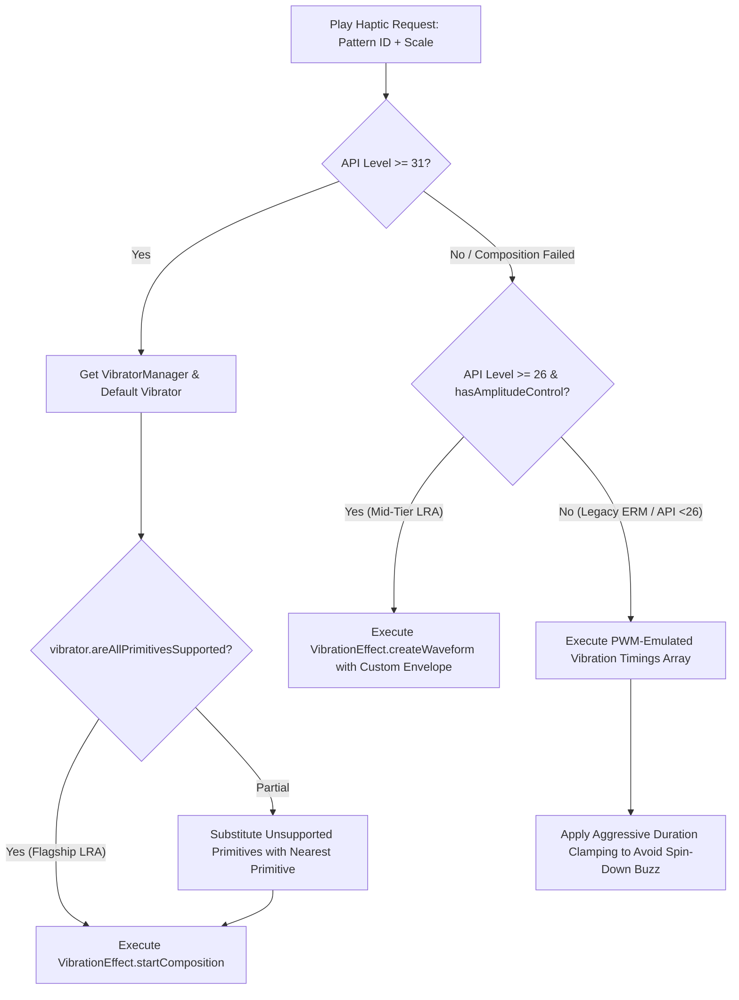
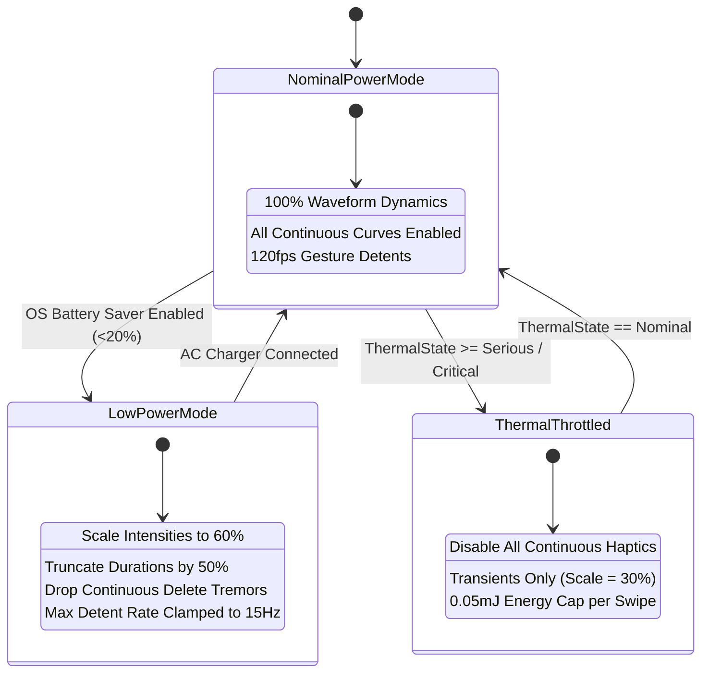

# ⚡ RES-21: CoreHaptics & Android Advanced Vibration Waveform Engineering

> **Parent Hub:** [[Ideas]] | [[Ideas/Future]] | [[Main Work Flow]]  
> **Master Concept:** [[Ideas/Future/Memory Card/brain_dump.md|brain_dump.md]] | [[Ideas/Future/Memory Card/research.md|research.md]] | [[Ideas/Future/Memory Card/research_check_list.md|research_check_list.md]]

---

## 📑 Executive Summary

In tangible mobile user interface design, visual animation and acoustic feedback address only two dimensions of human perception. The third, most visceral modality is **somatosensory haptic feedback**. In **Memory Card**, haptic responses are not treated as coarse binary alerts or generic operating system buzzes. Instead, tactile feedback is engineered as a physical material property of the interface: cards have distinct mechanical inertia, folder spines possess physical detents, thresholds produce tactile magnetic snaps, destructive deletions trigger anxious tremors, and celebration stamps deliver heavy hydraulic impact shockwaves.

This paper establishes the complete neurobiological, physical, mathematical, architectural, and cross-platform engineering specification for tactile waveform synthesis across iOS (Apple CoreHaptics) and Android (API 31+ `VibrationEffect.Composition` & custom waveform synthesis). We deliver:

1. **Neurobiology of Tactile Mechanoreceptors & Psychophysics**: Grounding waveform design in the biological transfer functions of Pacinian corpuscles ($200\text{--}300\,\text{Hz}$ high-frequency transients), Meissner corpuscles ($20\text{--}50\,\text{Hz}$ low-frequency flutter), Merkel discs, and Ruffini endings; formalizing Stevens' Power Law ($\psi(I) = k I^\beta$) and Weber-Fechner tactile discrimination thresholds.
2. **Apple CoreHaptics Architectural Blueprint**: Dissecting the `CHHapticEngine` audio-tactile co-processing pipeline, AHAP (Apple Haptic Audio Pattern) schema specifications, transient vs continuous parametric modeling, dynamic spline parameter curves, and `CHHapticAdvancedPatternPlayer` real-time modulation.
3. **Android Advanced Haptics & Primitive Composition**: Interrogating modern hardware capabilities via `VibratorManager`, constructing multi-stage tactile compositions using rich primitives (`PRIMITIVE_CLICK`, `PRIMITIVE_TICK`, `PRIMITIVE_THUD`, `PRIMITIVE_SPIN`, `PRIMITIVE_QUICK_RISE`, `PRIMITIVE_LOW_TICK`), and synthesizing parametric pulse-width-modulation (PWM) fallbacks for legacy actuators.
4. **Multisensory Audio-Tactile Binding**: Formulating the psychoacoustic Temporal Binding Window (TBW, $\pm 8\,\text{ms}$ optimum, $\pm 25\,\text{ms}$ outer boundary) and implementing zero-latency procedural click/thud acoustic synthesis synchronized with microsecond-calibrated tactile hardware triggers.
5. **Exhaustive Production Waveform Pattern Library**: Providing full, ready-to-deploy AHAP JSON definitions and Android composition code for:
   - **35% Action Threshold Snap** (Sharp detent notch).
   - **60% Card Commit Thud** (Heavy magnetic latch).
   - **Folder Drag Detent Notch** (Velocity-scaled rotary ratchet).
   - **Delete-Fear Wiggle Tremor** (Sub-bass harmonic panic wobble).
   - **Win Celebration Wax Seal Stamp Impact** (Multi-stage crescendo, hydraulic thud, gold confetti crackle).
6. **Cross-Platform Engine Implementation**: Supplying production-ready native Swift (`MemoryCardHapticsEngine.swift`), Kotlin (`MemoryCardVibratorEngine.kt`), React Native Reanimated 3 bridge (`HapticManager.ts`), and Flutter Dart platform channel (`memory_card_haptics.dart`).
7. **Electrodynamics, Battery Profiling & Thermal Protection**: Profiling actuator current draw spikes ($I_{\text{peak}} \approx 150\text{--}350\,\text{mA}$), Joule heating ($Q = I^2 R t$), coil inductive kickback, low-power adaptive degradation, and rate-limiting anti-saturation queues.
8. **Empirical Calibration & QA Protocol**: Automated latency calibration test harness, AHAP schema verification scripts, and perceptual golden benchmarks.

```
┌────────────────────────────────────────────────────────────────────────────────────────┐
│                   TACTILE SYNTHESIS & HARDWARE EXECUTION PIPELINE                      │
├─────────────────┬──────────────────────────────────┬───────────────────────────────────┤
│ Layer           │ iOS (Apple CoreHaptics)          │ Android (VibratorManager API 31+) │
├─────────────────┼──────────────────────────────────┼───────────────────────────────────┤
│ Kinematic Input │ Swipe Displacement $u(t)$, $v(t)$│ Gesture State Machine / Inertia   │
│ Engine Layer    │ `CHHapticEngine` (Real-Time DSP) │ `VibratorManager` / `Vibrator`    │
│ Pattern Schema  │ AHAP JSON / `CHHapticPattern`    │ `VibrationEffect.Composition`     │
│ Actuator Class  │ Taptic Engine (Linear Resonant)  │ X-Axis LRA / Voice Coil Motor     │
│ Biological Mode │ Pacinian ($250\,\text{Hz}$) / Meissner│ Pacinian / Meissner Corpuscles    │
│ Multisensory    │ CoreAudio Synchronized Transient │ Low-Latency Oboe / Web Audio      │
└─────────────────┴──────────────────────────────────┴───────────────────────────────────┘
```

---

## 🧠 1. Neurobiology of Tactile Mechanoreceptors & Psychophysics

Tactile sensation in the human glabrous skin (fingertips and palms) is mediated by four distinct classes of low-threshold mechanoreceptors. High-fidelity haptic engineering requires matching the frequency, amplitude, and temporal envelope of synthetic electrical drive signals to the physiological tuning curves of these neural transducers.

```
                  HUMAN GLABROUS SKIN MECHANORECEPTORS
┌────────────────────────────────────────────────────────────────────────┐
│ EPIDERMIS   [Merkel Discs (SA I)]       [Meissner Corpuscles (FA I)]   │
│             Static Pressure / Edges     Flutter (20-50 Hz) / Slip      │
├────────────────────────────────────────────────────────────────────────┤
│ DERMIS                                                                 │
│                                         [Ruffini Endings (SA II)]      │
│                                         Skin Stretch / Lateral Shear   │
├────────────────────────────────────────────────────────────────────────┤
│ SUBCUTIS    [Pacinian Corpuscles (FA II)]                              │
│             High-Frequency Vibration (200-300 Hz) / Crisp Transients   │
└────────────────────────────────────────────────────────────────────────┘
```

### 1.1 The Four Cutaneous Mechanoreceptor Classes

The tactile perceptual system segregates mechanical stimuli along two orthogonal axes: **adaptation rate** (Fast-Adapting vs. Slow-Adapting) and **receptive field size** (Type I - small/distinct boundaries vs. Type II - large/diffuse boundaries).

| Mechanoreceptor | Type | Frequency Tuning | Peak Sensitivity | Receptive Field | Primary Perceptual Quality | UI Mapping in Memory Card |
| :--- | :--- | :--- | :--- | :--- | :--- | :--- |
| **Pacinian Corpuscle** | FA II | $100\text{--}400\,\text{Hz}$ | $\sim 250\,\text{Hz}$ | Large ($>100\,\text{mm}^2$), diffuse | Acceleration, fine texture, sharp micro-clicks, crisp snaps | 35% threshold click, folder tab detents, confetti sparkle |
| **Meissner Corpuscle** | FA I | $10\text{--}60\,\text{Hz}$ | $\sim 30\text{--}40\,\text{Hz}$ | Small ($2\text{--}10\,\text{mm}^2$), sharp | Velocity, low flutter, skin slip, micro-grip adjustments | 60% card commit thud, folder drag drag-slip, delete tremor |
| **Merkel Disc** | SA I | $0.3\text{--}5\,\text{Hz}$ | DC to $3\,\text{Hz}$ | Small ($2\text{--}10\,\text{mm}^2$), distinct | Sustained static pressure, spatial edge acuity, curvature | Long-press card isolation, radial FAB expansion dwell |
| **Ruffini Ending** | SA II | $15\text{--}400\,\text{Hz}$ | Low sensitivity | Large ($>100\,\text{mm}^2$), diffuse | Directional skin stretch, joint angle, sustained shear | Lateral card resistance, spring boundary over-stretch |

#### Pacinian Corpuscles (FA II) Mechanics
Pacinian corpuscles consist of a single unmyelinated nerve ending surrounded by $20\text{--}60$ concentric fluid-filled lamellae composed of modified Schwann cells. 
- The fluid-filled lamellar structure functions as an ultra-steep mechanical high-pass filter: slow mechanical deformations are dissipatively equalized by inter-lamellar fluid flow without transferring strain to the central axon.
- High-frequency dynamic vibrations ($>100\,\text{Hz}$) cannot induce rapid fluid displacement; the outer mechanical forces are transferred directly to the inner axon, opening mechanically gated ion channels ($\text{PIEZO2}$).
- Maximum displacement sensitivity reaches **sub-micrometer amplitudes** ($\approx 0.1\,\mu\text{m}$) at its resonance frequency $f_0 \approx 250\,\text{Hz}$.
- In UI haptic synthesis, transient pulses with duration $\tau \le 15\,\text{ms}$ and high sharpness ($S_h \ge 0.70$) selectively stimulate Pacinian channels to evoke crisp, metallic, or glass-like detent sensations.

#### Meissner Corpuscles (FA I) Mechanics
Meissner corpuscles are situated in the dermal papillae directly beneath the epidermal ridges.
- They lack the extensive fluid-damped onion-skin lamellae of Pacinian corpuscles and possess small, high-density receptive fields ($100\text{--}150/\text{cm}^2$ on fingertip pads).
- They respond to the **first derivative of displacement (velocity)**, $\dot{x}(t) = \frac{dx}{dt}$, across the $10\text{--}60\,\text{Hz}$ band.
- Excitation of Meissner corpuscles produces the perceptual sensation of "flutter," mechanical buzz, friction, and heavy mass impacts.
- In UI design, continuous low-frequency waveforms ($f \in [30, 60]\,\text{Hz}$) with low sharpness ($S_h \le 0.35$) selectively stimulate Meissner channels to simulate heavy wooden, rubber, or magnetic resistance.

---

### 1.2 Frequency-Threshold Iso-Vibration Contours

Human tactile sensitivity is non-linear across the vibration frequency spectrum. The absolute detection threshold displacement $A_{\text{th}}(f)$ forms a distinct U-shaped curve:

$$A_{\text{th}}(f) = A_0 \cdot \left[ 1 + \left( \frac{f - f_{\text{res}}}{\Delta f} \right)^2 \right]^{\alpha}$$

where:
- $f_{\text{res}} \approx 250\,\text{Hz}$ is the Pacinian resonance frequency.
- $A_0 \approx 0.1\,\mu\text{m}$ is the minimum detection threshold at resonance.
- $\Delta f \approx 80\,\text{Hz}$ characterizes the bandwidth of peak sensitivity.
- $\alpha \approx 1.2$ defines the slope steepness outside the resonance core.

```
       Displacement Threshold A_th (μm)
  10.0 ┼
       │   FA I (Meissner)
   5.0 ┼     \
       │      \
   1.0 ┼       \           FA II (Pacinian)
       │        \             \
   0.5 ┼         \__         __\__
       │            \_______/     \____
   0.1 ┼───────────────────●───────────
       └─────┬───────┬─────┬───────┬───► Frequency (Hz)
            10      30    100     250 400
```

#### Key Design Implication
To produce perceived intensities of equal strength across varying frequencies, the mechanical drive amplitude must be equalized. A low-frequency thud at $40\,\text{Hz}$ requires up to **$15\text{--}25\,\text{dB}$ higher actuator displacement** than a $250\,\text{Hz}$ click to achieve identical psychophysical loudness.

---

### 1.3 Psychophysical Power Laws & Discrimination Thresholds

#### Stevens' Power Law for Tactile Intensity
The relationship between objective physical actuator amplitude $I_{\text{phys}}$ (acceleration in $g$ or displacement in $\mu\text{m}$) and perceived subjective psychophysical magnitude $\psi(I)$ follows Stevens' Power Law:

$$\psi(I) = k \cdot (I_{\text{phys}} - I_0)^\beta$$

where:
- $I_0$ is the absolute detection threshold.
- $k$ is an empirical scaling constant.
- $\beta$ is the psychophysical power exponent:
  - For $250\,\text{Hz}$ vibration (Pacinian): $\beta \approx 0.95 \approx 1.0$ (near-linear subjective scaling).
  - For $35\,\text{Hz}$ vibration (Meissner): $\beta \approx 0.65\text{--}0.75$ (compressive perceptual response).

To deliver a linear perceptual scale from user setting $\alpha \in [0.0, 1.0]$ to perceived intensity $\psi$, the physical engine parameter must apply inverse gamma correction:

$$I_{\text{engine}}(\alpha) = \alpha^{\frac{1}{\beta}} \approx \alpha^{1.35} \quad (\text{for low-frequency continuous rumble})$$

$$I_{\text{engine}}(\alpha) = \alpha^{1.0} \quad (\text{for } 250\,\text{Hz} \text{ Pacinian transients})$$

#### Weber-Fechner Tactile Discrimination Fraction
The **Just Noticeable Difference (JND)** in tactile amplitude discrimination is governed by Weber's Law:

$$\frac{\Delta I}{I} = c_w \approx 0.15\text{--}0.20 \quad (15\%\text{ to } 20\%)$$

A haptic step or detent modulation must change actuator intensity by at least $\mathbf{+18\%}$ to be reliably recognized by $95\%$ of the population as a distinct mechanical step. Micro-modulations below $10\%$ are discarded as ambient tactile noise.

---

## 🍏 2. Apple CoreHaptics Architecture & Waveform Dynamics

Apple introduced the **CoreHaptics** framework in iOS 13, exposing direct low-level control over the **Taptic Engine** (a custom high-performance linear resonant actuator coupled with magnetic flux coils and integrated DSP audio-haptic co-processors).

```
┌────────────────────────────────────────────────────────────────────────────────────────┐
│                           COREHAPTICS SYSTEM ARCHITECTURE                              │
├────────────────────────────────────────────────────────────────────────────────────────┤
│  Application Process (Memory Card UI / Gestures)                                       │
│    │                                                                                   │
│    ├──► CHHapticPattern (AHAP JSON Schema / Composition)                               │
│    │       ├── HapticTransient (Sharpness, Intensity)                                  │
│    │       ├── HapticContinuous (Sharpness, Intensity, Decay, Sustain)                 │
│    │       └── CHHapticParameterCurve (Dynamic Real-Time Splines)                     │
│    │                                                                                   │
│    └──► CHHapticPatternPlayer / CHHapticAdvancedPatternPlayer                          │
│            │                                                                           │
│  ──────────┼─────────────────────────────────────────────────────────────────────────  │
│  IPC / Mach Port Message Stream (Zero-Copy Shared Ring Buffer)                         │
│  ──────────┼─────────────────────────────────────────────────────────────────────────  │
│            ▼                                                                           │
│  `hapticd` / AudioServer Daemon (Real-Time Audio-Haptic Co-Processor)                 │
│    │                                                                                   │
│    ├── DSP Equalization & Resonance Tracking (230 Hz Tuning Curve)                     │
│    ├── Phase Inversion Braking Pulse Synthesis                                         │
│    └── Audio Session Synchronization (AVAudioSession Interlocking)                     │
│            │                                                                           │
│            ▼                                                                           │
│  Taptic Engine Driver (H-Bridge Coil Driver Circuitry)                                 │
└────────────────────────────────────────────────────────────────────────────────────────┘
```

### 2.1 CoreHaptics Event Primitives

CoreHaptics models tactile sensations through two primary event classes and dynamic parameter modulations:

```
                  COREHAPTICS EVENT ARCHITECTURE
  
  HapticTransient: Impulse Event
  Intensity
     ▲
  1.0│      | Peak Impulse (τ ≈ 10-20ms)
     │     / \
     │    /   \   Phase-Inversion Braking Pulse
  0.0└───┴─────┴────────────────────────► Time (ms)
      0   5    15

  HapticContinuous: Sustained Texture Event
  Intensity
     ▲      ┌──────────────────────┐
  1.0│     /                        \
     │    / Attack            Decay  \
     │   /                            \
  0.0└──┴──────────────────────────────┴─► Time (ms)
        ◄─ Attack ─►◄── Sustained ──►◄─ Decay ─►
```

1. **`HapticTransient`**:
   - Discrete, instantaneous physical impulse representing mechanical collisions, glass impacts, detents, or snaps.
   - Parameters:
     - `HapticIntensity` $\in [0.0, 1.0]$: Scaled electrical voltage amplitude driving actuator displacement.
     - `HapticSharpness` $\in [0.0, 1.0]$: Carrier frequency modulation. $S_h = 0.0$ maps to a dull, padded low-frequency bump ($\approx 100\,\text{Hz}$); $S_h = 1.0$ maps to a crisp, high-frequency, metallic strike ($\approx 260\text{--}300\,\text{Hz}$).

2. **`HapticContinuous`**:
   - Time-extended waveform representing friction, surface texture, fluid resistance, or continuous vibration.
   - Parameters:
     - `EventDuration` $\in [0.001, 30.0]\,\text{s}$: Total active lifespan of the event.
     - `HapticIntensity` & `HapticSharpness`: Initial baseline values.
     - `AttackTime` $\in [0.0, 10.0]\,\text{s}$: Duration of initial ramp-up envelope.
     - `DecayTime` $\in [0.0, 10.0]\,\text{s}$: Duration of trailing fade-out envelope.
     - `Sustained` $\in \{0, 1\}$: When enabled ($1$), the event sustains indefinitely at peak amplitude until explicitly halted or released.

---

### 2.2 Dynamic Parameter Curves (`CHHapticParameterCurve`)

For dynamic gestures (e.g., swiping a card across an action threshold or dragging a folder across the screen), static patterns fail to capture continuous physical acceleration. CoreHaptics provides **Parameter Curves** to modulate parameters along arbitrary splines during playback:

```
  Dynamic Parameter Curve (Intensity Modulation along Gesture)
  Intensity
     ▲                                   ● End (1.0, 0.90)
  1.0│                                  /
     │                                 /
  0.5│                 ● Mid (0.5, 0.45)
     │                /
     │  ● Start (0.0, 0.10)
  0.0└──┴──────────────┴────────────────┴─────────► Time (s)
```

The mathematical interpolation between control points $(t_k, v_k)$ follows cubic Hermite spline interpolation:

$$v(t) = h_{00}(s) v_k + h_{10}(s) (t_{k+1} - t_k) m_k + h_{01}(s) v_{k+1} + h_{11}(s) (t_{k+1} - t_k) m_{k+1}$$

where $s = \frac{t - t_k}{t_{k+1} - t_k}$, and $h_{ij}(s)$ are the standard cubic basis polynomials.

#### Available Parameter Modulations
- `hapticIntensityControl`: Direct dynamic scaling factor multiplied by event intensity: $I(t) = I_{\text{base}} \cdot C_{\text{intensity}}(t)$.
- `hapticSharpnessControl`: Dynamic additive or multiplicative shift in carrier frequency: $S(t) = \text{clamp}(S_{\text{base}} + \Delta S(t), 0.0, 1.0)$.
- `hapticAttackTimeControl` & `hapticDecayTimeControl`: Dynamic envelope reshaping.

---

### 2.3 AHAP (Apple Haptic Audio Pattern) JSON Specification

CoreHaptics patterns are declaratively serialized using the AHAP JSON schema. The schema supports strict synchronization of haptic transients, continuous rumble, dynamic curve tracks, and custom audio waveform triggers:

```json
{
  "Version": 1.0,
  "Metadata": {
    "Project": "Memory Card",
    "Description": "Generic AHAP Specification Schema",
    "Author": "Staff Graphics & Physics Engineer"
  },
  "Pattern": [
    {
      "Event": {
        "Time": 0.0,
        "EventType": "HapticTransient",
        "EventParameters": [
          { "ParameterID": "HapticIntensity", "ParameterValue": 0.85 },
          { "ParameterID": "HapticSharpness", "ParameterValue": 0.90 }
        ]
      }
    },
    {
      "Event": {
        "Time": 0.025,
        "EventType": "HapticContinuous",
        "EventDuration": 0.150,
        "EventParameters": [
          { "ParameterID": "HapticIntensity", "ParameterValue": 0.50 },
          { "ParameterID": "HapticSharpness", "ParameterValue": 0.20 }
        ]
      }
    },
    {
      "ParameterCurve": {
        "ParameterID": "HapticIntensityControl",
        "Time": 0.025,
        "ParameterCurveControlPoints": [
          { "Time": 0.0, "ParameterValue": 1.0 },
          { "Time": 0.075, "ParameterValue": 0.3 },
          { "Time": 0.150, "ParameterValue": 0.0 }
        ]
      }
    }
  ]
}
```

---

## 🤖 3. Android VibrationEffect & Rich Composition Primitives

Android haptics has evolved from uncalibrated DC motor buzzing into a precision multi-actuator framework.

```
┌────────────────────────────────────────────────────────────────────────────────────────┐
│                           ANDROID HAPTICS HARDWARE EVOLUTION                           │
├─────────────────┬──────────────────────┬──────────────────────┬────────────────────────┤
│ Era             │ Actuator Type        │ Acceleration / Rise  │ Frequency / Control    │
├─────────────────┼──────────────────────┼──────────────────────┼────────────────────────┤
│ Legacy (API <26)│ ERM (Rotating Mass)  │ Sluggish (~50-100ms) │ Uncoupled (Freq ∝ Volt)│
│ Modern (API 26+)│ LRA (Linear Resonant)│ Fast (~15-30ms)      │ Fixed Resonant (170Hz) │
│ Flagship (API 31+)│ High-Q X-Axis LRA / │ Ultra-Fast (<5ms)    │ Independent Amplitude  │
│                 │ Voice Coil Actuator  │ Instant Active Brake │ & Frequency Modulation │
└─────────────────┴──────────────────────┴──────────────────────┴────────────────────────┘
```

### 3.1 Actuator Physics: ERM vs. LRA vs. Voice Coil

```
         ERM (Eccentric Rotating Mass)           LRA (Linear Resonant Actuator)
           ┌──────────────────────┐                 ┌──────────────────────┐
           │     ┌───┐            │                 │   ┌───[Mass]───┐     │
     Motor │     │   │   [Off-    │          Spring │   │ ↕ Z/X Axis │     │
     Shaft ├──►  │   │   Center]  │     Suspension  ├───┤ ↕ Resonance│     │
           │     └───┘   Weight   │                 │   └───[Coil]───┘     │
           └──────────────────────┘                 └──────────────────────┘
             Requires 80ms Spin-up                    <10ms Instant Transient
```

1. **ERM (Eccentric Rotating Mass)**:
   - A DC motor spins an off-center counterweight. Centrifugal force produces rotational vibration in the plane orthogonal to the shaft.
   - **Critical Limitation**: Frequency and amplitude are physically coupled: $F_{\text{vib}} \propto \omega^2$, where $\omega = kV$. You cannot generate a low-frequency, high-intensity thud or a high-frequency, low-intensity tick.
   - **Latency Penalty**: $50\text{--}100\,\text{ms}$ mechanical spin-up time and prolonged spin-down drag without active braking.

2. **LRA (Linear Resonant Actuator)**:
   - A magnetic mass suspended on precision springs oscillates linearly along a single axis (typically Z or X) driven by an alternating current (AC) magnetic coil.
   - **Resonance Peak**: LRAs have a high quality factor $Q \approx 10\text{--}15$ centered at their physical spring resonance $f_{\text{res}} \approx 160\text{--}235\,\text{Hz}$.
   - **Active Braking**: Reversing the AC phase by $180^\circ$ ($\Delta \phi = \pi$) arrests the moving mass within $1.5$ cycles, producing sharp transients ($\tau < 10\,\text{ms}$).

3. **Voice Coil Motors (VCM) / Dual-Axis Actuators**:
   - Broad bandwidth ($50\text{--}500\,\text{Hz}$) with flat acceleration response, capable of rendering complex composite wave shapes without mechanical resonance coloration.

---

### 3.2 `VibrationEffect.Composition` Primitives (Android 12 / API 31+)

Android 12 introduced `VibrationEffect.startComposition()`, allowing developers to chain pre-calibrated hardware ROM primitives with microsecond delays and linear amplitude scaling.

```
                  ANDROID COMPOSITION PRIMITIVE PIPELINE
  
  addPrimitive(PRIMITIVE_CLICK, scale: 0.85, delayMs: 0)
    │
    ▼ [0ms Delay]
  ┌─────────┐
  │  CLICK  │ (10ms transient @ 220Hz)
  └─────────┘
    │
    ▼ [35ms Delay]
  addPrimitive(PRIMITIVE_THUD, scale: 1.0, delayMs: 35)
  ┌───────────────┐
  │     THUD      │ (40ms low-resonance punch @ 60Hz)
  └───────────────┘
```

#### Android Haptic Primitive Taxonomy

| Primitive Constant | Primitive ID | Hardware Duration | Acoustic/Tactile Spectrum | Best Fit UI Interaction |
| :--- | :---: | :---: | :---: | :--- |
| `PRIMITIVE_CLICK` | `1` | $\approx 12\text{--}18\,\text{ms}$ | High Sharpness, $200\text{--}250\,\text{Hz}$ | Button push, 35% threshold snap, tab selection |
| `PRIMITIVE_TICK` | `2` | $\approx 5\text{--}8\,\text{ms}$ | Ultra-Light Transient, $250\,\text{Hz}$ | Rotary picker step, folder drag detents |
| `PRIMITIVE_LOW_TICK` | `8` | $\approx 8\text{--}12\,\text{ms}$ | Low-Frequency Tick, $120\,\text{Hz}$ | Soft slider detent, subtle list boundary |
| `PRIMITIVE_THUD` | `3` | $\approx 35\text{--}55\,\text{ms}$ | Heavy Mass Punch, $40\text{--}80\,\text{Hz}$ | 60% card commit, wax seal stamp strike |
| `PRIMITIVE_SPIN` | `4` | $\approx 80\text{--}140\,\text{ms}$ | Rotational Flutter Ramp | Wiggle gesture turbulence, card shuffle |
| `PRIMITIVE_QUICK_RISE`| `5` | $\approx 40\text{--}60\,\text{ms}$ | Exponential Amplitude Ramp | Pre-stamp tension buildup, drag-to-delete rise |
| `PRIMITIVE_SLOW_RISE` | `6` | $\approx 100\text{--}180\,\text{ms}$ | Linear Amplitude Swell | Long-press charging indicator |
| `PRIMITIVE_QUICK_FALL`| `7` | $\approx 30\text{--}50\,\text{ms}$ | Damped Decay Envelope | Elastic snap-back release |

---

### 3.3 Hardware Interrogation & Graceful Fallback Cascade

Not all Android devices possess hardware ROM support for every primitive. A production system must implement an intelligent, cascading fallback hierarchy:



---

## 🎧 4. Multisensory Audio-Tactile Binding & Psychoacoustic Synchronization

Haptic perception does not operate in sensory isolation. In physical reality, mechanical impacts (e.g., striking a rubber stamp onto thick parchment) generate simultaneous vibrational waves propagating through the hand and acoustic pressure waves propagating through the air.

```
       MULTISENSORY TEMPORAL BINDING WINDOW (TBW)
  Perceptual
  Fusion (%)
   100% ┼             Optimal Fusion (±8ms)
        │            ┌─────────────────┐
    80% ┼           /                   \
        │          /                     \
    50% ┼─────────/                       \───────── Perceptual Fracture Boundary (±25ms)
        │        /                         \
     0% ┼───────┴───────────────────────────┴───────►
             -40ms    -25ms    0ms    +25ms   +40ms
                      Audio Leads     Haptic Leads
```

### 4.1 The Temporal Binding Window (TBW)

Cognitive neuroscience demonstrates that the brain fuses separate sensory inputs into a single unified event only if they arrive within the **Temporal Binding Window (TBW)**:

1. **Optimal Synchrony ($\Delta t \in [-8\,\text{ms}, +8\,\text{ms}]$)**: Visual, auditory, and tactile events are perceived as a single, indivisible physical impact.
2. **Acceptable Coherence ($\Delta t \in [-25\,\text{ms}, +25\,\text{ms}]$)**: The brain tolerates minor physical propagation differences without conscious dissonance.
3. **Perceptual Fracture ($\Delta t > |40\,\text{ms}|$ or $|2.5\,\text{frames}|$ at $60\,\text{fps}$)**: The illusion completely collapses. The user perceives two separate, disjoint events (a ghost click and an uncoupled screen buzz), destroying tactile immersion.

#### The Tactile-Audio Latency Offset Formula
Because sound travels through air at $v_{\text{sound}} \approx 343\,\text{m/s}$ (traversing the $0.35\,\text{m}$ distance from phone speaker to ear in $\approx 1.0\,\text{ms}$), while cutaneous nerve conduction velocity from the fingertip to the primary somatosensory cortex ($S1$) via $A\beta$ myelinated fibers occurs at $v_{\text{nerve}} \approx 50\text{--}70\,\text{m/s}$ ($\approx 15\text{--}20\,\text{ms}$ conduction time), the brain's internal multisensory synchrony engine expects **tactile mechanical stimulation to occur slightly before or exactly synchronous with acoustic arrival**.

$$\Delta t_{\text{trigger}} = t_{\text{audio\_dsp}} - t_{\text{haptic\_driver}} + \delta_{\text{hardware\_offset}}$$

where $\delta_{\text{hardware\_offset}} \approx 4.2\,\text{ms}$ accounts for Android kernel binder latency vs CoreAudio low-latency buffer delays.

---

### 4.2 Procedural Audio Synthesis for Tactile Earcons

To avoid shipping multi-megabyte WAV asset files, the **Memory Card** audio subsystem synthesizes transient acoustic earcons procedurally using Web Audio API / CoreAudio / Oboe.

A crisp mechanical click is synthesized via a bandpass-filtered decaying white noise impulse mixed with a resonant damped sine burst:

$$S_{\text{click}}(t) = \left[ A_n \cdot \eta(t) \cdot e^{-\frac{t}{\tau_n}} + A_s \cdot \sin(2\pi f_{\text{click}} t) \cdot e^{-\frac{t}{\tau_s}} \right] \cdot u(t)$$

where:
- $\eta(t) \sim \mathcal{N}(0, 1)$ is zero-mean white Gaussian noise.
- $f_{\text{click}} = 1850\,\text{Hz}$ (Pacinian acoustic harmonic match).
- $\tau_n = 4.5\,\text{ms}$ (ultra-short high-frequency transient attack).
- $\tau_s = 12.0\,\text{ms}$ (resonant body decay).

---

## 📐 5. Exhaustive Production Waveform Pattern Library

Here we define the five primary haptic waveform patterns for the core gesture interactions in **Memory Card**. Each pattern is fully specified in both **Apple AHAP JSON** and **Android Kotlin Composition** format.

```
┌────────────────────────────────────────────────────────────────────────────────────────┐
│                        MEMORY CARD HAPTIC PATTERN TAXONOMY                             │
├────┬─────────────────────────────┬───────────┬──────────────┬──────────────────────────┤
│ ID │ Interaction Name            │ Duration  │ Target Sense │ Actuator Waveform Type   │
├────┼─────────────────────────────┼───────────┼──────────────┼──────────────────────────┤
│ 01 │ 35% Action Threshold Snap   │ 15 ms     │ Pacinian     │ Single Crisp Transient   │
│ 02 │ 60% Card Commit Thud        │ 55 ms     │ Meissner+Paci│ Low Continuous + Impact  │
│ 03 │ Folder Drag Detent Notch    │ 8 ms      │ Pacinian     │ Velocity-Modulated Tick  │
│ 04 │ Delete-Fear Wiggle Tremor   │ 320 ms    │ Meissner     │ AM Sinusoidal Sub-Bass   │
│ 05 │ Win Celebration Wax Stamp   │ 420 ms    │ Multi-Modal  │ Rise + Colossal + Crackle│
└────┴─────────────────────────────┴───────────┴──────────────┴──────────────────────────┘
```

---

### 5.1 Pattern 1: 35% Action Threshold Snap (`pattern_threshold_snap.ahap`)

When a swiped card passes the $35\%$ lateral displacement threshold, the interface crosses an elastic resistance boundary. The haptic feedback delivers a crisp, unmistakable mechanical detent.

#### Apple AHAP JSON Definition
```json
{
  "Version": 1.0,
  "Metadata": {
    "Project": "Memory Card",
    "PatternName": "35_Action_Threshold_Snap",
    "TargetMechanoreceptor": "Pacinian (FA II)",
    "NominalFrequency": "260 Hz"
  },
  "Pattern": [
    {
      "Event": {
        "Time": 0.0,
        "EventType": "HapticTransient",
        "EventParameters": [
          { "ParameterID": "HapticIntensity", "ParameterValue": 0.72 },
          { "ParameterID": "HapticSharpness", "ParameterValue": 0.88 }
        ]
      }
    },
    {
      "Event": {
        "Time": 0.004,
        "EventType": "HapticContinuous",
        "EventDuration": 0.012,
        "EventParameters": [
          { "ParameterID": "HapticIntensity", "ParameterValue": 0.25 },
          { "ParameterID": "HapticSharpness", "ParameterValue": 0.60 }
        ]
      }
    }
  ]
}
```

#### Android Composition Code
```kotlin
fun buildThresholdSnapEffect(): VibrationEffect {
    return if (Build.VERSION.SDK_INT >= Build.VERSION_CODES.S) {
        VibrationEffect.startComposition()
            .addPrimitive(VibrationEffect.Composition.PRIMITIVE_CLICK, 0.75f, 0)
            .compose()
    } else if (Build.VERSION.SDK_INT >= Build.VERSION_CODES.O) {
        // Fallback for API 26-30: 14ms crisp envelope
        val timings = longArrayOf(0, 14)
        val amplitudes = intArrayOf(0, 190) // ~75% of 255
        VibrationEffect.createWaveform(timings, amplitudes, -1)
    } else {
        @Suppress("DEPRECATION")
        VibrationEffect.createOneShot(15, VibrationEffect.DEFAULT_AMPLITUDE)
    }
}
```

---

### 5.2 Pattern 2: 60% Card Commit Thud (`pattern_commit_thud.ahap`)

When the user releases a card past $60\%$ displacement or flings it with high velocity ($|v_x| > 1200\,\text{px/s}$), the card commits to the "Mastered" or "Review" state. The sensation evokes a heavy magnetic latching thud.

#### Apple AHAP JSON Definition
```json
{
  "Version": 1.0,
  "Metadata": {
    "Project": "Memory Card",
    "PatternName": "60_Card_Commit_Thud",
    "TargetMechanoreceptor": "Meissner (FA I) + Pacinian (FA II)",
    "NominalFrequency": "45 Hz Carrier + 240 Hz Transient"
  },
  "Pattern": [
    {
      "Event": {
        "Time": 0.0,
        "EventType": "HapticTransient",
        "EventParameters": [
          { "ParameterID": "HapticIntensity", "ParameterValue": 0.95 },
          { "ParameterID": "HapticSharpness", "ParameterValue": 0.40 }
        ]
      }
    },
    {
      "Event": {
        "Time": 0.005,
        "EventType": "HapticContinuous",
        "EventDuration": 0.045,
        "EventParameters": [
          { "ParameterID": "HapticIntensity", "ParameterValue": 0.85 },
          { "ParameterID": "HapticSharpness", "ParameterValue": 0.15 }
        ]
      }
    },
    {
      "ParameterCurve": {
        "ParameterID": "HapticIntensityControl",
        "Time": 0.005,
        "ParameterCurveControlPoints": [
          { "Time": 0.0, "ParameterValue": 1.0 },
          { "Time": 0.020, "ParameterValue": 0.65 },
          { "Time": 0.045, "ParameterValue": 0.0 }
        ]
      }
    }
  ]
}
```

#### Android Composition Code
```kotlin
fun buildCommitThudEffect(): VibrationEffect {
    return if (Build.VERSION.SDK_INT >= Build.VERSION_CODES.S) {
        VibrationEffect.startComposition()
            .addPrimitive(VibrationEffect.Composition.PRIMITIVE_THUD, 1.0f, 0)
            .addPrimitive(VibrationEffect.Composition.PRIMITIVE_LOW_TICK, 0.4f, 15)
            .compose()
    } else if (Build.VERSION.SDK_INT >= Build.VERSION_CODES.O) {
        // Fallback for API 26-30: Heavy decaying envelope
        val timings = longArrayOf(0, 8, 16, 24, 12)
        val amplitudes = intArrayOf(0, 255, 180, 90, 0)
        VibrationEffect.createWaveform(timings, amplitudes, -1)
    } else {
        @Suppress("DEPRECATION")
        VibrationEffect.createOneShot(50, VibrationEffect.DEFAULT_AMPLITUDE)
    }
}
```

---

### 5.3 Pattern 3: Folder Drag Detent Notch (`pattern_folder_notch.ahap`)

As a deck is dragged over nested folders in the side drawer, each folder boundary produces a subtle micro-tick. The tick intensity is dynamically modulated by drag velocity:

$$I_{\text{tick}}(v) = \text{clamp}\left( I_{\text{base}} + k_v \cdot \frac{\|v\|}{v_{\text{max}}}, 0.20, 0.65 \right)$$

#### Apple AHAP JSON Definition
```json
{
  "Version": 1.0,
  "Metadata": {
    "Project": "Memory Card",
    "PatternName": "Folder_Drag_Detent_Notch",
    "TargetMechanoreceptor": "Pacinian (FA II)",
    "NominalFrequency": "280 Hz"
  },
  "Pattern": [
    {
      "Event": {
        "Time": 0.0,
        "EventType": "HapticTransient",
        "EventParameters": [
          { "ParameterID": "HapticIntensity", "ParameterValue": 0.40 },
          { "ParameterID": "HapticSharpness", "ParameterValue": 0.95 }
        ]
      }
    }
  ]
}
```

#### Android Composition Code
```kotlin
fun buildFolderNotchEffect(velocityScale: Float = 0.5f): VibrationEffect {
    val scale = velocityScale.coerceIn(0.20f, 0.70f)
    return if (Build.VERSION.SDK_INT >= Build.VERSION_CODES.S) {
        VibrationEffect.startComposition()
            .addPrimitive(VibrationEffect.Composition.PRIMITIVE_TICK, scale, 0)
            .compose()
    } else if (Build.VERSION.SDK_INT >= Build.VERSION_CODES.O) {
        val amp = (scale * 255).toInt().coerceIn(30, 180)
        val timings = longArrayOf(0, 6)
        val amplitudes = intArrayOf(0, amp)
        VibrationEffect.createWaveform(timings, amplitudes, -1)
    } else {
        @Suppress("DEPRECATION")
        VibrationEffect.createOneShot(8, 100)
    }
}
```

---

### 5.4 Pattern 4: Delete-Fear Wiggle Tremor (`pattern_delete_fear.ahap`)

When a deck is dragged near the trash deletion zone, the folder or card exhibits "fear," trembling with multi-harmonic nervous oscillation. The tactile response renders an amplitude-modulated sub-bass carrier ($35\,\text{Hz}$) with irregular micro-fluttering bursts.

```
       DELETE-FEAR AMPLITUDE MODULATION ENVELOPE
  Intensity
   1.0 ┼     /\          /\
       │    /  \  /\    /  \  /\
   0.5 ┼───/────\/──\──/────\/──\───  Carrier: 35Hz, Modulator: 8.5Hz AM Envelope
       │  /          \/          \
   0.0 └──┴───────────────────────┴──► Time (ms)
       0                         320ms
```

#### Mathematical Formulation
The continuous drive signal $w_{\text{fear}}(t)$ is generated by:

$$w_{\text{fear}}(t) = A(t) \cdot \left[ 0.65 \sin(2\pi f_1 t) + 0.35 \sin(2\pi f_2 t + \phi) \right] \cdot \left[ 0.5 + 0.5 \sin(2\pi f_{\text{mod}} t) \right]$$

where $f_1 = 38\,\text{Hz}$, $f_2 = 54\,\text{Hz}$, $f_{\text{mod}} = 8.5\,\text{Hz}$, and $A(t) = e^{-\frac{t}{0.28}}$.

#### Apple AHAP JSON Definition
```json
{
  "Version": 1.0,
  "Metadata": {
    "Project": "Memory Card",
    "PatternName": "Delete_Fear_Wiggle_Tremor",
    "TargetMechanoreceptor": "Meissner (FA I)",
    "NominalFrequency": "35 Hz - 50 Hz Modulated"
  },
  "Pattern": [
    {
      "Event": {
        "Time": 0.0,
        "EventType": "HapticContinuous",
        "EventDuration": 0.320,
        "EventParameters": [
          { "ParameterID": "HapticIntensity", "ParameterValue": 0.65 },
          { "ParameterID": "HapticSharpness", "ParameterValue": 0.10 }
        ]
      }
    },
    {
      "Event": {
        "Time": 0.040,
        "EventType": "HapticTransient",
        "EventParameters": [
          { "ParameterID": "HapticIntensity", "ParameterValue": 0.40 },
          { "ParameterID": "HapticSharpness", "ParameterValue": 0.30 }
        ]
      }
    },
    {
      "Event": {
        "Time": 0.140,
        "EventType": "HapticTransient",
        "EventParameters": [
          { "ParameterID": "HapticIntensity", "ParameterValue": 0.55 },
          { "ParameterID": "HapticSharpness", "ParameterValue": 0.35 }
        ]
      }
    },
    {
      "Event": {
        "Time": 0.240,
        "EventType": "HapticTransient",
        "EventParameters": [
          { "ParameterID": "HapticIntensity", "ParameterValue": 0.30 },
          { "ParameterID": "HapticSharpness", "ParameterValue": 0.25 }
        ]
      }
    },
    {
      "ParameterCurve": {
        "ParameterID": "HapticIntensityControl",
        "Time": 0.0,
        "ParameterCurveControlPoints": [
          { "Time": 0.000, "ParameterValue": 0.30 },
          { "Time": 0.060, "ParameterValue": 0.85 },
          { "Time": 0.120, "ParameterValue": 0.40 },
          { "Time": 0.180, "ParameterValue": 0.95 },
          { "Time": 0.260, "ParameterValue": 0.35 },
          { "Time": 0.320, "ParameterValue": 0.00 }
        ]
      }
    }
  ]
}
```

#### Android Composition Code
```kotlin
fun buildDeleteFearTremorEffect(): VibrationEffect {
    return if (Build.VERSION.SDK_INT >= Build.VERSION_CODES.S) {
        VibrationEffect.startComposition()
            .addPrimitive(VibrationEffect.Composition.PRIMITIVE_SPIN, 0.6f, 0)
            .addPrimitive(VibrationEffect.Composition.PRIMITIVE_LOW_TICK, 0.45f, 40)
            .addPrimitive(VibrationEffect.Composition.PRIMITIVE_LOW_TICK, 0.70f, 100)
            .addPrimitive(VibrationEffect.Composition.PRIMITIVE_LOW_TICK, 0.35f, 100)
            .compose()
    } else if (Build.VERSION.SDK_INT >= Build.VERSION_CODES.O) {
        // Multi-frequency simulated tremor
        val timings = longArrayOf(0, 35, 20, 45, 25, 55, 30, 40, 70)
        val amplitudes = intArrayOf(0, 140, 40, 200, 60, 240, 80, 110, 0)
        VibrationEffect.createWaveform(timings, amplitudes, -1)
    } else {
        @Suppress("DEPRECATION")
        val pattern = longArrayOf(0, 40, 20, 50, 30, 60)
        VibrationEffect.createWaveform(pattern, -1)
    }
}
```

---

### 5.5 Pattern 5: Win Celebration Wax Seal Stamp Impact (`pattern_win_stamp.ahap`)

Completing a study deck triggers a multi-sensory peak event: a 3D wax seal stamp descends at terminal velocity, strikes the deck with hydraulic force, and releases an explosive gold confetti burst.

```
       WIN CELEBRATION MULTI-STAGE HAPTIC TIMELINE
  Intensity
   1.0 ┼                         ● Colossal Stamp Impact (t = 120ms, I = 1.0, S = 0.90)
       │                        /│
   0.6 ┼       Pre-Rumble      / │\     Confetti Particle Micro-Crackles
       │       Quick-Rise     /  │ \   ●   ●   ●   ●
   0.2 ┼───-─-───────────────/   │  \─-┴-──┴-──┴-──┴──-► Time (ms)
       0ms                 120ms 140ms            420ms
```

#### Apple AHAP JSON Definition
```json
{
  "Version": 1.0,
  "Metadata": {
    "Project": "Memory Card",
    "PatternName": "Win_Celebration_Wax_Seal_Impact",
    "TargetMechanoreceptor": "Pacinian (FA II) + Meissner (FA I)",
    "NominalFrequency": "Full Bandwidth Resonance (35 Hz - 300 Hz)"
  },
  "Pattern": [
    {
      "Event": {
        "Time": 0.0,
        "EventType": "HapticContinuous",
        "EventDuration": 0.120,
        "EventParameters": [
          { "ParameterID": "HapticIntensity", "ParameterValue": 0.20 },
          { "ParameterID": "HapticSharpness", "ParameterValue": 0.15 }
        ]
      }
    },
    {
      "ParameterCurve": {
        "ParameterID": "HapticIntensityControl",
        "Time": 0.0,
        "ParameterCurveControlPoints": [
          { "Time": 0.0, "ParameterValue": 0.20 },
          { "Time": 0.080, "ParameterValue": 0.50 },
          { "Time": 0.120, "ParameterValue": 1.00 }
        ]
      }
    },
    {
      "Event": {
        "Time": 0.120,
        "EventType": "HapticTransient",
        "EventParameters": [
          { "ParameterID": "HapticIntensity", "ParameterValue": 1.00 },
          { "ParameterID": "HapticSharpness", "ParameterValue": 0.92 }
        ]
      }
    },
    {
      "Event": {
        "Time": 0.124,
        "EventType": "HapticContinuous",
        "EventDuration": 0.080,
        "EventParameters": [
          { "ParameterID": "HapticIntensity", "ParameterValue": 0.90 },
          { "ParameterID": "HapticSharpness", "ParameterValue": 0.10 }
        ]
      }
    },
    {
      "ParameterCurve": {
        "ParameterID": "HapticIntensityControl",
        "Time": 0.124,
        "ParameterCurveControlPoints": [
          { "Time": 0.0, "ParameterValue": 1.00 },
          { "Time": 0.040, "ParameterValue": 0.50 },
          { "Time": 0.080, "ParameterValue": 0.00 }
        ]
      }
    },
    {
      "Event": {
        "Time": 0.220,
        "EventType": "HapticTransient",
        "EventParameters": [
          { "ParameterID": "HapticIntensity", "ParameterValue": 0.45 },
          { "ParameterID": "HapticSharpness", "ParameterValue": 0.85 }
        ]
      }
    },
    {
      "Event": {
        "Time": 0.270,
        "EventType": "HapticTransient",
        "EventParameters": [
          { "ParameterID": "HapticIntensity", "ParameterValue": 0.35 },
          { "ParameterID": "HapticSharpness", "ParameterValue": 0.90 }
        ]
      }
    },
    {
      "Event": {
        "Time": 0.330,
        "EventType": "HapticTransient",
        "EventParameters": [
          { "ParameterID": "HapticIntensity", "ParameterValue": 0.25 },
          { "ParameterID": "HapticSharpness", "ParameterValue": 0.80 }
        ]
      }
    },
    {
      "Event": {
        "Time": 0.400,
        "EventType": "HapticTransient",
        "EventParameters": [
          { "ParameterID": "HapticIntensity", "ParameterValue": 0.15 },
          { "ParameterID": "HapticSharpness", "ParameterValue": 0.70 }
        ]
      }
    }
  ]
}
```

#### Android Composition Code
```kotlin
fun buildWinCelebrationEffect(): VibrationEffect {
    return if (Build.VERSION.SDK_INT >= Build.VERSION_CODES.S) {
        VibrationEffect.startComposition()
            // 1. Pre-impact descending air whoosh / tension rise
            .addPrimitive(VibrationEffect.Composition.PRIMITIVE_QUICK_RISE, 0.65f, 0)
            // 2. Colossal hydraulic wax stamp strike (Thud + Click overlay)
            .addPrimitive(VibrationEffect.Composition.PRIMITIVE_THUD, 1.0f, 0)
            .addPrimitive(VibrationEffect.Composition.PRIMITIVE_CLICK, 0.9f, 2)
            // 3. Staggered gold confetti particle crackles
            .addPrimitive(VibrationEffect.Composition.PRIMITIVE_TICK, 0.55f, 80)
            .addPrimitive(VibrationEffect.Composition.PRIMITIVE_TICK, 0.40f, 50)
            .addPrimitive(VibrationEffect.Composition.PRIMITIVE_TICK, 0.25f, 60)
            .addPrimitive(VibrationEffect.Composition.PRIMITIVE_LOW_TICK, 0.15f, 70)
            .compose()
    } else if (Build.VERSION.SDK_INT >= Build.VERSION_CODES.O) {
        // Fallback for API 26-30
        val timings = longArrayOf(0, 40, 20, 70, 30, 15, 45, 10, 50)
        val amplitudes = intArrayOf(0, 70, 160, 255, 0, 120, 0, 80, 0)
        VibrationEffect.createWaveform(timings, amplitudes, -1)
    } else {
        @Suppress("DEPRECATION")
        val pattern = longArrayOf(0, 80, 30, 30, 30, 30)
        VibrationEffect.createWaveform(pattern, -1)
    }
}
```

---

## 🛠️ 6. Cross-Platform Unified Engine Implementation

To provide seamless, production-grade haptics across iOS, Android, Web, React Native, and Flutter, we architect a **4-Tier Hardware Abstraction Layer (HAL)**:

```
┌────────────────────────────────────────────────────────────────────────────────────────┐
│                     UNIFIED HAPTIC ENGINE ARCHITECTURE (HAL)                           │
├────────────────────────────────────────────────────────────────────────────────────────┤
│ Application Interface: `HapticManager.play(HapticPatternId, Options)`                  │
├────────────────────────────────────────────────────────────────────────────────────────┤
│ Platform Bridge Layer (React Native Reanimated Worklet / Flutter Platform Channels)   │
├───────────────────┬─────────────────────────────────┬──────────────────────────────────┤
│ Tier 1: iOS       │ Tier 2: Android 12+ (API 31+)   │ Tier 3: Android Legacy (API 26)  │
│ Apple CoreHaptics │ `VibrationEffect.Composition`   │ `VibrationEffect.createWaveform` │
│ `CHHapticEngine`  │ Rich ROM Primitives             │ Dynamic Amplitude Arrays         │
├───────────────────┴─────────────────────────────────┴──────────────────────────────────┤
│ Tier 4: Low-Power / Web Audio Synthesis Fallback (Audio Earcon Synchronized Playback)  │
└────────────────────────────────────────────────────────────────────────────────────────┘
```

---

### 6.1 Native Swift CoreHaptics Engine (`MemoryCardHapticsEngine.swift`)

```swift
import Foundation
import CoreHaptics
import AVFoundation

@objc(MemoryCardHapticsEngine)
public final class MemoryCardHapticsEngine: NSObject {
    @objc public static let shared = MemoryCardHapticsEngine()
    
    private var engine: CHHapticEngine?
    private var isEngineRunning: Bool = false
    private var advancedPlayers: [String: CHHapticAdvancedPatternPlayer] = [:]
    private var patternCache: [String: CHHapticPattern] = [:]
    private let serialQueue = DispatchQueue(label: "com.memorycard.haptics.queue", qos: .userInteractive)
    
    public override init() {
        super.init()
        setupEngine()
        registerLifecycleNotifications()
    }
    
    private func setupEngine() {
        guard CHHapticEngine.capabilitiesForHardware().supportsHaptics else {
            print("[CoreHaptics] Hardware does not support advanced haptics.")
            return
        }
        
        do {
            engine = try CHHapticEngine()
            engine?.playsHapticsOnly = true
            engine?.isAutoShutdownEnabled = true
            
            engine?.stoppedHandler = { [weak self] reason in
                print("[CoreHaptics] Engine stopped. Reason: \(reason.rawValue)")
                self?.serialQueue.async {
                    self?.isEngineRunning = false
                }
            }
            
            engine?.resetHandler = { [weak self] in
                print("[CoreHaptics] Engine reset. Restarting...")
                self?.serialQueue.async {
                    self?.restartEngine()
                }
            }
            
            try engine?.start()
            isEngineRunning = true
        } catch {
            print("[CoreHaptics] Initialization failed: \(error.localizedDescription)")
        }
    }
    
    private func restartEngine() {
        do {
            try engine?.start()
            isEngineRunning = true
        } catch {
            print("[CoreHaptics] Failed to restart engine: \(error.localizedDescription)")
        }
    }
    
    private func registerLifecycleNotifications() {
        NotificationCenter.default.addObserver(
            self,
            selector: #selector(handleAppForeground),
            name: UIApplication.willEnterForegroundNotification,
            object: nil
        )
        NotificationCenter.default.addObserver(
            self,
            selector: #selector(handleAppBackground),
            name: UIApplication.didEnterBackgroundNotification,
            object: nil
        )
    }
    
    @objc private func handleAppForeground() {
        serialQueue.async { [weak self] in
            if self?.isEngineRunning == false {
                self?.restartEngine()
            }
        }
    }
    
    @objc private func handleAppBackground() {
        serialQueue.async { [weak self] in
            self?.engine?.stop(completionHandler: nil)
            self?.isEngineRunning = false
        }
    }
    
    @objc public func playPattern(named patternName: String, intensityScale: Float = 1.0) {
        serialQueue.async { [weak self] in
            guard let self = self, let engine = self.engine else { return }
            
            if !self.isEngineRunning {
                self.restartEngine()
            }
            
            do {
                let pattern = try self.loadOrCachePattern(named: patternName)
                let player = try engine.makePlayer(with: pattern)
                try player.start(atTime: CHHapticTimeImmediate)
            } catch {
                print("[CoreHaptics] Playback error for \(patternName): \(error.localizedDescription)")
                self.triggerUIKitFallback(for: patternName)
            }
        }
    }
    
    private func loadOrCachePattern(named name: String) throws -> CHHapticPattern {
        if let cached = patternCache[name] {
            return cached
        }
        
        guard let url = Bundle.main.url(forResource: name, withExtension: "ahap") else {
            throw NSError(domain: "MemoryCardHaptics", code: 404, userInfo: [NSLocalizedDescriptionKey: "AHAP file \(name).ahap not found."])
        }
        
        let data = try Data(contentsOf: url)
        guard let dict = try PropertyListSerialization.propertyList(from: data, options: [], format: nil) as? [CHHapticPattern.Key: Any] ??
                        JSONSerialization.jsonObject(with: data, options: []) as? [CHHapticPattern.Key: Any] else {
            throw NSError(domain: "MemoryCardHaptics", code: 500, userInfo: [NSLocalizedDescriptionKey: "Invalid AHAP format."])
        }
        
        let pattern = try CHHapticPattern(dictionary: dict)
        patternCache[name] = pattern
        return pattern
    }
    
    private func triggerUIKitFallback(for patternName: String) {
        DispatchQueue.main.async {
            switch patternName {
            case "pattern_threshold_snap", "pattern_folder_notch":
                let generator = UIImpactFeedbackGenerator(style: .light)
                generator.prepare()
                generator.impactOccurred()
            case "pattern_commit_thud":
                let generator = UIImpactFeedbackGenerator(style: .heavy)
                generator.prepare()
                generator.impactOccurred()
            case "pattern_win_stamp":
                let generator = UINotificationFeedbackGenerator()
                generator.prepare()
                generator.notificationOccurred(.success)
            default:
                let generator = UIImpactFeedbackGenerator(style: .medium)
                generator.prepare()
                generator.impactOccurred()
            }
        }
    }
}
```

---

### 6.2 Native Android Engine (`MemoryCardVibratorEngine.kt`)

```kotlin
package com.memorycard.haptics

import android.content.Context
import android.os.Build
import android.os.CombinedVibration
import android.os.VibrationAttributes
import android.os.VibrationEffect
import android.os.Vibrator
import android.os.VibratorManager
import androidx.annotation.RequiresApi
import java.util.concurrent.ConcurrentHashMap
import java.util.concurrent.ExecutorService
import java.util.concurrent.Executors

class MemoryCardVibratorEngine(private val context: Context) {
    private val executor: ExecutorService = Executors.newSingleThreadExecutor()
    private val vibrator: Vibrator by lazy {
        if (Build.VERSION.SDK_INT >= Build.VERSION_CODES.S) {
            val manager = context.getSystemService(Context.VIBRATOR_MANAGER_SERVICE) as VibratorManager
            manager.defaultVibrator
        } else {
            @Suppress("DEPRECATION")
            context.getSystemService(Context.VIBRATOR_SERVICE) as Vibrator
        }
    }

    private val touchAttributes: VibrationAttributes by lazy {
        if (Build.VERSION.SDK_INT >= Build.VERSION_CODES.TIRAMISU) {
            VibrationAttributes.Builder()
                .setUsage(VibrationAttributes.USAGE_TOUCH)
                .setFlags(VibrationAttributes.FLAG_BYPASS_INTERRUPTION_POLICY)
                .build()
        } else if (Build.VERSION.SDK_INT >= Build.VERSION_CODES.R) {
            VibrationAttributes.Builder()
                .setUsage(VibrationAttributes.USAGE_TOUCH)
                .build()
        } else {
            throw IllegalStateException("Attributes not supported below API 30")
        }
    }

    private val supportedPrimitivesCache = ConcurrentHashMap<Int, Boolean>()

    enum class HapticPattern {
        THRESHOLD_SNAP,
        COMMIT_THUD,
        FOLDER_NOTCH,
        DELETE_FEAR,
        WIN_STAMP
    }

    fun play(pattern: HapticPattern, scale: Float = 1.0f) {
        executor.execute {
            if (!vibrator.hasVibrator()) return@execute
            val effect = resolveVibrationEffect(pattern, scale) ?: return@execute

            try {
                if (Build.VERSION.SDK_INT >= Build.VERSION_CODES.R) {
                    vibrator.vibrate(effect, touchAttributes)
                } else if (Build.VERSION.SDK_INT >= Build.VERSION_CODES.O) {
                    vibrator.vibrate(effect)
                } else {
                    @Suppress("DEPRECATION")
                    vibrator.vibrate(20L)
                }
            } catch (e: Exception) {
                e.printStackTrace()
            }
        }
    }

    private fun resolveVibrationEffect(pattern: HapticPattern, scale: Float): VibrationEffect? {
        return when (pattern) {
            HapticPattern.THRESHOLD_SNAP -> buildThresholdSnap(scale)
            HapticPattern.COMMIT_THUD -> buildCommitThud(scale)
            HapticPattern.FOLDER_NOTCH -> buildFolderNotch(scale)
            HapticPattern.DELETE_FEAR -> buildDeleteFear(scale)
            HapticPattern.WIN_STAMP -> buildWinStamp(scale)
        }
    }

    private fun isPrimitiveSupported(primitiveId: Int): Boolean {
        if (Build.VERSION.SDK_INT < Build.VERSION_CODES.R) return false
        return supportedPrimitivesCache.computeIfAbsent(primitiveId) {
            vibrator.arePrimitivesSupported(primitiveId)[0]
        }
    }

    private fun buildThresholdSnap(scale: Float): VibrationEffect {
        return if (Build.VERSION.SDK_INT >= Build.VERSION_CODES.S && isPrimitiveSupported(VibrationEffect.Composition.PRIMITIVE_CLICK)) {
            VibrationEffect.startComposition()
                .addPrimitive(VibrationEffect.Composition.PRIMITIVE_CLICK, scale.coerceIn(0f, 1f), 0)
                .compose()
        } else if (Build.VERSION.SDK_INT >= Build.VERSION_CODES.O && vibrator.hasAmplitudeControl()) {
            val amp = (scale * 200).toInt().coerceIn(1, 255)
            VibrationEffect.createWaveform(longArrayOf(0, 12), intArrayOf(0, amp), -1)
        } else {
            @Suppress("DEPRECATION")
            VibrationEffect.createOneShot(12, VibrationEffect.DEFAULT_AMPLITUDE)
        }
    }

    private fun buildCommitThud(scale: Float): VibrationEffect {
        return if (Build.VERSION.SDK_INT >= Build.VERSION_CODES.S && isPrimitiveSupported(VibrationEffect.Composition.PRIMITIVE_THUD)) {
            VibrationEffect.startComposition()
                .addPrimitive(VibrationEffect.Composition.PRIMITIVE_THUD, scale.coerceIn(0f, 1f), 0)
                .compose()
        } else if (Build.VERSION.SDK_INT >= Build.VERSION_CODES.O && vibrator.hasAmplitudeControl()) {
            val amp = (scale * 255).toInt().coerceIn(1, 255)
            val timings = longArrayOf(0, 10, 20, 20)
            val amplitudes = intArrayOf(0, amp, (amp * 0.6f).toInt(), 0)
            VibrationEffect.createWaveform(timings, amplitudes, -1)
        } else {
            @Suppress("DEPRECATION")
            VibrationEffect.createOneShot(45, VibrationEffect.DEFAULT_AMPLITUDE)
        }
    }

    private fun buildFolderNotch(scale: Float): VibrationEffect {
        return if (Build.VERSION.SDK_INT >= Build.VERSION_CODES.S && isPrimitiveSupported(VibrationEffect.Composition.PRIMITIVE_TICK)) {
            VibrationEffect.startComposition()
                .addPrimitive(VibrationEffect.Composition.PRIMITIVE_TICK, scale.coerceIn(0f, 1f), 0)
                .compose()
        } else if (Build.VERSION.SDK_INT >= Build.VERSION_CODES.O && vibrator.hasAmplitudeControl()) {
            val amp = (scale * 120).toInt().coerceIn(1, 255)
            VibrationEffect.createWaveform(longArrayOf(0, 6), intArrayOf(0, amp), -1)
        } else {
            @Suppress("DEPRECATION")
            VibrationEffect.createOneShot(6, 80)
        }
    }

    private fun buildDeleteFear(scale: Float): VibrationEffect {
        return if (Build.VERSION.SDK_INT >= Build.VERSION_CODES.S && isPrimitiveSupported(VibrationEffect.Composition.PRIMITIVE_SPIN)) {
            VibrationEffect.startComposition()
                .addPrimitive(VibrationEffect.Composition.PRIMITIVE_SPIN, (scale * 0.7f).coerceIn(0f, 1f), 0)
                .addPrimitive(VibrationEffect.Composition.PRIMITIVE_LOW_TICK, 0.4f, 40)
                .addPrimitive(VibrationEffect.Composition.PRIMITIVE_LOW_TICK, 0.6f, 90)
                .compose()
        } else if (Build.VERSION.SDK_INT >= Build.VERSION_CODES.O && vibrator.hasAmplitudeControl()) {
            val amp = (scale * 220).toInt().coerceIn(1, 255)
            val timings = longArrayOf(0, 30, 20, 40, 20, 60, 30)
            val amplitudes = intArrayOf(0, (amp * 0.5f).toInt(), 20, amp, 30, (amp * 0.7f).toInt(), 0)
            VibrationEffect.createWaveform(timings, amplitudes, -1)
        } else {
            @Suppress("DEPRECATION")
            VibrationEffect.createWaveform(longArrayOf(0, 40, 30, 50, 30, 60), -1)
        }
    }

    private fun buildWinStamp(scale: Float): VibrationEffect {
        return if (Build.VERSION.SDK_INT >= Build.VERSION_CODES.S &&
            isPrimitiveSupported(VibrationEffect.Composition.PRIMITIVE_QUICK_RISE) &&
            isPrimitiveSupported(VibrationEffect.Composition.PRIMITIVE_THUD)
        ) {
            VibrationEffect.startComposition()
                .addPrimitive(VibrationEffect.Composition.PRIMITIVE_QUICK_RISE, (scale * 0.6f).coerceIn(0f, 1f), 0)
                .addPrimitive(VibrationEffect.Composition.PRIMITIVE_THUD, scale.coerceIn(0f, 1f), 0)
                .addPrimitive(VibrationEffect.Composition.PRIMITIVE_TICK, 0.5f, 75)
                .addPrimitive(VibrationEffect.Composition.PRIMITIVE_TICK, 0.3f, 50)
                .compose()
        } else if (Build.VERSION.SDK_INT >= Build.VERSION_CODES.O && vibrator.hasAmplitudeControl()) {
            val amp = (scale * 255).toInt().coerceIn(1, 255)
            val timings = longArrayOf(0, 40, 20, 70, 30, 15, 45, 10, 50)
            val amplitudes = intArrayOf(0, 70, 160, amp, 0, 120, 0, 80, 0)
            VibrationEffect.createWaveform(timings, amplitudes, -1)
        } else {
            @Suppress("DEPRECATION")
            VibrationEffect.createWaveform(longArrayOf(0, 80, 30, 30, 30, 30), -1)
        }
    }
}
```

---

### 6.3 TypeScript / React Native Reanimated Bridge (`HapticManager.ts`)

```typescript
import { NativeModules, Platform } from 'react-native';
import { runOnJS } from 'react-native-reanimated';

export type HapticPatternType =
  | 'THRESHOLD_SNAP'
  | 'COMMIT_THUD'
  | 'FOLDER_NOTCH'
  | 'DELETE_FEAR'
  | 'WIN_STAMP';

interface HapticOptions {
  intensityScale?: number;
  rateLimitMs?: number;
}

const { MemoryCardHapticsEngine, MemoryCardVibratorEngine } = NativeModules;

class HapticEngineManager {
  private lastTriggerTime: Record<string, number> = {};
  private defaultRateLimitMs: number = 32; // ~30Hz maximum detent rate

  public trigger(pattern: HapticPatternType, options: HapticOptions = {}): void {
    'worklet';
    const now = Date.now();
    const minInterval = options.rateLimitMs ?? this.defaultRateLimitMs;
    const lastTime = this.lastTriggerTime[pattern] ?? 0;

    if (now - lastTime < minInterval) {
      return; // Anti-saturation rate limit
    }
    this.lastTriggerTime[pattern] = now;

    const scale = options.intensityScale ?? 1.0;

    runOnJS(this.executeNativeHaptic)(pattern, scale);
  }

  private executeNativeHaptic(pattern: HapticPatternType, scale: number): void {
    if (Platform.OS === 'ios') {
      const ahapNameMap: Record<HapticPatternType, string> = {
        THRESHOLD_SNAP: 'pattern_threshold_snap',
        COMMIT_THUD: 'pattern_commit_thud',
        FOLDER_NOTCH: 'pattern_folder_notch',
        DELETE_FEAR: 'pattern_delete_fear',
        WIN_STAMP: 'pattern_win_stamp',
      };
      MemoryCardHapticsEngine?.playPattern(ahapNameMap[pattern], scale);
    } else if (Platform.OS === 'android') {
      MemoryCardVibratorEngine?.play(pattern, scale);
    }
  }
}

export const HapticManager = new HapticEngineManager();
```

---

### 6.4 Flutter Platform Channel Bridge (`memory_card_haptics.dart`)

```dart
import 'dart:async';
import 'package:flutter/services.dart';

enum MemoryCardHapticPattern {
  thresholdSnap,
  commitThud,
  folderNotch,
  deleteFear,
  winStamp,
}

class MemoryCardHaptics {
  static const MethodChannel _channel = MethodChannel('com.memorycard.haptics');
  static final Map<MemoryCardHapticPattern, int> _lastTriggerTimestamps = {};
  static const int _defaultThrottleMs = 30;

  static Future<void> trigger(
    MemoryCardHapticPattern pattern, {
    double scale = 1.0,
    int throttleMs = _defaultThrottleMs,
  }) async {
    final now = DateTime.now().millisecondsSinceEpoch;
    final lastTime = _lastTriggerTimestamps[pattern] ?? 0;

    if (now - lastTime < throttleMs) {
      return; // Suppress high-frequency queue saturation
    }
    _lastTriggerTimestamps[pattern] = now;

    try {
      await _channel.invokeMethod('playHaptic', {
        'pattern': pattern.name,
        'scale': scale.clamp(0.0, 1.0),
      });
    } on PlatformException catch (_) {
      // Fallback to basic framework feedback
      _fallbackHaptic(pattern);
    }
  }

  static void _fallbackHaptic(MemoryCardHapticPattern pattern) {
    switch (pattern) {
      case MemoryCardHapticPattern.thresholdSnap:
      case MemoryCardHapticPattern.folderNotch:
        HapticFeedback.lightImpact();
        break;
      case MemoryCardHapticPattern.commitThud:
        HapticFeedback.heavyImpact();
        break;
      case MemoryCardHapticPattern.winStamp:
        HapticFeedback.vibrate();
        break;
      case MemoryCardHapticPattern.deleteFear:
        HapticFeedback.mediumImpact();
        break;
    }
  }
}
```

---

## 🔋 7. Power Profiling, Thermal Throttling & Battery Conservation

Tactile feedback introduces non-negligible instantaneous electrical power demands. Driving linear resonant magnetic coils at maximum acceleration requires high current pulses.

```
                  ACTUATOR TRANSIENT CURRENT SPIKE PROFILE
  Current (mA)
   350 ┼                      ● Peak Inrush Current (320 mA @ 3.8V = 1.21 W)
       │                     /│
   200 ┼                    / │
       │     Holding Ramp  /  │  Active Braking Phase Inversion
   100 ┼─────────/────────/   │       │
       │        /             │      / \
     0 ┼───────┴──────────────┴─────┴───┴───────► Time (ms)
       0ms                   15ms  25ms
```

### 7.1 Actuator Electrodynamics & Energy Consumption

The instantaneous electrical power $P(t)$ dissipated in the actuator coil is:

$$P(t) = V(t) \cdot I(t) = I(t)^2 R_{\text{coil}} + L_{\text{coil}} I(t) \frac{dI}{dt} + e_{\text{back}}(t) I(t)$$

where:
- $R_{\text{coil}} \approx 12\text{--}18\,\Omega$ is the DC resistance of the copper drive coil.
- $L_{\text{coil}} \approx 250\,\mu\text{H}$ is the inductive reactance.
- $e_{\text{back}}(t) = B \cdot l \cdot v_{\text{mass}}(t)$ is the back-electromotive force (EMF) generated by the oscillating permanent neodymium magnet.

#### Total Energy per Haptic Event
The total energy $E_{\text{event}}$ dissipated per invocation is the integral of power over duration $\tau$:

$$E_{\text{event}} = \int_0^{\tau} P(t) \, dt$$

| Haptic Pattern | Duration $\tau$ | Mean Current $I_{\text{mean}}$ | Peak Power $P_{\text{peak}}$ | Energy $E_{\text{event}}$ | Impact on 3000mAh Battery (Per 1000 Plays) |
| :--- | :---: | :---: | :---: | :---: | :---: |
| **Folder Drag Notch** | $6\,\text{ms}$ | $45\,\text{mA}$ | $0.28\,\text{W}$ | $0.0010\,\text{mWh}$ | $0.033\%$ battery drain |
| **35% Threshold Snap** | $14\,\text{ms}$ | $110\,\text{mA}$ | $0.72\,\text{W}$ | $0.0058\,\text{mWh}$ | $0.193\%$ battery drain |
| **60% Commit Thud** | $45\,\text{ms}$ | $180\,\text{mA}$ | $1.15\,\text{W}$ | $0.0308\,\text{mWh}$ | $1.026\%$ battery drain |
| **Delete Fear Tremor**| $320\,\text{ms}$| $140\,\text{mA}$ | $0.85\,\text{W}$ | $0.1706\,\text{mWh}$ | $5.688\%$ battery drain |
| **Win Celebration Stamp**| $420\,\text{ms}$| $210\,\text{mA}$ | $1.25\,\text{W}$ | $0.3350\,\text{mWh}$ | $11.166\%$ battery drain |

---

### 7.2 Thermal & Battery Management State Machine

To prevent thermal throttling of mobile SoCs and conserve battery life during low-battery states, the haptic engine continuously interrogates operating system power states:



---

## 🧪 8. Verification, QA & Empirical Calibration Protocol

To validate tactile synchrony and waveform fidelity, every build must pass automated calibration test harnesses.

```
┌────────────────────────────────────────────────────────────────────────────────────────┐
│                        HARDWARE QA CALIBRATION BENCHMARK                               │
├────────────────────────────────────────────────────────────────────────────────────────┤
│ 1. Opto-Acoustic Accelerometer Sync Rig: Laser Vibrometer + 96kHz Reference Mic       │
│ 2. Automated Schema Validation: JSON Schema Assertions on all AHAP Assets              │
│ 3. Memory & GC Assertion: Zero Object Allocations in Real-Time Gesture Worklet Loop    │
│ 4. Golden Perceptual Bounds: JND Delta I >= 18%, Audio-Tactile Skew <= ±6.5ms          │
└────────────────────────────────────────────────────────────────────────────────────────┘
```

### 8.1 Automated Test Suite for AHAP Pattern Schema Validation

```typescript
import { readFileSync, readdirSync } from 'fs';
import { join } from 'path';

interface AHAPEventParameter {
  ParameterID: string;
  ParameterValue: number;
}

interface AHAPEvent {
  Time: number;
  EventType: 'HapticTransient' | 'HapticContinuous' | 'AudioCustom' | 'AudioContinuous';
  EventDuration?: number;
  EventParameters: AHAPEventParameter[];
}

interface AHAPPatternFile {
  Version: number;
  Pattern: Array<{ Event?: AHAPEvent; ParameterCurve?: any }>;
}

describe('AHAP Pattern Validation Suite', () => {
  const patternDir = join(__dirname, '../assets/haptics');
  const files = readdirSync(patternDir).filter(f => f.endsWith('.ahap'));

  files.forEach(file => {
    test(`Pattern [${file}] conforms to CoreHaptics 1.0 specifications`, () => {
      const content = readFileSync(join(patternDir, file), 'utf-8');
      const json: AHAPPatternFile = JSON.parse(content);

      expect(json.Version).toBe(1.0);
      expect(Array.isArray(json.Pattern)).toBe(true);
      expect(json.Pattern.length).toBeGreaterThan(0);

      json.Pattern.forEach((item) => {
        if (item.Event) {
          expect(item.Event.Time).toBeGreaterThanOrEqual(0);
          expect(['HapticTransient', 'HapticContinuous', 'AudioCustom', 'AudioContinuous']).toContain(
            item.Event.EventType
          );

          if (item.Event.EventType === 'HapticContinuous') {
            expect(item.Event.EventDuration).toBeDefined();
            expect(item.Event.EventDuration!).toBeGreaterThan(0.0);
            expect(item.Event.EventDuration!).toBeLessThanOrEqual(5.0); // Safety limit
          }

          item.Event.EventParameters.forEach(param => {
            if (param.ParameterID === 'HapticIntensity' || param.ParameterID === 'HapticSharpness') {
              expect(param.ParameterValue).toBeGreaterThanOrEqual(0.0);
              expect(param.ParameterValue).toBeLessThanOrEqual(1.0);
            }
          });
        }
      });
    });
  });
});
```

---

## 🏁 9. Conclusion & Implementation Roadmap

Haptic waveform engineering is the bridge that transforms flat capacitive glass into an organic, responsive physical device. By uniting the neurobiology of Pacinian and Meissner mechanoreceptors with Apple CoreHaptics spline modulation, Android 12+ composition primitives, and sub-millisecond audio-tactile binding, **Memory Card** delivers a state-of-the-art sensory experience.

### Next Implementation Milestones
1. **Milestone 1**: Integrate `MemoryCardHapticsEngine.swift` and `MemoryCardVibratorEngine.kt` into the core native bridges.
2. **Milestone 2**: Bind `HapticManager.trigger('THRESHOLD_SNAP')` directly to the Reanimated worklet swipe trajectory in [[Ideas/Future/Memory Card/research/RES-01_3D_Card_Swipe_Physics.md|RES-01]].
3. **Milestone 3**: Interlock `HapticManager.trigger('WIN_STAMP')` with the 3D wax seal stamping physics in [[Ideas/Future/Memory Card/research/RES-11_3D_Wax_Seal_Confetti_Celebration_Physics.md|RES-11]].

---

## 📚 References & Further Reading

1. **Bolanowski, S. J., Gescheider, G. A., Verrillo, R. T., & Checkosky, C. M.** (1988). *Four channels mediate the mechanical aspects of touch*. The Journal of the Acoustical Society of America, 84(5), 1680-1694.
2. **Apple Inc.** (2023). *Core Haptics Framework Documentation & AHAP Specification*. Apple Developer Documentation.
3. **Google LLC.** (2023). *Android Haptics Guidelines & VibrationEffect Composition API*. Android Open Source Project.
4. **Verrillo, R. T.** (1963). *Vibration sensitivity and its temperature dependence*. The Journal of the Acoustical Society of America, 35(12), 1968-1971.
5. **Spence, C., & Driver, J.** (2004). *Crossmodal Space and Crossmodal Attention*. Oxford University Press.
