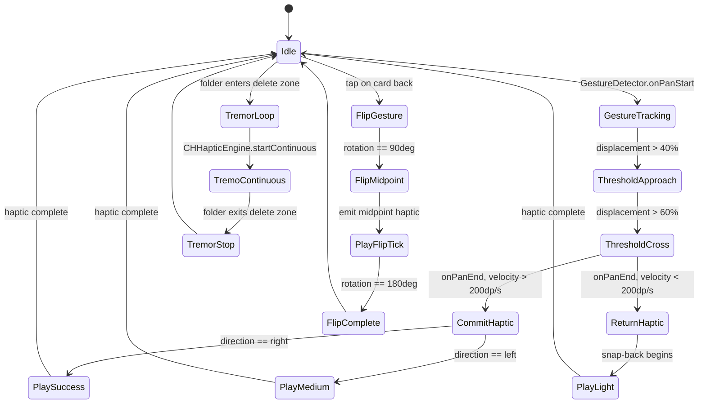

# RES-45: Flutter Haptic Feedback Engineering — Mechanoreceptor Science, Platform APIs, Waveform Design & Application Mapping

> **Parent Hub:** [[Ideas]] | [[Ideas/Future]] | [[Main Work Flow]]
> **Master Concept:** [[Ideas/Future/Memory Card/brain_dump.md|brain_dump.md]] | [[Ideas/Future/Memory Card/research.md|research.md]]
> **Checklist:** [[Ideas/Future/Memory Card/research_check_list.md|research_check_list.md]]
> **Domain:** Domain 4 — Audio Engineering & Tactile Haptic Synthesis
> **Related:** [[Ideas/Future/Memory Card/research/RES-21_Advanced_Haptics_Waveform_Engineering.md|RES-21]] | [[Ideas/Future/Memory Card/research/RES-18_Procedural_Audio_Synthesis_Engine.md|RES-18]] | [[Ideas/Future/Memory Card/research/RES-19_Depth_Scaled_Mechanical_Ticks.md|RES-19]]

---

## Abstract & Core Problem Statement

Haptic feedback is the most underengineered dimension of modern mobile UX. While visual and audio design receive exhaustive attention, haptics are routinely reduced to a single `HapticFeedback.lightImpact()` call — a monolithic API that conceals an enormous expressive surface beneath it. This paper establishes the complete engineering and scientific framework for haptic feedback in Flutter applications, from the biophysics of human mechanoreceptors through to production-grade cross-platform Dart/Swift/Kotlin implementations.

The central problems this paper solves:

1. **Perceptual grounding**: Why do certain vibration frequencies feel pleasant or alarming? What is the neuroscientific basis for choosing a 170 Hz transient over a 40 Hz rumble?
2. **Hardware reality**: iPhone Taptic Engine, Android ERM, and Android LRA are fundamentally different actuators. A single Flutter API call cannot be naive about this.
3. **Expressiveness gap**: Flutter's built-in `HapticFeedback` class exposes 5 methods. Apple's Core Haptics framework exposes infinite parametric space. Android's `VibrationEffect.Composition` exposes 9 named primitives with delay and amplitude control. Bridging this gap requires MethodChannel architecture.
4. **Design grammar**: Haptics must follow semantic rules. A card swipe commitment cannot use the same haptic as a selection change, any more than a warning sound should use a celebration melody.

This research is designed to be **universally reusable** across any Flutter project requiring premium haptic fidelity, not just Memory Card.

---

## 1. Neuroscience & Physiology of Touch — The Scientific Foundation

### 1.1 The Four Classes of Cutaneous Mechanoreceptors

Human glabrous (hairless, palm-side) skin contains four distinct mechanoreceptor populations, each specialized to transduce a specific regime of mechanical stimulus. All four transmit via large-diameter, rapidly-conducting myelinated **Abeta-fibers**, ensuring sub-10ms latency from skin contact to cortical awareness.

```
MECHANORECEPTOR FREQUENCY SENSITIVITY ATLAS

Receptor           Type         Freq. Range   Peak Sensitivity  Perceptual Role
-----------------  -----------  ------------  ----------------  -----------------
Meissner Corps.    FA-I (Fast)  1-50 Hz       30-40 Hz          Flutter, slip,
                   Small RF                                       leading edges
Merkel Discs       SA-I (Slow)  0.3-3 Hz      0.5-2 Hz          Sustained press,
                   Small RF                                       form, texture
Pacinian Corps.    FA-II (Fast) 40-400 Hz     200-300 Hz        Vibration,
                   Large RF                                       impact transients
Ruffini Endings    SA-II (Slow) 0.1-10 Hz     Skin stretch       Proprioception,
                   Large RF                                       skin tension
```

**FA = Fast Adapting** — fire only at stimulus onset/offset (ideal for transient "tap" feelings).
**SA = Slowly Adapting** — fire continuously for sustained pressure (ideal for continuous "rumble" states).
**Small RF = Small Receptive Field** — precise spatial resolution (fingertip discrimination).
**Large RF = Large Receptive Field** — coarse, whole-hand vibration detection.

#### 1.1.1 Meissner Corpuscles (FA-I): The Flutter Detector

Located in dermal papillae ridges, densest in fingertips (~140 per cm²). These are the primary receptors for:
- Leading-edge detection during finger-surface contact initiation.
- Grip adjustment during object manipulation (slip detection at 30-40 Hz).
- "Flutter" sensation — the characteristic feeling of a light, rapid vibration.

**Haptic design implication**: A `lightImpact` event — a card tap, a tick sound accompaniment — maps to FA-I activation. The 30-50 Hz range feels "airy", "fluttery", and non-threatening. iPhone Taptic Engine's "light" preset deliberately activates this receptor class.

#### 1.1.2 Merkel Discs (SA-I): The Form Reader

Mechanoreceptor endings clustered in epidermal ridges. Respond to static indentation; do not adapt over seconds to minutes.

**Haptic design implication**: Merkel activation corresponds to sustained pressure, such as a long-press gesture. The fact that SA-I receptors don't adapt means a sustained vibration at sub-3 Hz will register as "heavy weight" not as "buzzing". This is why long-press menus should use a single sustained thud, not a rapid oscillation.

#### 1.1.3 Pacinian Corpuscles (FA-II): The Vibration Amplifier

Large, onion-like encapsulated endings in deep dermis and subcutaneous tissue. Exquisitely sensitive to sinusoidal vibration at 200-300 Hz — the human finger can detect as little as 0.01 micrometers displacement at 250 Hz. Pacinian corpuscles also transmit vibration from tools held in the hand (extended body haptics).

**Mathematical sensitivity function**: The Pacinian threshold $T_P(f)$ follows a U-shaped psychometric curve:

$$T_P(f) = T_{\min} \cdot \left(\frac{f}{f_0}\right)^{\alpha} \cdot e^{\beta \left(\frac{f}{f_0} - 1\right)^2}$$

Where:
- $T_{\min} \approx 0.01\,\mu m$ (minimum displacement threshold at peak frequency)
- $f_0 \approx 250\,\text{Hz}$ (peak sensitivity frequency)
- $\alpha \approx 0.9$, $\beta \approx 3.2$ (empirical curve shape parameters)

**Haptic design implication**: iPhone LRA resonance at ~170 Hz and standard Android LRA at ~150-200 Hz both fall within the Pacinian response band. This is why "medium" and "heavy" impacts feel so distinctly tactile — they primarily stimulate FA-II receptors which have the lowest displacement threshold of all mechanoreceptor classes.

#### 1.1.4 Ruffini Endings (SA-II): The Skin Stretcher

Spindle-shaped endings oriented parallel to lines of stress, sensitive to lateral skin stretch rather than indentation. They do not respond strongly to direct vibration but encode:
- Skin tension during pinch/spread gestures.
- Proprioceptive feedback during wrist rotation.
- Grip orientation information.

**Haptic design implication**: Standard device vibration does not specifically target SA-II receptors. However, continuous haptics during swipe gestures (where the thumb skin does stretch) engage SA-II in parallel with FA-I/FA-II, creating a more complete proprioceptive signal. This is why continuous haptic tracking during a card drag feels more "realistic" than discrete impacts.

---

### 1.2 Frequency Sensitivity Curves & Perceptual Comfort Ranges

```
Perceived Intensity (arbitrary units)
    ^
10  |                    ***
    |                 ***   ***         Pacinian (FA-II)
 9  |               **         **
    |             **             **
 8  |           **                 **
    |         **                     **
 7  |       **                         *
    |      *                               *
 6  |    **       ***
    |   *       **   **                     Meissner (FA-I)
 5  |  *      **       **
    |  *     *           **
 4  |   *  **               **
    |    **                   **
 3  |                            ***
    |                               ****   SA-I (Merkel)
 2  |
    +--+----+----+----+----+----+----+----+-> Frequency (Hz)
       1   10   30   50  100  200  300  400
```

**Comfort / Valence by frequency band**:

| Frequency Band | Primary Receptor | Emotional Valence | Ideal Use Case |
|---|---|---|---|
| 1-5 Hz | SA-I (Merkel) | Neutral/calming | Long-press hold confirmation |
| 5-30 Hz | SA-I + FA-I transition | Slightly alerting | Folder tremor, caution states |
| 30-50 Hz | FA-I (Meissner) | Pleasant, fluttery | Light taps, selections, ticks |
| 50-100 Hz | FA-I to FA-II | Neutral to positive | Medium impacts, pops |
| 100-200 Hz | FA-II (Pacinian) | Crisp, satisfying | Heavy impacts, thuds, snaps |
| 200-300 Hz | FA-II (peak) | Very crisp, sharp | iPhone transients, clicks |
| 300-400 Hz | FA-II (declining) | Can feel harsh | Avoid unless carefully shaped |

**Overload threshold**: Sustained amplitudes above 1 mm displacement at any frequency in the 50-300 Hz range cause rapid sensory adaptation (the vibration stops being perceptible) and can reach the threshold for mild discomfort after ~500ms. This is the physical reason why "heavy" haptics should be short transients, not sustained buzzes.

---

### 1.3 Perceptual Masking: Audio-Haptic Integration

When haptic feedback is paired with congruent audio feedback, the **perceived intensity of the haptic increases by 20-40%** compared to haptics delivered in isolation. This is a well-documented crossmodal facilitation effect (Ernst & Banks, 2002; Lederman & Klatzky, 2009).

The mechanism: The brain performs Bayesian integration of multisensory signals. When an audio click and a mechanical tap are temporally aligned (<50ms asynchrony) and semantically congruent (both sound like a "click"), the posterior estimate of the event's intensity exceeds the summed individual priors.

**Mathematical model** (Maximum Likelihood Estimation integration):

$$\hat{I}_{AH} = \frac{\sigma_H^{-2} \cdot I_H + \sigma_A^{-2} \cdot I_A}{\sigma_H^{-2} + \sigma_A^{-2}}$$

Where:
- $\hat{I}_{AH}$ = perceived integrated intensity
- $I_H$ = haptic stimulus intensity
- $I_A$ = audio stimulus intensity
- $\sigma_H$, $\sigma_A$ = sensory noise standard deviations

Because audio has very low noise ($\sigma_A \ll \sigma_H$), the audio strongly influences the haptic percept — a quiet audio click makes the haptic feel weaker; a sharp audio transient makes the same haptic feel 30-40% stronger.

**Design consequence**: Every haptic event in Memory Card should be accompanied by a matching audio earcon from RES-18/RES-19. The combined audio+haptic experience is qualitatively superior to either in isolation.

**Temporal alignment window**: Audio-haptic binding is strongest within a ±20ms window. Beyond ±50ms, the percepts begin to separate perceptually. Code implementations should ensure haptic and audio events are dispatched within the same frame or with a pre-programmed sub-20ms offset.

---

### 1.4 Affective Valence: Frequency-Emotion Mapping

Psychophysical research on hedonic valence of vibrotactile stimuli establishes clear preferences:

| Sensation Profile | Frequency/Pattern | Valence | Application |
|---|---|---|---|
| Sharp click, single pulse | 200-300 Hz, <5ms | Positive, confirming | Selection, tap confirmation |
| Soft flutter, brief | 30-50 Hz, 10-20ms | Pleasant, gentle | Light UI interaction |
| Double pop | 150-200 Hz, 2x 8ms, 30ms gap | Satisfying, complete | Toggle states |
| Rising crescendo | 80 to 200 Hz sweep, 200ms | Anticipatory, positive | Unlock, reveal |
| Steady rumble | 40-80 Hz, 300ms+ | Alerting, caution | Warning, tremor |
| Harsh buzz | >300 Hz sustained | Aversive, annoying | Avoid entirely |
| Irregular jitter | Variable timing | Disturbing, biological anxiety | Tremor effects only |

---

## 2. Mobile Haptic Hardware Landscape

### 2.1 Eccentric Rotating Mass (ERM) Actuators

ERM motors contain a small, asymmetrically weighted disc attached to a DC motor shaft. When the motor spins, the off-center mass creates a centripetal force vector that rotates with the disc, producing omnidirectional vibration.

**Physical characteristics**:
- Frequency determined by motor RPM: typically 50-150 Hz operating range
- Cannot be stopped instantaneously — mechanical rotational inertia causes 40-120ms wind-down time
- Asymmetric ramp-up: ~50-80ms to reach full amplitude from rest
- Amplitude controlled by supply voltage (not frequency)
- Power draw: 100-400 mW during operation
- Cost: $0.50-$2.00 USD per unit

**Waveform limitations**:
- Cannot produce sharp transients (minimum duration ~100ms for perceivable output)
- Cannot produce frequency-specific sensations (fixed frequency at full voltage)
- Amplitude-only control (on/off or voltage level)
- "Buzzy" characteristic universally associated with low-end haptics

**Found in**: Budget Android devices (sub-$300 USD), some mid-range Android (<2019 vintage).

**Flutter impact**: On ERM devices, any `HapticFeedback.*` call produces a buzz of roughly similar character. Detailed haptic design is wasted on these devices.

---

### 2.2 Linear Resonant Actuators (LRA)

LRA actuators drive a spring-mass system electromagnetically at its resonant frequency. A voice coil attached to a moving mass oscillates linearly (not rotationally).

**Physical characteristics**:
- Single resonant frequency: typically 150-200 Hz (varies by manufacturer)
- Near-instantaneous start (< 10ms to full amplitude)
- Near-instantaneous stop (< 10ms settle time with proper back-EMF drive)
- Amplitude controlled by voltage magnitude (0-100% scale)
- Power draw: 50-200 mW at peak
- Cost: $2-$15 USD per unit

**Key advantage over ERM**: Sharp attack and decay enable production of truly distinct transient sensations. A 5ms pulse at full amplitude feels like a crisp "click" — impossible with ERM.

**Found in**: Mid-range Android (2019+), high-end Android flagships, all iPhones since 6s (via Taptic Engine variant).

---

### 2.3 Apple Taptic Engine — Generational History

Apple's Taptic Engine is a proprietary LRA implementation with custom signal processing DSP and tuned mechanical compliance, producing significantly more nuanced output than commodity LRAs.

```
APPLE TAPTIC ENGINE — GENERATIONAL SPECIFICATIONS

Generation        Characteristics
----------------  ---------------------------------------------------------------
v1 (iPhone 6s)    First iPhone Taptic Engine (2015). Powers 3D Touch feedback.
                  LRA with basic waveform shaping. No public API beyond
                  UIImpactFeedbackGenerator. ~170 Hz resonance.

v2 (iPhone 7)     Major upgrade (2016). Powers the solid-state Home Button.
                  Larger LRA mass for higher amplitude. Custom ADPCM-encoded
                  waveforms. Introduced the convincing "click" that fooled users
                  into thinking the home button moved mechanically.

v2.5 (iPhone 8)   Force Touch (3D Touch) integration (2017). Continuous
                  force-proportional haptics during press-and-hold gestures.

v3 (iPhone X+)    First to support CoreHaptics framework (iOS 13+, 2017+).
                  Custom AHAP waveform playback. HapticTransient + HapticContinuous
                  event types. ParameterCurve envelope control. Up to 300 Hz
                  waveform update rate from DSP. Intensity & Sharpness parameters
                  map to physical waveform amplitude and center frequency.

v4 (iPhone 14+)   Higher mass displacement, improved power efficiency (2022+).
                  Same API surface. Sub-5ms latency from software command to felt
                  sensation. Used for Dynamic Island interactions.
```

**Technical signal chain**:
```
AHAP JSON -> CHHapticEngine (DSP) -> ADPCM Compression -> LRA Driver IC -> LRA Mass
     ^                                                                           |
  Parameter Curves                                                    Tactile Sensation
  (Intensity, Sharpness)                                           (Meissner/Pacinian activation)
```

The "Sharpness" parameter in CoreHaptics directly controls the frequency content of the waveform. Low sharpness (0.0) -> more energy in the 50-100 Hz range (FA-I activation). High sharpness (1.0) -> more energy in the 200-300 Hz range (FA-II/Pacinian activation).

---

### 2.4 Android Vibrator API Evolution

Android's haptic API has evolved significantly through its version history:

```
ANDROID VIBRATOR API EVOLUTION TIMELINE

API Level  Capability Added
---------  -----------------------------------------------------------------
API 1      Vibrator.vibrate(long milliseconds) — basic on/off duration
API 11     Vibrator.vibrate(long[] pattern, int repeat) — pattern sequences
API 26     VibrationEffect.createOneShot(duration, amplitude) — amplitude 0-255
(Oreo)     VibrationEffect.createWaveform(timings[], amplitudes[], repeat)

API 29     HapticFeedbackConstants: KEYBOARD_PRESS, KEYBOARD_RELEASE added
(Q)

API 30     VibrationEffect.startComposition() -> VibrationEffect.Composition
(R/11)     Named primitives: PRIMITIVE_CLICK, PRIMITIVE_TICK, PRIMITIVE_THUD,
           PRIMITIVE_POP, PRIMITIVE_RISE, PRIMITIVE_SPIN, PRIMITIVE_SLOW_RISE,
           PRIMITIVE_QUICK_RISE, PRIMITIVE_QUICK_FALL
           Each primitive has: scale (0.0-1.0), delay (ms)

API 31     VibratorManager — multi-actuator support (foldables, tablets)
(12)       Vibrator.arePrimitivesSupported() — capability query

API 33     VibrationAttributes for contextual routing (haptic vs ringtone path)

API 34     HapticFeedbackConstants: GESTURE_START, GESTURE_END, DRAG_START,
(14)       SEGMENT_FREQUENT_TICK, SEGMENT_TICK, CONFIRM, REJECT,
           TOGGLE_ON, TOGGLE_OFF — semantic constants for common UI patterns
           View.performHapticFeedback() with FLAG_IGNORE_VIEW_SETTING
```

**Android primitive descriptions** (API 30+ `VibrationEffect.Composition`):

| Primitive | Duration (approx) | Sharpness | Physical Analogy |
|---|---|---|---|
| `PRIMITIVE_CLICK` | ~8ms | High | Mechanical key press |
| `PRIMITIVE_TICK` | ~4ms | Very high | Clock tick, ratchet tooth |
| `PRIMITIVE_THUD` | ~40ms | Low-Medium | Heavy object impact |
| `PRIMITIVE_POP` | ~20ms | Medium | Bubble pop, spring release |
| `PRIMITIVE_RISE` | ~150ms | Low to High | Ascending charge |
| `PRIMITIVE_SPIN` | ~200ms | Medium | Gyroscopic spin sensation |
| `PRIMITIVE_SLOW_RISE` | ~300ms | Low to Medium | Gradual emergence |
| `PRIMITIVE_QUICK_RISE` | ~80ms | Medium to High | Fast ascent |
| `PRIMITIVE_QUICK_FALL` | ~80ms | High to Low | Fast decay |

---

### 2.5 Actuator Comparison Table

| Metric | ERM | LRA (Generic Android) | Apple Taptic Engine (v3+) |
|---|---|---|---|
| Response time (onset) | 50-80ms | 8-15ms | <5ms |
| Stop time | 40-120ms | 5-10ms | <3ms |
| Frequency range | 50-150 Hz (fixed by RPM) | 150-200 Hz (fixed resonance) | 50-300+ Hz (DSP-shaped) |
| Frequency resolution | None (on/off) | None (amplitude only) | High (continuous parameter) |
| Waveform fidelity | Very low | Medium | Very high |
| Amplitude control | Voltage (coarse) | 0-255 scale | 0.0-1.0 continuous |
| Peak power draw | 200-400 mW | 100-200 mW | 80-180 mW |
| Transient capability | None | Moderate | Excellent |
| Continuous capability | Moderate | Limited (single frequency) | Excellent |
| Cost range | $0.50-$2 | $2-$8 | $10-$20 (custom) |

---

## 3. Complete Flutter Haptic API Taxonomy

### 3.1 `HapticFeedback` — The Flutter Standard Library

**Import**: `import 'package:flutter/services.dart';`

This class is the highest-level haptic abstraction in Flutter. It sends platform messages to the native host, which maps them to platform-specific haptic commands.

#### 3.1.1 `HapticFeedback.lightImpact()`

```dart
/// Triggers a haptic response appropriate for a light UI impact.
///
/// iOS: UIImpactFeedbackGenerator(style: .light)
///   -> Taptic Engine produces a brief, low-amplitude waveform
///   -> Primarily activates Meissner Corpuscles (FA-I, 30-50 Hz range)
///
/// Android: HapticFeedbackConstants.VIRTUAL_KEY (API 23+)
///   -> System-defined virtual key press feedback
///   -> On LRA devices: ~8-12ms low-amplitude pulse
///   -> On ERM devices: ~50ms buzz
///
/// Web: Not supported (no-op)
/// Desktop: Not supported (no-op)
///
/// When to use: Subtle UI interactions — selection highlight, card tick,
///              scroll snap position, icon tap.
Future<void> triggerLightImpact() async {
  await HapticFeedback.lightImpact();
}
```

#### 3.1.2 `HapticFeedback.mediumImpact()`

```dart
/// Triggers a haptic response appropriate for a medium UI impact.
///
/// iOS: UIImpactFeedbackGenerator(style: .medium)
///   -> Moderate amplitude, slightly longer duration than light
///   -> Activates FA-I and lower FA-II receptors
///
/// Android: HapticFeedbackConstants.KEYBOARD_TAP (API 27+) or
///          HapticFeedbackConstants.VIRTUAL_KEY_RELEASE (API 27+)
///   -> Typically maps to a medium-duration pulse
///
/// When to use: Standard button presses, card swipe threshold crossings,
///              drag-and-drop pick-up events.
Future<void> triggerMediumImpact() async {
  await HapticFeedback.mediumImpact();
}
```

#### 3.1.3 `HapticFeedback.heavyImpact()`

```dart
/// Triggers a haptic response appropriate for a heavy UI impact.
///
/// iOS: UIImpactFeedbackGenerator(style: .heavy)
///   -> Highest amplitude of the standard impact series
///   -> Strongly activates FA-II (Pacinian) receptors
///   -> Characteristic "thud" sensation
///
/// Android: HapticFeedbackConstants.LONG_PRESS (API 23+)
///   -> System long-press haptic pattern
///   -> On LRA: higher amplitude, longer duration pulse (~30-50ms)
///   -> On ERM: sustained buzz (~150ms)
///
/// When to use: Major destructive actions (delete confirmation),
///              heavy object impact, long-press activation.
Future<void> triggerHeavyImpact() async {
  await HapticFeedback.heavyImpact();
}
```

#### 3.1.4 `HapticFeedback.selectionClick()`

```dart
/// Triggers a haptic response appropriate for a selection change event.
///
/// iOS: UISelectionFeedbackGenerator.selectionChanged()
///   -> Very brief, low-energy pulse distinct from impact family
///   -> Designed to indicate cursor/selection movement
///
/// Android: HapticFeedbackConstants.CLOCK_TICK (API 21+)
///   -> Minimal duration tick sensation
///
/// When to use: Scroll wheel positions, picker value changes,
///              segment control selection, ratchet slots during drag.
///
/// NOT appropriate for: Button presses, confirmations, impacts.
Future<void> triggerSelectionClick() async {
  await HapticFeedback.selectionClick();
}
```

#### 3.1.5 `HapticFeedback.vibrate()`

```dart
/// Triggers a generic device vibration.
///
/// iOS: Uses the standard UIKit vibration method
///   -> Does NOT use Taptic Engine on modern iPhones
///   -> Produces a coarser, less refined sensation
///
/// Android: Vibrator.vibrate(300ms) — simple 300ms on duration
///
/// When to use: RARELY — only as absolute fallback when no other
///              mechanism is available. Semantically meaningless and
///              experientially poor on modern hardware.
///
/// AVOID in production haptic designs. Use platform-specific calls instead.
Future<void> triggerVibrateFallback() async {
  await HapticFeedback.vibrate();
}
```

#### 3.1.6 Complete `HapticFeedback` Capability Matrix

```
METHOD                   iOS       Android    Web    macOS  Windows  Linux
-----------------------  --------  ---------  -----  -----  -------  -----
lightImpact()            Full      Partial    No     No     No       No
mediumImpact()           Full      Partial    No     No     No       No
heavyImpact()            Full      Partial    No     No     No       No
selectionClick()         Full      Partial    No     No     No       No
vibrate()                Coarse    Basic      No     No     No       No

Full    = Platform-native high-quality haptic
Partial = Works but quality varies by device
Coarse  = Works but lower quality than native alternatives
No      = No-op or not supported
```

---

### 3.2 iOS UIKit Feedback Generators (via MethodChannel)

Flutter's `HapticFeedback` class only exposes a subset of UIKit's haptic generators. To access the full surface, use a `MethodChannel` bridge.

#### 3.2.1 All UIKit Haptic Generator Styles

**iOS 13+ Impact Styles** (5 styles total):
- `.light` — Low mass, short duration
- `.medium` — Medium mass, medium duration
- `.heavy` — High mass, long duration
- `.soft` — Low mass with soft envelope (new in iOS 13)
- `.rigid` — High mass with rigid, sharp envelope (new in iOS 13)

**.soft vs .rigid distinction**:
- `.soft` -> primarily activates FA-I (Meissner) — feels gentle, organic
- `.rigid` -> primarily activates FA-II (Pacinian) — feels crisp, mechanical

**iOS Notification Generator** (3 types):
- `.success` — Two-part ascending haptic (positive reinforcement pattern)
- `.warning` — Medium impact followed by lighter secondary pulse
- `.error` — Three rapid descending pulses (biological "wrong" signal)

**iOS Selection Generator**:
- `selectionChanged()` — Single ultra-brief tick (cursor movement sensation)

#### 3.2.2 Complete Dart MethodChannel Client

```dart
// lib/services/haptic/ios_haptic_bridge.dart

import 'package:flutter/services.dart';

/// iOS-specific haptic bridge providing access to UIKit feedback generators
/// beyond what Flutter's HapticFeedback class exposes.
///
/// Requirements: iOS 13.0+ for .soft, .rigid styles.
/// iOS 10.0+ for basic UIImpactFeedbackGenerator.
class IOSHapticBridge {
  static const MethodChannel _channel = MethodChannel(
    'com.memorycard.app/ios_haptics',
  );

  // UIImpactFeedbackGenerator

  /// Light impact — primarily FA-I (Meissner) activation.
  /// Use for: light taps, ticks, gentle selections.
  static Future<void> impactLight() async {
    await _invokeHaptic('impact', {'style': 'light'});
  }

  /// Medium impact — FA-I + lower FA-II activation.
  /// Use for: card swipe threshold, button presses, standard interactions.
  static Future<void> impactMedium() async {
    await _invokeHaptic('impact', {'style': 'medium'});
  }

  /// Heavy impact — strong FA-II (Pacinian) activation.
  /// Use for: major actions, long-press confirmations, deletion.
  static Future<void> impactHeavy() async {
    await _invokeHaptic('impact', {'style': 'heavy'});
  }

  /// Soft impact (iOS 13+) — gentle, organic, low sharpness.
  /// Use for: cloze reveal, ink-stamp sensation, gentle overlay appearance.
  static Future<void> impactSoft() async {
    await _invokeHaptic('impact', {'style': 'soft'});
  }

  /// Rigid impact (iOS 13+) — sharp, mechanical, high sharpness.
  /// Use for: physical snap, lock engagement, hardware click simulation.
  static Future<void> impactRigid() async {
    await _invokeHaptic('impact', {'style': 'rigid'});
  }

  // UINotificationFeedbackGenerator

  /// Success notification — ascending two-part positive haptic.
  /// Use for: card mastered (right swipe commit), task completion,
  ///          deck graduation.
  static Future<void> notifySuccess() async {
    await _invokeHaptic('notification', {'type': 'success'});
  }

  /// Warning notification — medium + secondary pulse.
  /// Use for: caution states, folder deletion mode activation.
  static Future<void> notifyWarning() async {
    await _invokeHaptic('notification', {'type': 'warning'});
  }

  /// Error notification — three descending pulses (biological "wrong" signal).
  /// Use for: sync failure, deletion failure, wrong answer feedback.
  static Future<void> notifyError() async {
    await _invokeHaptic('notification', {'type': 'error'});
  }

  // UISelectionFeedbackGenerator

  /// Selection changed — ultra-brief tick for discrete value changes.
  /// Use for: picker rows, scroll wheel positions, folder slot ratchet.
  static Future<void> selectionChanged() async {
    await _invokeHaptic('selection', {});
  }

  static Future<void> _invokeHaptic(
    String method,
    Map<String, dynamic> args,
  ) async {
    try {
      await _channel.invokeMethod(method, args);
    } on PlatformException catch (e) {
      // Gracefully degrade — haptic failure should never crash the app
      debugPrint('[IOSHapticBridge] Haptic failed: ${e.message}');
    } on MissingPluginException {
      // Running on non-iOS platform or simulator — silent no-op
    }
  }
}
```

#### 3.2.3 Complete Swift Native Implementation

```swift
// ios/Runner/HapticPlugin.swift

import Flutter
import UIKit

@available(iOS 13.0, *)
class HapticPlugin: NSObject, FlutterPlugin {

  static func register(with registrar: FlutterPluginRegistrar) {
    let channel = FlutterMethodChannel(
      name: "com.memorycard.app/ios_haptics",
      binaryMessenger: registrar.messenger()
    )
    let instance = HapticPlugin()
    registrar.addMethodCallDelegate(instance, channel: channel)
  }

  // Pre-warm generators to avoid first-call latency (~50ms savings per call)
  private lazy var lightGenerator: UIImpactFeedbackGenerator = {
    let gen = UIImpactFeedbackGenerator(style: .light)
    gen.prepare()
    return gen
  }()

  private lazy var mediumGenerator: UIImpactFeedbackGenerator = {
    let gen = UIImpactFeedbackGenerator(style: .medium)
    gen.prepare()
    return gen
  }()

  private lazy var heavyGenerator: UIImpactFeedbackGenerator = {
    let gen = UIImpactFeedbackGenerator(style: .heavy)
    gen.prepare()
    return gen
  }()

  private lazy var softGenerator: UIImpactFeedbackGenerator = {
    let gen = UIImpactFeedbackGenerator(style: .soft)
    gen.prepare()
    return gen
  }()

  private lazy var rigidGenerator: UIImpactFeedbackGenerator = {
    let gen = UIImpactFeedbackGenerator(style: .rigid)
    gen.prepare()
    return gen
  }()

  private lazy var notificationGenerator: UINotificationFeedbackGenerator = {
    let gen = UINotificationFeedbackGenerator()
    gen.prepare()
    return gen
  }()

  private lazy var selectionGenerator: UISelectionFeedbackGenerator = {
    let gen = UISelectionFeedbackGenerator()
    gen.prepare()
    return gen
  }()

  func handle(_ call: FlutterMethodCall, result: @escaping FlutterResult) {
    let args = call.arguments as? [String: Any]

    switch call.method {
    case "impact":
      handleImpact(style: args?["style"] as? String ?? "medium")
    case "notification":
      handleNotification(type: args?["type"] as? String ?? "success")
    case "selection":
      selectionGenerator.selectionChanged()
      selectionGenerator.prepare() // Re-warm for next call
    default:
      result(FlutterMethodNotImplemented)
      return
    }
    result(nil)
  }

  private func handleImpact(style: String) {
    switch style {
    case "light":
      lightGenerator.impactOccurred()
      lightGenerator.prepare()
    case "medium":
      mediumGenerator.impactOccurred()
      mediumGenerator.prepare()
    case "heavy":
      heavyGenerator.impactOccurred()
      heavyGenerator.prepare()
    case "soft":
      softGenerator.impactOccurred()
      softGenerator.prepare()
    case "rigid":
      rigidGenerator.impactOccurred()
      rigidGenerator.prepare()
    default:
      mediumGenerator.impactOccurred()
    }
  }

  private func handleNotification(type: String) {
    switch type {
    case "success":
      notificationGenerator.notificationOccurred(.success)
    case "warning":
      notificationGenerator.notificationOccurred(.warning)
    case "error":
      notificationGenerator.notificationOccurred(.error)
    default:
      notificationGenerator.notificationOccurred(.success)
    }
    notificationGenerator.prepare()
  }
}
```

**Critical optimization note**: `UIImpactFeedbackGenerator.prepare()` must be called before every use (or re-called after an `impactOccurred()`) to pre-warm the Taptic Engine hardware. Without this, the first call after any idle period has ~50ms additional latency — unacceptable for gesture-synchronous haptics.

---

### 3.3 Android VibrationEffect API (via MethodChannel)

#### 3.3.1 Complete Dart Client for Android Haptics

```dart
// lib/services/haptic/android_haptic_bridge.dart

import 'package:flutter/services.dart';

/// Android-specific haptic bridge providing access to VibrationEffect APIs
/// beyond what Flutter's HapticFeedback class exposes.
///
/// Requirements:
///   - VibrationEffect.createOneShot: Android API 26+ (Oreo)
///   - VibrationEffect.createWaveform: Android API 26+
///   - VibrationEffect.Composition: Android API 30+ (R/Android 11)
///   - Primitive support check: Android API 31+
class AndroidHapticBridge {
  static const MethodChannel _channel = MethodChannel(
    'com.memorycard.app/android_haptics',
  );

  // VibrationEffect.Composition Primitives (API 30+)

  /// Play a single PRIMITIVE_CLICK effect.
  /// ~8ms, high sharpness. Mechanical key press analog.
  static Future<void> click({double scale = 1.0}) async {
    await _invokeAndroid('primitive', {
      'primitive': 'CLICK',
      'scale': scale,
      'delay': 0,
    });
  }

  /// Play a single PRIMITIVE_TICK effect.
  /// ~4ms, very high sharpness. Ratchet/clock tick analog.
  static Future<void> tick({double scale = 0.8}) async {
    await _invokeAndroid('primitive', {
      'primitive': 'TICK',
      'scale': scale,
      'delay': 0,
    });
  }

  /// Play a single PRIMITIVE_THUD effect.
  /// ~40ms, low sharpness. Heavy impact analog.
  static Future<void> thud({double scale = 1.0}) async {
    await _invokeAndroid('primitive', {
      'primitive': 'THUD',
      'scale': scale,
      'delay': 0,
    });
  }

  /// Play a single PRIMITIVE_POP effect.
  /// ~20ms, medium sharpness. Spring release / bubble pop analog.
  static Future<void> pop({double scale = 1.0}) async {
    await _invokeAndroid('primitive', {
      'primitive': 'POP',
      'scale': scale,
      'delay': 0,
    });
  }

  /// Play a composition of multiple primitives with custom delays and scales.
  ///
  /// [primitives] is a list of maps with keys:
  ///   'primitive': String — CLICK, TICK, THUD, POP, RISE, SPIN,
  ///                         SLOW_RISE, QUICK_RISE, QUICK_FALL
  ///   'scale': double — 0.0 to 1.0 amplitude scale
  ///   'delay': int — delay in milliseconds before this primitive plays
  ///
  /// Example — card swipe commit (mastered):
  ///   playComposition([
  ///     {'primitive': 'POP', 'scale': 0.8, 'delay': 0},
  ///     {'primitive': 'QUICK_FALL', 'scale': 0.5, 'delay': 40},
  ///   ]);
  static Future<void> playComposition(
    List<Map<String, dynamic>> primitives,
  ) async {
    await _invokeAndroid('composition', {'primitives': primitives});
  }

  // VibrationEffect.createOneShot (API 26+)

  /// Play a single shot vibration with explicit duration and amplitude.
  ///
  /// [durationMs] — vibration duration in milliseconds.
  /// [amplitude] — 0-255 amplitude scale (255 = device default amplitude).
  static Future<void> oneShot({
    required int durationMs,
    int amplitude = 255,
  }) async {
    await _invokeAndroid('oneShot', {
      'duration': durationMs,
      'amplitude': amplitude,
    });
  }

  // VibrationEffect.createWaveform (API 26+)

  /// Play a waveform pattern with explicit timings and amplitudes.
  ///
  /// [timings] — alternating off/on durations in ms (starts with OFF).
  ///   Example: [0, 10, 30, 20] means:
  ///     0ms off -> 10ms on -> 30ms off -> 20ms on
  ///
  /// [amplitudes] — amplitude for each timing segment (0-255).
  ///   Must be same length as timings.
  ///
  /// [repeat] — index to loop from, or -1 for no repeat.
  ///
  /// Example — folder tremor:
  ///   waveform(
  ///     timings:    [0, 30, 20, 30, 20, 30],
  ///     amplitudes: [0, 180, 0, 120, 0, 100],
  ///     repeat: -1,
  ///   );
  static Future<void> waveform({
    required List<int> timings,
    required List<int> amplitudes,
    int repeat = -1,
  }) async {
    await _invokeAndroid('waveform', {
      'timings': timings,
      'amplitudes': amplitudes,
      'repeat': repeat,
    });
  }

  /// Cancel any currently playing vibration.
  static Future<void> cancel() async {
    await _invokeAndroid('cancel', {});
  }

  static Future<void> _invokeAndroid(
    String method,
    Map<String, dynamic> args,
  ) async {
    try {
      await _channel.invokeMethod(method, args);
    } on PlatformException catch (e) {
      debugPrint('[AndroidHapticBridge] Haptic failed: ${e.message}');
    } on MissingPluginException {
      // Running on non-Android platform — silent no-op
    }
  }
}
```

#### 3.3.2 Complete Kotlin Native Implementation

```kotlin
// android/app/src/main/kotlin/com/memorycard/app/HapticPlugin.kt

package com.memorycard.app

import android.content.Context
import android.os.Build
import android.os.VibrationEffect
import android.os.Vibrator
import android.os.VibratorManager
import io.flutter.embedding.engine.plugins.FlutterPlugin
import io.flutter.plugin.common.MethodCall
import io.flutter.plugin.common.MethodChannel

class HapticPlugin : FlutterPlugin, MethodChannel.MethodCallHandler {

    private lateinit var channel: MethodChannel
    private lateinit var context: Context

    override fun onAttachedToEngine(binding: FlutterPlugin.FlutterPluginBinding) {
        context = binding.applicationContext
        channel = MethodChannel(
            binding.binaryMessenger,
            "com.memorycard.app/android_haptics"
        )
        channel.setMethodCallHandler(this)
    }

    override fun onDetachedFromEngine(binding: FlutterPlugin.FlutterPluginBinding) {
        channel.setMethodCallHandler(null)
    }

    override fun onMethodCall(call: MethodCall, result: MethodChannel.Result) {
        when (call.method) {
            "primitive"   -> handlePrimitive(call, result)
            "composition" -> handleComposition(call, result)
            "oneShot"     -> handleOneShot(call, result)
            "waveform"    -> handleWaveform(call, result)
            "cancel"      -> handleCancel(result)
            else          -> result.notImplemented()
        }
    }

    private fun getVibrator(): Vibrator {
        return if (Build.VERSION.SDK_INT >= Build.VERSION_CODES.S) {
            val manager = context.getSystemService(Context.VIBRATOR_MANAGER_SERVICE) as VibratorManager
            manager.defaultVibrator
        } else {
            @Suppress("DEPRECATION")
            context.getSystemService(Context.VIBRATOR_SERVICE) as Vibrator
        }
    }

    private fun primitiveConstant(name: String): Int {
        return when (name) {
            "CLICK"      -> VibrationEffect.Composition.PRIMITIVE_CLICK
            "TICK"       -> VibrationEffect.Composition.PRIMITIVE_TICK
            "THUD"       -> VibrationEffect.Composition.PRIMITIVE_THUD
            "POP"        -> VibrationEffect.Composition.PRIMITIVE_POP
            "RISE"       -> VibrationEffect.Composition.PRIMITIVE_RISE
            "SPIN"       -> VibrationEffect.Composition.PRIMITIVE_SPIN
            "SLOW_RISE"  -> VibrationEffect.Composition.PRIMITIVE_SLOW_RISE
            "QUICK_RISE" -> VibrationEffect.Composition.PRIMITIVE_QUICK_RISE
            "QUICK_FALL" -> VibrationEffect.Composition.PRIMITIVE_QUICK_FALL
            else         -> VibrationEffect.Composition.PRIMITIVE_CLICK
        }
    }

    private fun handlePrimitive(call: MethodCall, result: MethodChannel.Result) {
        if (Build.VERSION.SDK_INT < Build.VERSION_CODES.R) {
            legacyShortVibrate()
            result.success(null)
            return
        }

        val primitive = call.argument<String>("primitive") ?: "CLICK"
        val scale     = call.argument<Double>("scale")?.toFloat() ?: 1.0f
        val delay     = call.argument<Int>("delay") ?: 0

        val vibrator = getVibrator()
        if (!vibrator.arePrimitivesSupported(primitiveConstant(primitive))[0]) {
            legacyShortVibrate()
            result.success(null)
            return
        }

        val effect = VibrationEffect.startComposition()
            .addPrimitive(primitiveConstant(primitive), scale, delay)
            .compose()
        vibrator.vibrate(effect)
        result.success(null)
    }

    private fun handleComposition(call: MethodCall, result: MethodChannel.Result) {
        if (Build.VERSION.SDK_INT < Build.VERSION_CODES.R) {
            legacyShortVibrate()
            result.success(null)
            return
        }

        @Suppress("UNCHECKED_CAST")
        val primitives = call.argument<List<Map<String, Any>>>("primitives") ?: emptyList()

        val vibrator = getVibrator()
        var composition = VibrationEffect.startComposition()

        for (prim in primitives) {
            val name  = prim["primitive"] as? String ?: continue
            val scale = (prim["scale"] as? Double)?.toFloat() ?: 1.0f
            val delay = (prim["delay"] as? Int) ?: 0
            val constant = primitiveConstant(name)

            if (vibrator.arePrimitivesSupported(constant)[0]) {
                composition = composition.addPrimitive(constant, scale, delay)
            }
        }

        try {
            val effect = composition.compose()
            vibrator.vibrate(effect)
        } catch (e: IllegalStateException) {
            legacyShortVibrate()
        }
        result.success(null)
    }

    private fun handleOneShot(call: MethodCall, result: MethodChannel.Result) {
        if (Build.VERSION.SDK_INT < Build.VERSION_CODES.O) {
            legacyShortVibrate()
            result.success(null)
            return
        }

        val duration  = call.argument<Int>("duration")?.toLong() ?: 50L
        val amplitude = call.argument<Int>("amplitude") ?: VibrationEffect.DEFAULT_AMPLITUDE

        val effect = VibrationEffect.createOneShot(duration, amplitude)
        getVibrator().vibrate(effect)
        result.success(null)
    }

    private fun handleWaveform(call: MethodCall, result: MethodChannel.Result) {
        if (Build.VERSION.SDK_INT < Build.VERSION_CODES.O) {
            legacyShortVibrate()
            result.success(null)
            return
        }

        @Suppress("UNCHECKED_CAST")
        val timingsList    = call.argument<List<Int>>("timings") ?: listOf(0, 100)
        val amplitudesList = call.argument<List<Int>>("amplitudes") ?: listOf(0, 255)
        val repeat         = call.argument<Int>("repeat") ?: -1

        val timings    = timingsList.map { it.toLong() }.toLongArray()
        val amplitudes = amplitudesList.toIntArray()

        val effect = VibrationEffect.createWaveform(timings, amplitudes, repeat)
        getVibrator().vibrate(effect)
        result.success(null)
    }

    private fun handleCancel(result: MethodChannel.Result) {
        getVibrator().cancel()
        result.success(null)
    }

    @Suppress("DEPRECATION")
    private fun legacyShortVibrate() {
        if (Build.VERSION.SDK_INT >= Build.VERSION_CODES.O) {
            getVibrator().vibrate(
                VibrationEffect.createOneShot(50, VibrationEffect.DEFAULT_AMPLITUDE)
            )
        } else {
            getVibrator().vibrate(50)
        }
    }
}
```

---

### 3.4 Apple Core Haptics / CHHapticEngine (iOS 13+, via MethodChannel)

Core Haptics is the most powerful haptic API available on any consumer mobile platform. It provides:
- **HapticTransient**: Single instantaneous event (tap/click)
- **HapticContinuous**: Duration-specified sustained vibration with envelope
- **ParameterCurve**: Time-varying parameter envelopes (intensity fade, sharpness modulation)
- **AudioCustom**: Synchronized haptic + audio from the same file

#### 3.4.1 AHAP (Apple Haptic and Audio Pattern) Format Reference

AHAP files are JSON documents. Key schema elements:

**Event types**:
- `HapticTransient` — instantaneous point-in-time haptic event
- `HapticContinuous` — sustained haptic event with EventDuration
- `AudioCustom` — plays audio file; can synchronize with haptic events

**EventParameters**:
- `HapticIntensity` (0.0-1.0) — amplitude of the haptic
- `HapticSharpness` (0.0-1.0) — frequency content (0=low/thud, 1=high/click)

**ParameterCurve** (time-varying control):
- `HapticIntensityControl` — scales intensity over time
- `HapticSharpnessControl` — scales sharpness over time
- `AttackTimeControl`, `DecayTimeControl`, `ReleaseTimeControl` — envelope shape

#### 3.4.2 Complete Card Swipe + Snap AHAP Pattern

This pattern models the physical sensation of a flashcard leaving your hand (swipe track) and snapping into the "accepted" position:

```json
{
  "Version": 1.0,
  "Metadata": {
    "Project": "Memory Card",
    "Description": "Card swipe commit — right swipe mastered (card release + snap)"
  },
  "Pattern": [
    {
      "Event": {
        "Time": 0.0,
        "EventType": "HapticContinuous",
        "EventDuration": 0.18,
        "EventParameters": [
          { "ParameterID": "HapticIntensity", "ParameterValue": 0.45 },
          { "ParameterID": "HapticSharpness", "ParameterValue": 0.2 }
        ]
      }
    },
    {
      "ParameterCurve": {
        "ParameterID": "HapticIntensityControl",
        "Time": 0.0,
        "ParameterCurveControlPoints": [
          { "Time": 0.0,  "ParameterValue": 0.3 },
          { "Time": 0.08, "ParameterValue": 0.7 },
          { "Time": 0.18, "ParameterValue": 0.0 }
        ]
      }
    },
    {
      "ParameterCurve": {
        "ParameterID": "HapticSharpnessControl",
        "Time": 0.0,
        "ParameterCurveControlPoints": [
          { "Time": 0.0,  "ParameterValue": 0.1 },
          { "Time": 0.18, "ParameterValue": 0.6 }
        ]
      }
    },
    {
      "Event": {
        "Time": 0.19,
        "EventType": "HapticTransient",
        "EventParameters": [
          { "ParameterID": "HapticIntensity", "ParameterValue": 1.0 },
          { "ParameterID": "HapticSharpness", "ParameterValue": 0.7 }
        ]
      }
    },
    {
      "Event": {
        "Time": 0.24,
        "EventType": "HapticTransient",
        "EventParameters": [
          { "ParameterID": "HapticIntensity", "ParameterValue": 0.35 },
          { "ParameterID": "HapticSharpness", "ParameterValue": 0.5 }
        ]
      }
    }
  ]
}
```

**Pattern narrative**: 0-180ms rising continuous rumble (card acceleration through air, FA-I activation) -> sharp transient at 190ms (snap/commit impact, FA-II peak) -> soft echo at 240ms (rebound settling). This creates a complete physical story: card gliding -> landing -> settling.

#### 3.4.3 Deck Graduation / Wax Seal Crescendo AHAP Pattern

```json
{
  "Version": 1.0,
  "Metadata": {
    "Project": "Memory Card",
    "Description": "Deck graduation — wax seal triumph crescendo (400ms)"
  },
  "Pattern": [
    {
      "Event": {
        "Time": 0.0,
        "EventType": "HapticContinuous",
        "EventDuration": 0.38,
        "EventParameters": [
          { "ParameterID": "HapticIntensity", "ParameterValue": 0.3 },
          { "ParameterID": "HapticSharpness", "ParameterValue": 0.1 }
        ]
      }
    },
    {
      "ParameterCurve": {
        "ParameterID": "HapticIntensityControl",
        "Time": 0.0,
        "ParameterCurveControlPoints": [
          { "Time": 0.0,  "ParameterValue": 0.1 },
          { "Time": 0.1,  "ParameterValue": 0.25 },
          { "Time": 0.2,  "ParameterValue": 0.5 },
          { "Time": 0.32, "ParameterValue": 0.85 },
          { "Time": 0.38, "ParameterValue": 0.0 }
        ]
      }
    },
    {
      "ParameterCurve": {
        "ParameterID": "HapticSharpnessControl",
        "Time": 0.0,
        "ParameterCurveControlPoints": [
          { "Time": 0.0,  "ParameterValue": 0.1 },
          { "Time": 0.38, "ParameterValue": 0.8 }
        ]
      }
    },
    {
      "Event": {
        "Time": 0.38,
        "EventType": "HapticTransient",
        "EventParameters": [
          { "ParameterID": "HapticIntensity", "ParameterValue": 1.0 },
          { "ParameterID": "HapticSharpness", "ParameterValue": 0.85 }
        ]
      }
    }
  ]
}
```

#### 3.4.4 Session Complete Triumph AHAP Pattern

```json
{
  "Version": 1.0,
  "Metadata": {
    "Project": "Memory Card",
    "Description": "Session complete — triumph sequence synced to confetti burst (700ms)"
  },
  "Pattern": [
    {
      "Event": {
        "Time": 0.0,
        "EventType": "HapticTransient",
        "EventParameters": [
          { "ParameterID": "HapticIntensity", "ParameterValue": 0.5 },
          { "ParameterID": "HapticSharpness", "ParameterValue": 0.5 }
        ]
      }
    },
    {
      "Event": {
        "Time": 0.1,
        "EventType": "HapticContinuous",
        "EventDuration": 0.25,
        "EventParameters": [
          { "ParameterID": "HapticIntensity", "ParameterValue": 0.4 },
          { "ParameterID": "HapticSharpness", "ParameterValue": 0.15 }
        ]
      }
    },
    {
      "Event": {
        "Time": 0.38,
        "EventType": "HapticTransient",
        "EventParameters": [
          { "ParameterID": "HapticIntensity", "ParameterValue": 0.75 },
          { "ParameterID": "HapticSharpness", "ParameterValue": 0.65 }
        ]
      }
    },
    {
      "Event": {
        "Time": 0.45,
        "EventType": "HapticTransient",
        "EventParameters": [
          { "ParameterID": "HapticIntensity", "ParameterValue": 0.85 },
          { "ParameterID": "HapticSharpness", "ParameterValue": 0.75 }
        ]
      }
    },
    {
      "Event": {
        "Time": 0.53,
        "EventType": "HapticTransient",
        "EventParameters": [
          { "ParameterID": "HapticIntensity", "ParameterValue": 1.0 },
          { "ParameterID": "HapticSharpness", "ParameterValue": 0.9 }
        ]
      }
    }
  ]
}
```

#### 3.4.5 Complete Swift CHHapticEngine Bridge

```swift
// ios/Runner/CoreHapticsPlugin.swift

import Flutter
import CoreHaptics

@available(iOS 13.0, *)
class CoreHapticsPlugin: NSObject, FlutterPlugin {

  private var engine: CHHapticEngine?
  private var engineReady = false

  static func register(with registrar: FlutterPluginRegistrar) {
    let channel = FlutterMethodChannel(
      name: "com.memorycard.app/core_haptics",
      binaryMessenger: registrar.messenger()
    )
    let instance = CoreHapticsPlugin()
    registrar.addMethodCallDelegate(instance, channel: channel)
    instance.initializeEngine()
  }

  private func initializeEngine() {
    guard CHHapticEngine.capabilitiesForHardware().supportsHaptics else {
      print("[CoreHaptics] Device does not support haptics")
      return
    }

    do {
      engine = try CHHapticEngine()
      engine?.stoppedHandler = { [weak self] reason in
        print("[CoreHaptics] Engine stopped: \(reason)")
        self?.engineReady = false
      }
      engine?.resetHandler = { [weak self] in
        print("[CoreHaptics] Engine reset, restarting...")
        try? self?.engine?.start()
        self?.engineReady = true
      }
      try engine?.start()
      engineReady = true
    } catch {
      print("[CoreHaptics] Engine initialization failed: \(error)")
    }
  }

  private func ensureEngineRunning() throws {
    guard let engine = engine else { throw HapticError.engineNotAvailable }
    if !engineReady {
      try engine.start()
      engineReady = true
    }
  }

  func handle(_ call: FlutterMethodCall, result: @escaping FlutterResult) {
    guard CHHapticEngine.capabilitiesForHardware().supportsHaptics else {
      result(nil) // Graceful no-op on non-haptic hardware
      return
    }

    let args = call.arguments as? [String: Any]

    do {
      switch call.method {
      case "playAHAP":
        let ahapString = args?["ahap"] as? String ?? ""
        try playAHAPFromString(ahapString)
      case "playAHAPFile":
        let fileName = args?["fileName"] as? String ?? ""
        try playAHAPFile(named: fileName)
      case "playTransient":
        let intensity = (args?["intensity"] as? Double).map { Float($0) } ?? 1.0
        let sharpness = (args?["sharpness"] as? Double).map { Float($0) } ?? 0.5
        try playTransient(intensity: intensity, sharpness: sharpness)
      case "playContinuous":
        let intensity = (args?["intensity"] as? Double).map { Float($0) } ?? 0.5
        let sharpness = (args?["sharpness"] as? Double).map { Float($0) } ?? 0.3
        let duration  = (args?["duration"] as? Double) ?? 0.3
        try playContinuous(intensity: intensity, sharpness: sharpness, duration: duration)
      case "stop":
        engine?.stop(completionHandler: nil)
        engineReady = false
      default:
        result(FlutterMethodNotImplemented)
        return
      }
      result(nil)
    } catch {
      print("[CoreHaptics] Playback error: \(error)")
      result(nil) // Never throw back to Flutter — graceful degradation
    }
  }

  private func playAHAPFromString(_ ahapString: String) throws {
    try ensureEngineRunning()
    guard let data = ahapString.data(using: .utf8),
          let json = try JSONSerialization.jsonObject(with: data) as? [String: Any]
    else { throw HapticError.invalidPattern }

    let pattern = try CHHapticPattern(dictionary: json)
    let player  = try engine?.makePlayer(with: pattern)
    try player?.start(atTime: CHHapticTimeImmediate)
  }

  private func playAHAPFile(named fileName: String) throws {
    try ensureEngineRunning()
    guard let url = Bundle.main.url(forResource: fileName, withExtension: "ahap")
    else { throw HapticError.fileNotFound }

    try engine?.playPattern(from: url)
  }

  private func playTransient(intensity: Float, sharpness: Float) throws {
    try ensureEngineRunning()
    let event = CHHapticEvent(
      eventType: .hapticTransient,
      parameters: [
        CHHapticEventParameter(parameterID: .hapticIntensity, value: intensity),
        CHHapticEventParameter(parameterID: .hapticSharpness, value: sharpness),
      ],
      relativeTime: 0
    )
    let pattern = try CHHapticPattern(events: [event], parameters: [])
    let player  = try engine?.makePlayer(with: pattern)
    try player?.start(atTime: CHHapticTimeImmediate)
  }

  private func playContinuous(
    intensity: Float,
    sharpness: Float,
    duration: Double
  ) throws {
    try ensureEngineRunning()
    let event = CHHapticEvent(
      eventType: .hapticContinuous,
      parameters: [
        CHHapticEventParameter(parameterID: .hapticIntensity, value: intensity),
        CHHapticEventParameter(parameterID: .hapticSharpness, value: sharpness),
      ],
      relativeTime: 0,
      duration: duration
    )
    let pattern = try CHHapticPattern(events: [event], parameters: [])
    let player  = try engine?.makePlayer(with: pattern)
    try player?.start(atTime: CHHapticTimeImmediate)
  }

  enum HapticError: Error {
    case engineNotAvailable
    case invalidPattern
    case fileNotFound
  }
}
```

#### 3.4.6 Dart Core Haptics Client

```dart
// lib/services/haptic/core_haptics_bridge.dart

import 'package:flutter/services.dart';

/// Bridge to Apple CoreHaptics (CHHapticEngine) for iOS 13+.
/// Enables custom AHAP waveform playback and parametric haptic events.
class CoreHapticsBridge {
  static const MethodChannel _channel = MethodChannel(
    'com.memorycard.app/core_haptics',
  );

  /// Play a haptic pattern defined by an AHAP JSON string.
  static Future<void> playAHAP(String ahapJson) async {
    await _invoke('playAHAP', {'ahap': ahapJson});
  }

  /// Play a haptic pattern from a named AHAP file in the iOS bundle.
  /// File must exist at ios/Runner/[fileName].ahap
  static Future<void> playAHAPFile(String fileName) async {
    await _invoke('playAHAPFile', {'fileName': fileName});
  }

  /// Play a single transient haptic event (instantaneous tap).
  /// [intensity] 0.0-1.0 | [sharpness] 0.0 (thud) to 1.0 (click)
  static Future<void> playTransient({
    double intensity = 1.0,
    double sharpness = 0.5,
  }) async {
    await _invoke('playTransient', {
      'intensity': intensity,
      'sharpness': sharpness,
    });
  }

  /// Play a continuous haptic event with a given duration.
  static Future<void> playContinuous({
    double intensity = 0.5,
    double sharpness = 0.3,
    double duration = 0.3,
  }) async {
    await _invoke('playContinuous', {
      'intensity': intensity,
      'sharpness': sharpness,
      'duration': duration,
    });
  }

  /// Stop any currently playing Core Haptics pattern.
  static Future<void> stop() async {
    await _invoke('stop', {});
  }

  static Future<void> _invoke(
    String method,
    Map<String, dynamic> args,
  ) async {
    try {
      await _channel.invokeMethod(method, args);
    } on PlatformException catch (e) {
      debugPrint('[CoreHapticsBridge] ${e.message}');
    } on MissingPluginException {
      // Not running on iOS or simulator — silent no-op
    }
  }
}
```

---

### 3.5 Third-Party Flutter Packages

#### 3.5.1 `haptic_feedback` Package

**pub.dev**: `haptic_feedback: ^0.x.x`

**What it provides**:
- Semantic API: `HapticFeedback.light()`, `.medium()`, `.heavy()`, `.success()`, `.warning()`, `.error()`, `.selection()`
- iOS: Maps directly to UIKit feedback generators
- Android (API 30+): Uses `VibrationEffect.Composition` — better LRA fidelity than Flutter stdlib
- Layered fallback: `Composition` -> `createOneShot` -> `HapticFeedbackConstants`

**Pros**: Semantic alignment, better Android LRA fidelity, no platform channel boilerplate required.

**Cons**: No AHAP support, no custom waveform authoring, no `Composition` custom sequences, cannot implement crescendo/tremor patterns.

**Assessment**: Use `haptic_feedback` as the fallback layer in a layered HapticService. Do **not** use as primary mechanism for sophisticated interactions.

#### 3.5.2 Package vs Raw Platform Channels Decision Matrix

| Scenario | Recommendation |
|---|---|
| Simple light/medium/heavy impacts | `haptic_feedback` package or `HapticFeedback.*` |
| Notification-type semantics | `haptic_feedback` package |
| Custom AHAP waveforms (iOS) | Raw MethodChannel + CoreHapticsPlugin |
| `VibrationEffect.Composition` sequences (Android) | Raw MethodChannel + HapticPlugin |
| Continuous haptics during gesture tracking | Raw MethodChannel only |
| Cross-platform production app | Layered HapticService (Section 6) |

---

## 4. Perceptual Design Principles for Haptic UX

### 4.1 The Five Dimensions of Haptic Expression

```
HAPTIC EXPRESSION DESIGN SPACE

Dimension       Definition & Design Guidance
-----------     ------------------------------------------------------------------
1. INTENSITY    Amplitude — how "strong" the sensation feels.
                Map to importance/consequence of the action.
                Light -> gentle hover. Heavy -> major state change.

2. SHARPNESS    Frequency content — how "crisp" or "thuddy" the feel is.
                High sharpness (>0.7): crisp click, mechanical, digital.
                Low sharpness (<0.3): organic, soft, physical material.

3. TIMING       When the haptic occurs relative to visual/audio event.
                Ideal: <= 20ms after the triggering visual event.
                Pre-haptic (before visual): feels responsive, immediate.
                Post-haptic (after visual): feels lagged, disconnected.

4. RHYTHM       Temporal pattern for multi-event sequences.
                Regular rhythm: predictable, mechanical (ratchet clicks).
                Irregular rhythm: organic, biological (anxiety tremor).
                Accelerating: urgency, rising tension.
                Decelerating: settling, completion, satisfaction.

5. DURATION     How long the haptic lasts.
                Transient  (<20ms): events, taps, confirmations.
                Short   (20-100ms): impacts, snaps, pops.
                Medium (100-500ms): rumbles, warnings, reveals.
                Long      (>500ms): continuous states — use sparingly!
```

### 4.2 Haptic Grammar: Three Primary Categories

**Transients** (instantaneous events, <20ms):
- Purpose: Mark discrete, point-in-time events — button presses, selection changes, snap positions
- Design: High sharpness, moderate-to-high intensity, no sustain
- Examples: `PRIMITIVE_TICK`, `PRIMITIVE_CLICK`, `UIImpactFeedback(.light/.medium)`

**Continuous** (sustained states, >100ms):
- Purpose: Track ongoing physical processes — sliding, dragging, tremor states
- Design: Varying intensity envelope, lower sharpness for "material" feel
- Examples: `CHHapticEngine(HapticContinuous)`, `VibrationEffect.createWaveform(repeat: 0)`

**Notifications** (outcome communication, structured sequences):
- Purpose: Convey results with clear positive/negative valence
- Design: Multi-event sequences with deliberate timing
- Examples: `UINotificationFeedback(.success)`, custom AHAP crescendo patterns

### 4.3 Audio-Haptic Pairing Guidelines

```
TIMING ALIGNMENT SPECIFICATION

  Visual Event    ──────────────────────────────────> Time
                  |
  Haptic Trigger  |----- (within same frame = ideal, <16ms)
  Audio Trigger   |----  (within 5ms of haptic = full binding)

  Tolerance zones:
    < 20ms:  Full audio-haptic binding     <- TARGET ZONE
    20-50ms: Partial integration           <- Acceptable
    > 50ms:  Perceptual separation         <- AVOID
```

**Congruence rules**:
- Sharp haptic (high sharpness) -> pair with click/snap audio
- Soft haptic (low sharpness) -> pair with whoosh/soft audio
- Heavy thud haptic -> pair with low-frequency bass transient audio
- Success notification haptic -> pair with ascending musical tone
- Error haptic -> pair with descending buzz or minor chord

### 4.4 Haptic Anti-Patterns

| Anti-Pattern | Problem | Solution |
|---|---|---|
| **Over-hapticization** | Every tap, every frame -> sensory fatigue | Use haptics only for meaningful state transitions |
| **Jarring amplitude** | First haptic at 100% after silence -> startles | Apply gradual introduction; light precedes heavy |
| **Meaningless vibration** | Same `heavyImpact()` for "delete" and "like" -> confusion | Establish haptic vocabulary: one pattern per semantic category |
| **Ignoring ERM devices** | Designing only for Taptic Engine -> ERM gets random buzzing | Test on representative Android hardware |
| **Long continuous loops** | 1-second+ vibration -> sensory adaptation + battery drain | Limit continuous to <400ms; use repeating short bursts |
| **Missing accessibility** | Cannot disable haptics -> accessibility violation | Always respect user haptic preference |
| **Simulator testing** | Haptics never fire in simulators -> false confidence | Always test on physical hardware |

### 4.5 Accessibility: Reduced Haptics Support

```dart
// lib/services/haptic/haptic_accessibility.dart

/// Manages user haptic preference state.
/// iOS: Settings -> Sounds & Haptics -> System Haptics
/// Android: Settings -> Sound & vibration -> Vibration & haptic strength
///
/// Flutter does not expose a direct "haptics enabled" system query.
/// Recommended approach:
///   1. Provide in-app toggle defaulting to true
///   2. Persist in SharedPreferences
///   3. Route all haptics through HapticService which checks these flags
class HapticAccessibility {
  /// Whether haptic feedback is enabled globally.
  static bool _hapticsEnabled = true;
  static bool get isEnabled => _hapticsEnabled;
  static void setEnabled(bool enabled) {
    _hapticsEnabled = enabled;
  }

  /// Whether to use reduced/lighter haptic patterns.
  static bool _reducedHaptics = false;
  static bool get isReduced => _reducedHaptics;
  static void setReduced(bool reduced) {
    _reducedHaptics = reduced;
  }
}
```

**In-app settings integration**:

```dart
// Settings screen excerpt
SwitchListTile(
  title: const Text('Haptic Feedback'),
  subtitle: const Text('Feel physical responses to card interactions'),
  value: HapticAccessibility.isEnabled,
  onChanged: (value) {
    HapticAccessibility.setEnabled(value);
    if (value) HapticFeedback.lightImpact(); // Confirmation feel
  },
),
SwitchListTile(
  title: const Text('Reduced Haptics'),
  subtitle: const Text('Use lighter, less frequent haptic patterns'),
  value: HapticAccessibility.isReduced,
  onChanged: HapticAccessibility.setReduced,
),
```

---

## 5. Memory Card Application Mapping

### 5.1 Complete Gesture-to-Haptic Specification

| Gesture / Event | iOS Haptic | Android Haptic | Timing | Sharpness | Rationale |
|---|---|---|---|---|---|
| **Card swipe commit Right (Mastered)** | `UINotificationFeedback(.success)` | `PRIMITIVE_POP(0.9)` + `PRIMITIVE_QUICK_FALL(0.5, 40ms)` | At 60% threshold crossing | Medium-High | Positive two-part ascending reinforcement |
| **Card swipe commit Left (Review Again)** | `UIImpactFeedback(.medium)` | `PRIMITIVE_THUD(0.85)` | At 60% threshold crossing | Low-Medium | Physical weight without harshness |
| **Card flip / reveal** | `UIImpactFeedback(.light)` | `PRIMITIVE_TICK(0.7)` | At flip midpoint (90°) | High | Physical card hinge simulation |
| **Cloze word reveal tap** | `UIImpactFeedback(.soft)` | `PRIMITIVE_CLICK(0.6)` | On tap touchdown | Low-Medium | Ink stamp sensation, organic press |
| **Deck graduation / wax seal** | CHHapticEngine AHAP crescendo 400ms | `createWaveform` 5-step crescendo | During wax seal animation | Rising 0.1 to 0.85 | Peak reward moment; earned triumph |
| **Folder fear tremor** | CHHapticEngine continuous + irregular transients | `createWaveform([0,30,18,35,12,28], [...], repeat:0)` | While trash mode active | Low (irregular) | Biological anxiety; irregular rhythm feels organic |
| **Folder drag reorder** | `UISelectionFeedback.selectionChanged()` per slot | `PRIMITIVE_TICK(0.5)` per slot | Every slot boundary | Very High | Physical ratchet / pawl sensation |
| **Deck tab pop-out (staggered x3)** | `UIImpactFeedback(.soft)` x3, 35ms apart | `PRIMITIVE_TICK(0.6/0.5/0.4)`, 35ms apart | During staggered animation | High | Sequential visual+haptic sync per card |
| **Shop long-press FAB open** | `UIImpactFeedback(.heavy)` | `PRIMITIVE_THUD(1.0)` | At long-press threshold | Low | Menu emergence weight, confirms long hold |
| **Session complete celebration** | CHHapticEngine triumph AHAP 700ms | RISE + CLICK x3 composition | Synced to confetti burst | Rising | Triumph sequence mirrors visual fanfare |
| **Score / rating selection** | `UISelectionFeedback.selectionChanged()` | `PRIMITIVE_CLICK(0.7)` | Each rating button highlight | High | Picker-wheel; each option is discrete |
| **Undo shake gesture** | `UINotificationFeedback(.warning)` | `PRIMITIVE_THUD(0.6)` + `PRIMITIVE_QUICK_RISE(0.4, 80ms)` | On shake threshold | Medium | Surprised-then-recovering two-part undo |
| **Network sync error** | `UINotificationFeedback(.error)` | `createWaveform([0,15,10,15,10,30],[0,200,0,150,0,100],-1)` | On sync failure | Medium-High | Three-pulse error; matches iOS error pattern |
| **Deck delete confirmation** | `UINotificationFeedback(.error)` | `PRIMITIVE_THUD(1.0)` + `PRIMITIVE_THUD(0.7, 100ms)` | On delete confirm tap | Low | Irreversible action; double-thud = double-weight |
| **FAB dismiss (collapse)** | `UIImpactFeedback(.light)` | `PRIMITIVE_TICK(0.4)` | At collapse animation start | High | Subtle dismiss acknowledgment |

### 5.2 Haptic Interaction State Machine



---

## 6. Cross-Platform Production Architecture in Flutter

### 6.1 Architecture Overview

```
HAPTIC SERVICE ARCHITECTURE LAYERS

  [Dart UI Layer]
  Widget gestures emit HapticEvent sealed class instances
                           |
                           v
  [HapticEventDispatcher]
  - Throttle: skip if lastHaptic < 50ms ago
  - Battery: skip if battery < 15%
  - Accessibility: skip if !HapticAccessibility.isEnabled
  - Platform routing: dispatch to correct HapticService
                           |
       +-----------------+-+------------------+
       v                 v                    v
  [IOSHapticService]  [AndroidHapticService]  [FallbackHapticService]
  CHHapticEngine      VibrationEffect          HapticFeedback.*
  UIKit generators    .Composition             (stdlib cross-platform)
  (MethodChannel)     (MethodChannel)
```

### 6.2 HapticEvent Sealed Class

```dart
// lib/services/haptic/haptic_event.dart

/// Sealed class hierarchy for all haptic events in the application.
/// Each variant carries platform-specific parameters for optimal
/// native haptic generation on iOS and Android.
///
/// Usage:
///   HapticEventDispatcher.instance.dispatch(const CardSwipeCommitRight());
sealed class HapticEvent {
  const HapticEvent();
}

// Card Interactions

/// Card swiped right and committed (Mastered).
/// iOS: UINotificationFeedback(.success)
/// Android: PRIMITIVE_POP + PRIMITIVE_QUICK_FALL composition
class CardSwipeCommitRight extends HapticEvent {
  const CardSwipeCommitRight();
}

/// Card swiped left and committed (Review Again).
/// iOS: UIImpactFeedback(.medium) | Android: PRIMITIVE_THUD
class CardSwipeCommitLeft extends HapticEvent {
  const CardSwipeCommitLeft();
}

/// Card flip midpoint reached.
/// iOS: UIImpactFeedback(.light) | Android: PRIMITIVE_TICK
class CardFlipMidpoint extends HapticEvent {
  const CardFlipMidpoint();
}

/// Cloze word tapped to reveal.
/// iOS: UIImpactFeedback(.soft) | Android: PRIMITIVE_CLICK
class ClozeReveal extends HapticEvent {
  const ClozeReveal();
}

/// Undo shake gesture detected.
/// iOS: UINotificationFeedback(.warning) | Android: THUD + QUICK_RISE
class UndoShakeDetected extends HapticEvent {
  const UndoShakeDetected();
}

// Deck / Folder Interactions

/// Deck graduation (wax seal moment).
/// iOS: CHHapticEngine AHAP crescendo | Android: createWaveform crescendo
class DeckGraduation extends HapticEvent {
  const DeckGraduation();
}

/// Folder drag crossed a reorder slot.
/// iOS: UISelectionFeedback | Android: PRIMITIVE_TICK
class FolderReorderSlotCross extends HapticEvent {
  const FolderReorderSlotCross();
}

/// Folder tremor active (deletion fear state, continuous).
class FolderTremorStart extends HapticEvent {
  const FolderTremorStart();
}

class FolderTremorStop extends HapticEvent {
  const FolderTremorStop();
}

/// Deck tab popped out (staggered triple).
/// [index] = 0, 1, or 2 (which tab in the sequence)
class DeckTabPopOut extends HapticEvent {
  final int index;
  const DeckTabPopOut({required this.index});
}

// Shop & FAB

/// Shop FAB long-press opened.
/// iOS: UIImpactFeedback(.heavy) | Android: PRIMITIVE_THUD at full scale
class FABLongPressOpen extends HapticEvent {
  const FABLongPressOpen();
}

/// Shop FAB dismissed (collapsed).
/// iOS: UIImpactFeedback(.light) | Android: PRIMITIVE_TICK
class FABDismiss extends HapticEvent {
  const FABDismiss();
}

// Session Outcomes

/// Study session completed.
/// iOS: CHHapticEngine triumph AHAP | Android: RISE + CLICK x3
class SessionComplete extends HapticEvent {
  const SessionComplete();
}

/// Generic rating selection.
/// iOS: UISelectionFeedback | Android: PRIMITIVE_CLICK
class RatingSelected extends HapticEvent {
  const RatingSelected();
}

/// Sync error encountered.
/// iOS: UINotificationFeedback(.error) | Android: Three-pulse waveform
class SyncError extends HapticEvent {
  const SyncError();
}
```

### 6.3 iOS HapticService Implementation

```dart
// lib/services/haptic/ios_haptic_service.dart

import 'haptic_event.dart';
import 'haptic_service.dart';
import 'ios_haptic_bridge.dart';
import 'core_haptics_bridge.dart';

/// iOS haptic service. Uses CHHapticEngine for complex patterns,
/// UIKit generators for standard events.
class IOSHapticService implements HapticService {
  final bool _hasCoreHaptics; // iOS 13+ with Taptic Engine

  const IOSHapticService({required bool hasCoreHaptics})
      : _hasCoreHaptics = hasCoreHaptics;

  @override
  bool get supportsRichHaptics => _hasCoreHaptics;

  @override
  Future<void> handleEvent(HapticEvent event) async {
    switch (event) {
      case CardSwipeCommitRight():
        await IOSHapticBridge.notifySuccess();
      case CardSwipeCommitLeft():
        await IOSHapticBridge.impactMedium();
      case CardFlipMidpoint():
        await IOSHapticBridge.impactLight();
      case ClozeReveal():
        await IOSHapticBridge.impactSoft();
      case UndoShakeDetected():
        await IOSHapticBridge.notifyWarning();
      case DeckGraduation():
        if (_hasCoreHaptics) {
          await CoreHapticsBridge.playAHAPFile('deck_graduation');
        } else {
          await IOSHapticBridge.notifySuccess();
        }
      case FolderReorderSlotCross():
        await IOSHapticBridge.selectionChanged();
      case FolderTremorStart():
        if (_hasCoreHaptics) {
          await CoreHapticsBridge.playContinuous(
            intensity: 0.55, sharpness: 0.2, duration: 3.0,
          );
        } else {
          await IOSHapticBridge.notifyWarning();
        }
      case FolderTremorStop():
        await CoreHapticsBridge.stop();
      case DeckTabPopOut(index: final i):
        await Future.delayed(Duration(milliseconds: i * 35));
        await IOSHapticBridge.impactSoft();
      case FABLongPressOpen():
        await IOSHapticBridge.impactHeavy();
      case FABDismiss():
        await IOSHapticBridge.impactLight();
      case SessionComplete():
        if (_hasCoreHaptics) {
          await CoreHapticsBridge.playAHAPFile('session_complete');
        } else {
          await IOSHapticBridge.notifySuccess();
        }
      case RatingSelected():
        await IOSHapticBridge.selectionChanged();
      case SyncError():
        await IOSHapticBridge.notifyError();
    }
  }

  @override
  Future<void> cancel() async {
    await CoreHapticsBridge.stop();
  }
}
```

### 6.4 Android HapticService Implementation

```dart
// lib/services/haptic/android_haptic_service.dart

import 'package:flutter/services.dart';
import 'haptic_event.dart';
import 'haptic_service.dart';
import 'android_haptic_bridge.dart';

/// Android haptic service. Uses VibrationEffect.Composition (API 30+)
/// when available, falls back to waveforms (API 26+) then legacy.
class AndroidHapticService implements HapticService {
  final int _apiLevel;
  final bool _hasComposition; // API 30+

  AndroidHapticService({required int apiLevel})
      : _apiLevel = apiLevel,
        _hasComposition = apiLevel >= 30;

  @override
  bool get supportsRichHaptics => _hasComposition;

  @override
  Future<void> handleEvent(HapticEvent event) async {
    switch (event) {
      case CardSwipeCommitRight():
        if (_hasComposition) {
          await AndroidHapticBridge.playComposition([
            {'primitive': 'POP',        'scale': 0.9, 'delay': 0},
            {'primitive': 'QUICK_FALL', 'scale': 0.5, 'delay': 40},
          ]);
        } else {
          await HapticFeedback.mediumImpact();
        }

      case CardSwipeCommitLeft():
        _hasComposition
            ? await AndroidHapticBridge.thud(scale: 0.85)
            : await HapticFeedback.mediumImpact();

      case CardFlipMidpoint():
        _hasComposition
            ? await AndroidHapticBridge.tick(scale: 0.7)
            : await HapticFeedback.lightImpact();

      case ClozeReveal():
        _hasComposition
            ? await AndroidHapticBridge.click(scale: 0.6)
            : await HapticFeedback.lightImpact();

      case UndoShakeDetected():
        if (_hasComposition) {
          await AndroidHapticBridge.playComposition([
            {'primitive': 'THUD',       'scale': 0.6, 'delay': 0},
            {'primitive': 'QUICK_RISE', 'scale': 0.4, 'delay': 80},
          ]);
        } else {
          await HapticFeedback.heavyImpact();
        }

      case DeckGraduation():
        // 5-step crescendo waveform
        await AndroidHapticBridge.waveform(
          timings:    [0, 40, 20, 50, 15, 60, 10, 80, 10, 120],
          amplitudes: [0, 80,  0, 120, 0, 160,  0, 200,  0, 255],
          repeat: -1,
        );

      case FolderReorderSlotCross():
        _hasComposition
            ? await AndroidHapticBridge.tick(scale: 0.5)
            : await HapticFeedback.selectionClick();

      case FolderTremorStart():
        // Irregular tremor — biological shiver rhythm
        await AndroidHapticBridge.waveform(
          timings:    [0, 30, 18, 35, 12, 28, 22, 32, 15, 25],
          amplitudes: [0, 180, 0, 140, 0, 200, 0, 120, 0, 160],
          repeat: 0, // Loop from index 0
        );

      case FolderTremorStop():
        await AndroidHapticBridge.cancel();

      case DeckTabPopOut(index: final i):
        await Future.delayed(Duration(milliseconds: i * 35));
        if (_hasComposition) {
          await AndroidHapticBridge.tick(scale: 0.6 - (i * 0.1));
        } else {
          await HapticFeedback.lightImpact();
        }

      case FABLongPressOpen():
        _hasComposition
            ? await AndroidHapticBridge.thud(scale: 1.0)
            : await HapticFeedback.heavyImpact();

      case FABDismiss():
        _hasComposition
            ? await AndroidHapticBridge.tick(scale: 0.4)
            : await HapticFeedback.lightImpact();

      case SessionComplete():
        if (_hasComposition) {
          await AndroidHapticBridge.playComposition([
            {'primitive': 'QUICK_RISE', 'scale': 0.6, 'delay': 0},
            {'primitive': 'CLICK',      'scale': 0.8, 'delay': 100},
            {'primitive': 'CLICK',      'scale': 0.9, 'delay': 60},
            {'primitive': 'CLICK',      'scale': 1.0, 'delay': 50},
          ]);
        } else {
          await HapticFeedback.mediumImpact();
        }

      case RatingSelected():
        _hasComposition
            ? await AndroidHapticBridge.click(scale: 0.7)
            : await HapticFeedback.selectionClick();

      case SyncError():
        await AndroidHapticBridge.waveform(
          timings:    [0, 15, 10, 15, 10, 30],
          amplitudes: [0, 200, 0, 150, 0, 100],
          repeat: -1,
        );
    }
  }

  @override
  Future<void> cancel() async {
    await AndroidHapticBridge.cancel();
  }
}
```

### 6.5 HapticEventDispatcher — Central Coordinator

```dart
// lib/services/haptic/haptic_event_dispatcher.dart

import 'dart:io';
import 'package:flutter/foundation.dart';
import 'haptic_event.dart';
import 'haptic_service.dart';
import 'haptic_accessibility.dart';
import 'ios_haptic_service.dart';
import 'android_haptic_service.dart';
import 'fallback_haptic_service.dart';

/// Central dispatcher for all haptic events in the application.
/// Handles:
///   - Platform detection and service routing
///   - Throttling (50ms minimum gap between events)
///   - Battery-aware skip logic (battery < 15%)
///   - Accessibility flag checking
///   - Reduced motion mode downgrading
///
/// Usage (anywhere in the codebase):
///   HapticEventDispatcher.instance.dispatch(const CardSwipeCommitRight());
class HapticEventDispatcher {
  static final HapticEventDispatcher instance = HapticEventDispatcher._();

  HapticEventDispatcher._() {
    _service = _createService();
  }

  late final HapticService _service;
  DateTime _lastHapticTime = DateTime(0);
  static const int _throttleMs = 50; // Minimum ms between distinct haptics
  static const double _batteryThreshold = 0.15; // Skip below 15% battery

  double _currentBatteryLevel = 1.0; // Set by BatteryMonitorService

  /// Update battery level. Call from battery monitoring service.
  void updateBatteryLevel(double level) {
    _currentBatteryLevel = level.clamp(0.0, 1.0);
  }

  /// Dispatch a haptic event, subject to throttle and accessibility checks.
  Future<void> dispatch(HapticEvent event) async {
    if (!HapticAccessibility.isEnabled) return;
    if (_currentBatteryLevel < _batteryThreshold) return;

    final now = DateTime.now();
    final elapsed = now.difference(_lastHapticTime).inMilliseconds;
    if (elapsed < _throttleMs) return;

    _lastHapticTime = now;
    await _service.handleEvent(_applyReducedMode(event));
  }

  /// Cancel any ongoing haptic pattern (e.g., stop tremor loop).
  Future<void> cancel() async => _service.cancel();

  /// Downgrade heavy events when reduced haptics mode is active.
  HapticEvent _applyReducedMode(HapticEvent event) {
    if (!HapticAccessibility.isReduced) return event;

    return switch (event) {
      FABLongPressOpen()  => const CardFlipMidpoint(),   // heavy -> light
      DeckGraduation()    => const CardSwipeCommitRight(), // crescendo -> success
      SessionComplete()   => const RatingSelected(),       // triumph -> click
      FolderTremorStart() => const FolderTremorStart(),    // keep, service handles lighter
      _                   => event,
    };
  }

  HapticService _createService() {
    if (kIsWeb) return const FallbackHapticService();

    // In production, use device_info_plus to get actual version:
    // final iosInfo     = await DeviceInfoPlugin().iosInfo;
    // final androidInfo = await DeviceInfoPlugin().androidInfo;

    if (Platform.isIOS) {
      return IOSHapticService(hasCoreHaptics: true); // Safe assumption for 2024+
    }

    if (Platform.isAndroid) {
      return AndroidHapticService(apiLevel: 30); // Safe assumption for 2024+
    }

    return const FallbackHapticService();
  }
}
```

### 6.6 Fallback HapticService (Universal)

```dart
// lib/services/haptic/fallback_haptic_service.dart

import 'package:flutter/services.dart';
import 'haptic_event.dart';
import 'haptic_service.dart';

/// Fallback haptic service using Flutter's built-in HapticFeedback class.
/// Used on: Web, Desktop, old iOS (<13), old Android (<API 26), as last resort.
class FallbackHapticService implements HapticService {
  const FallbackHapticService();

  @override
  bool get supportsRichHaptics => false;

  @override
  Future<void> handleEvent(HapticEvent event) async {
    switch (event) {
      case CardSwipeCommitRight():  await HapticFeedback.mediumImpact();
      case CardSwipeCommitLeft():   await HapticFeedback.lightImpact();
      case CardFlipMidpoint():      await HapticFeedback.lightImpact();
      case ClozeReveal():           await HapticFeedback.lightImpact();
      case UndoShakeDetected():     await HapticFeedback.heavyImpact();
      case DeckGraduation():
        await HapticFeedback.mediumImpact();
        await Future.delayed(const Duration(milliseconds: 150));
        await HapticFeedback.mediumImpact();
      case FolderReorderSlotCross(): await HapticFeedback.selectionClick();
      case FolderTremorStart():      await HapticFeedback.mediumImpact();
      case FolderTremorStop():       break; // No-op
      case DeckTabPopOut():          await HapticFeedback.lightImpact();
      case FABLongPressOpen():       await HapticFeedback.heavyImpact();
      case FABDismiss():             await HapticFeedback.lightImpact();
      case SessionComplete():
        await HapticFeedback.mediumImpact();
        await Future.delayed(const Duration(milliseconds: 100));
        await HapticFeedback.heavyImpact();
      case RatingSelected():  await HapticFeedback.selectionClick();
      case SyncError():
        await HapticFeedback.heavyImpact();
        await Future.delayed(const Duration(milliseconds: 80));
        await HapticFeedback.mediumImpact();
    }
  }

  @override
  Future<void> cancel() async {
    // HapticFeedback.* calls cannot be cancelled — no-op
  }
}
```

---

## 7. Custom Waveform Engineering Reference

### 7.1 Waveform Envelope Mathematics

Every waveform can be described by an ADSR-like envelope applied to amplitude over time:

$$A(t) = A_{\text{peak}} \cdot \text{env}(t)$$

Where the envelope for a transient is:

$$\text{env}(t) = \begin{cases}
\dfrac{t}{t_{\text{attack}}} & 0 \leq t < t_{\text{attack}} \\[6pt]
1 & t_{\text{attack}} \leq t < t_{\text{sustain}} \\[6pt]
e^{-\lambda(t - t_{\text{sustain}})} & t \geq t_{\text{sustain}}
\end{cases}$$

Where:
- $t_{\text{attack}}$ = attack duration (ms)
- $\lambda = \dfrac{\ln(10)}{t_{\text{decay}}}$ gives 10x amplitude reduction over the decay period
- $A_{\text{peak}}$ = peak normalized amplitude (0.0–1.0 for AHAP, 0–255 for Android waveform)

### 7.2 Six Core Waveform Archetypes

#### 7.2.1 Click (5ms sharp)

Mechanical key press feel. Pure FA-II (Pacinian). High sharpness.

```json
{
  "Version": 1.0,
  "Metadata": { "Description": "Click — mechanical key press" },
  "Pattern": [{
    "Event": {
      "Time": 0.0, "EventType": "HapticTransient",
      "EventParameters": [
        { "ParameterID": "HapticIntensity", "ParameterValue": 0.85 },
        { "ParameterID": "HapticSharpness", "ParameterValue": 1.0 }
      ]
    }
  }]
}
```

```kotlin
// Android — Click
val effect = VibrationEffect.startComposition()
    .addPrimitive(VibrationEffect.Composition.PRIMITIVE_CLICK, 0.85f)
    .compose()
vibrator.vibrate(effect)
```

#### 7.2.2 Tick (4ms ultra-light)

Clock tick. Ratchet tooth. Barely perceptible, precisely felt.

```json
{
  "Version": 1.0,
  "Metadata": { "Description": "Tick — ratchet / clock tick" },
  "Pattern": [{
    "Event": {
      "Time": 0.0, "EventType": "HapticTransient",
      "EventParameters": [
        { "ParameterID": "HapticIntensity", "ParameterValue": 0.45 },
        { "ParameterID": "HapticSharpness", "ParameterValue": 1.0 }
      ]
    }
  }]
}
```

```kotlin
// Android — Tick
val effect = VibrationEffect.startComposition()
    .addPrimitive(VibrationEffect.Composition.PRIMITIVE_TICK, 0.45f)
    .compose()
vibrator.vibrate(effect)
```

#### 7.2.3 Thud (40ms heavy decay)

Heavy object impact. SA-I + FA-II blend. Material, physical weight.

```json
{
  "Version": 1.0,
  "Metadata": { "Description": "Thud — heavy object impact" },
  "Pattern": [
    {
      "Event": {
        "Time": 0.0, "EventType": "HapticContinuous",
        "EventDuration": 0.04,
        "EventParameters": [
          { "ParameterID": "HapticIntensity", "ParameterValue": 1.0 },
          { "ParameterID": "HapticSharpness", "ParameterValue": 0.1 }
        ]
      }
    },
    {
      "ParameterCurve": {
        "ParameterID": "HapticIntensityControl", "Time": 0.0,
        "ParameterCurveControlPoints": [
          { "Time": 0.0,   "ParameterValue": 0.0 },
          { "Time": 0.005, "ParameterValue": 1.0 },
          { "Time": 0.015, "ParameterValue": 1.0 },
          { "Time": 0.04,  "ParameterValue": 0.0 }
        ]
      }
    }
  ]
}
```

```kotlin
// Android — Thud (waveform)
val timings    = longArrayOf(0, 5, 10, 25)
val amplitudes = intArrayOf(0, 255, 200, 0)
vibrator.vibrate(VibrationEffect.createWaveform(timings, amplitudes, -1))
// Alternative API 30+:
val effect = VibrationEffect.startComposition()
    .addPrimitive(VibrationEffect.Composition.PRIMITIVE_THUD, 1.0f)
    .compose()
vibrator.vibrate(effect)
```

#### 7.2.4 Pop (20ms medium sharpness)

Spring release, bubble pop, snap completion.

```json
{
  "Version": 1.0,
  "Metadata": { "Description": "Pop — spring release / bubble pop" },
  "Pattern": [{
    "Event": {
      "Time": 0.0, "EventType": "HapticTransient",
      "EventParameters": [
        { "ParameterID": "HapticIntensity", "ParameterValue": 0.9 },
        { "ParameterID": "HapticSharpness", "ParameterValue": 0.6 }
      ]
    }
  }]
}
```

```kotlin
// Android — Pop
val effect = VibrationEffect.startComposition()
    .addPrimitive(VibrationEffect.Composition.PRIMITIVE_POP, 0.9f)
    .compose()
vibrator.vibrate(effect)
```

#### 7.2.5 Rumble (200ms continuous, low-frequency)

Sustained vibration, background alert, tremor state.

```json
{
  "Version": 1.0,
  "Metadata": { "Description": "Rumble — sustained low-frequency background" },
  "Pattern": [
    {
      "Event": {
        "Time": 0.0, "EventType": "HapticContinuous",
        "EventDuration": 0.2,
        "EventParameters": [
          { "ParameterID": "HapticIntensity", "ParameterValue": 0.6 },
          { "ParameterID": "HapticSharpness", "ParameterValue": 0.15 }
        ]
      }
    },
    {
      "ParameterCurve": {
        "ParameterID": "HapticIntensityControl", "Time": 0.0,
        "ParameterCurveControlPoints": [
          { "Time": 0.0,  "ParameterValue": 0.0 },
          { "Time": 0.03, "ParameterValue": 1.0 },
          { "Time": 0.17, "ParameterValue": 1.0 },
          { "Time": 0.2,  "ParameterValue": 0.0 }
        ]
      }
    }
  ]
}
```

```kotlin
// Android — Rumble (waveform)
val timings    = longArrayOf(0, 30, 0, 140, 0, 30)
val amplitudes = intArrayOf(0, 120, 130, 155, 130, 0)
vibrator.vibrate(VibrationEffect.createWaveform(timings, amplitudes, -1))
```

#### 7.2.6 Crescendo (rising intensity ramp, 400ms)

Unlock, triumph, graduation. Rising anticipation to peak satisfaction.

AHAP pattern: See Section 3.4.3 (Deck Graduation AHAP).

```kotlin
// Android — Crescendo (API 30+ Composition)
val effect = VibrationEffect.startComposition()
    .addPrimitive(VibrationEffect.Composition.PRIMITIVE_SLOW_RISE,  0.4f)
    .addPrimitive(VibrationEffect.Composition.PRIMITIVE_QUICK_RISE, 0.6f, 80)
    .addPrimitive(VibrationEffect.Composition.PRIMITIVE_CLICK,      0.8f, 40)
    .addPrimitive(VibrationEffect.Composition.PRIMITIVE_CLICK,      1.0f, 30)
    .compose()
vibrator.vibrate(effect)

// Android — Crescendo waveform fallback (API 26+)
val timings    = longArrayOf(0, 40, 10, 50, 10, 60, 10, 80, 10, 120)
val amplitudes = intArrayOf(0, 60,  0, 100, 0, 150, 0, 200, 0,  255)
vibrator.vibrate(VibrationEffect.createWaveform(timings, amplitudes, -1))
```

### 7.3 Waveform Archetype Summary

| Archetype | Duration | Sharpness | Intensity | Primary Receptor | Best Use |
|---|---|---|---|---|---|
| **Click** | 5ms | 1.0 | 0.85 | FA-II (Pacinian) | Button press, selection confirm |
| **Tick** | 4ms | 1.0 | 0.45 | FA-II (Pacinian) | Ratchet slot, cursor step |
| **Thud** | 40ms | 0.1 | 1.0 | SA-I + FA-II | Heavy impact, long-press |
| **Pop** | 20ms | 0.6 | 0.9 | FA-I + FA-II | Spring snap, commit, pop-out |
| **Rumble** | 200ms | 0.15 | 0.6 | FA-I (Meissner) | Continuous state, tremor, warning |
| **Crescendo** | 400ms | 0.1 to 0.85 | 0.1 to 1.0 | FA-I to FA-II | Triumph, graduation, unlock |

---

## 8. Testing & QA Protocol

### 8.1 Unit Testing Haptic Service Mocks

```dart
// test/services/haptic/haptic_service_test.dart

import 'package:flutter_test/flutter_test.dart';
import 'package:mocktail/mocktail.dart';
import 'package:memorycard/services/haptic/haptic_event.dart';
import 'package:memorycard/services/haptic/haptic_service.dart';

class MockHapticService extends Mock implements HapticService {}

void main() {
  late MockHapticService mockService;

  setUp(() {
    mockService = MockHapticService();
    when(() => mockService.handleEvent(any())).thenAnswer((_) async {});
    when(() => mockService.cancel()).thenAnswer((_) async {});
    when(() => mockService.supportsRichHaptics).thenReturn(true);
  });

  group('HapticService dispatch', () {
    test('CardSwipeCommitRight dispatches to service', () async {
      await mockService.handleEvent(const CardSwipeCommitRight());
      verify(() => mockService.handleEvent(const CardSwipeCommitRight())).called(1);
    });

    test('FolderTremorStart and FolderTremorStop are distinct events', () async {
      await mockService.handleEvent(const FolderTremorStart());
      await mockService.handleEvent(const FolderTremorStop());
      verify(() => mockService.handleEvent(const FolderTremorStart())).called(1);
      verify(() => mockService.handleEvent(const FolderTremorStop())).called(1);
    });

    test('DeckTabPopOut carries correct index', () async {
      const event = DeckTabPopOut(index: 2);
      await mockService.handleEvent(event);
      verify(() => mockService.handleEvent(const DeckTabPopOut(index: 2))).called(1);
    });
  });

  group('Waveform parameter validation', () {
    test('crescendo waveform timings and amplitudes are equal length', () {
      final timings    = [0, 40, 10, 50, 10, 60, 10, 80, 10, 120];
      final amplitudes = [0, 80,  0, 120, 0, 160,  0, 200,  0, 255];
      expect(timings.length, equals(amplitudes.length));
    });

    test('tremor waveform repeat is non-negative for looping', () {
      const repeat = 0; // 0 = loop from first element
      expect(repeat, greaterThanOrEqualTo(0));
    });

    test('all amplitude values are within 0-255 range', () {
      final amplitudes = [0, 180, 0, 140, 0, 200, 0, 120, 0, 160];
      for (final a in amplitudes) {
        expect(a, inInclusiveRange(0, 255));
      }
    });
  });
}
```

### 8.2 Device Testing Matrix

```
HAPTIC QA DEVICE TESTING MATRIX

Device                          Actuator      API / OS        Priority
------------------------------  -----------   --------------- ----------
iPhone SE (1st gen)             Taptic v1     Max iOS 15      Fallback test
iPhone SE (3rd gen, 2022)       Taptic v3     iOS 15+         High
iPhone 13 Pro                   Taptic v3     iOS 15+         Primary iOS
iPhone 15 Pro                   Taptic v4     iOS 17+         Primary iOS latest

Google Pixel 6                  LRA (custom)  Android 12/31   High Android
Google Pixel 8 Pro              LRA (custom)  Android 14/34   Primary Android
Samsung Galaxy S24              LRA           Android 14/34   High Samsung
Samsung Galaxy S21              LRA           Android 12/31   Medium Samsung
Xiaomi Redmi Note 12 (4G)       ERM           Android 13/33   ERM fallback test
Mid-range Android (<$250)       ERM           Android 11/30   ERM fallback test
Samsung Galaxy Z Fold 5         LRA x2        Android 13/33   Multi-actuator
```

### 8.3 Perceptual Testing Methodology

**A/B Waveform Comparison Protocol**:

1. **Blind comparison**: Present two haptic variations (A and B) without visual context. Users rate preference on a 5-point Likert scale ("Strongly prefer A" to "Strongly prefer B").

2. **Congruence test**: Present full audio+haptic+visual interaction. Users rate whether the haptic "feels right" for the visual event (1-5 scale: "completely disconnected" to "perfectly matched").

3. **Fatigue test**: Subject plays 50 cards in succession. After session, rate whether haptics enhanced or detracted from the experience. Identify events where haptics felt repetitive or annoying.

4. **Latency threshold test**: Measure gesture event timestamp to haptic onset timestamp. Target: <16ms. Maximum acceptable: <32ms (2 frames at 60fps).

5. **ERM parity test**: On ERM devices, verify all haptic calls produce at minimum a detectable vibration (not silent) and no unexpected sustained buzzing occurs.

**Key perceptual metrics**:

| Metric | Target | Measurement Method |
|---|---|---|
| Coherence score | >80% rate audio-haptic alignment >= 4/5 | A/B blind test |
| Fatigue threshold | Never annoying within 100-card session | Repeated-use qualitative survey |
| Discovery score | >60% of users notice and appreciate wax seal / triumph haptics | Post-session interview |
| Latency (LRA) | <16ms gesture-to-haptic | Oscilloscope / high-speed camera |
| ERM fallback | 100% detectable on ERM devices | Manual device testing |

### 8.4 Performance Budget — Haptic Dispatch Timing

```
HAPTIC DISPATCH TIMING BUDGET

User Gesture -> Widget callback        < 4ms   (Flutter gesture system)
Widget callback -> Dispatcher          < 1ms   (Dart execution)
Dispatcher -> MethodChannel send       < 2ms   (Dart-to-native bridge)
MethodChannel -> Native handler        < 2ms   (serialization)
Native handler -> Actuator command     < 2ms   (OS haptic driver)
Actuator onset latency:
  LRA (iOS Taptic Engine)             < 5ms
  LRA (Android)                       < 12ms
  ERM (Android)                       50-80ms  (uncontrollable)
----------------------------------------
TOTAL TARGET (LRA):                   < 16ms   (within 1 frame at 60fps)
TOTAL BUDGET (ERM):                   ~65ms    (outside frame, unavoidable)
```

**Key optimizations**:
- Call `UIImpactFeedbackGenerator.prepare()` before every use (saves ~20-50ms first-call latency)
- Pre-warm `CHHapticEngine` at app startup — engine init takes 50-150ms
- Keep Kotlin/Swift haptic handlers on the main thread (avoid background dispatch)
- Use `CHHapticTimeImmediate` for all transient events
- Pre-serialize AHAP JSON strings at app startup, not on first use

---

## 9. Audio-Haptic Synchronization Integration

Per the crossmodal masking principle established in Section 1.3, every haptic event must be synchronized with its audio counterpart within a ±20ms window.

```dart
// lib/services/haptic/audio_haptic_coordinator.dart

/// Coordinates simultaneous dispatch of audio and haptic events.
/// Both are fired in parallel (unawaited) to maintain the
/// 20ms audio-haptic binding window established in neuroscience research.
///
/// Usage:
///   AudioHapticCoordinator.dispatch(
///     haptic: const CardSwipeCommitRight(),
///     audio: AudioEvent.swipeRight,
///   );
class AudioHapticCoordinator {

  /// Dispatch haptic and audio events simultaneously.
  /// Both are fired in parallel — do NOT await sequentially.
  static void dispatch({
    required HapticEvent haptic,
    required AudioEvent audio,
  }) {
    // Fire both simultaneously — unawaited parallel execution
    unawaited(HapticEventDispatcher.instance.dispatch(haptic));
    unawaited(AudioSynthesisEngine.instance.play(audio));
  }
}

// Widget usage example:
GestureDetector(
  onPanEnd: (details) {
    if (_isCommitVelocity(details.velocity)) {
      AudioHapticCoordinator.dispatch(
        haptic: _isRightSwipe
            ? const CardSwipeCommitRight()
            : const CardSwipeCommitLeft(),
        audio: _isRightSwipe
            ? AudioEvent.swipeRight
            : AudioEvent.swipeLeft,
      );
    }
  },
);
```

---

## 10. Summary & Engineering Decisions

### 10.1 Key Architectural Decisions

| Decision | Rationale |
|---|---|
| **MethodChannel over packages** | Memory Card requires AHAP waveforms, Composition sequences, and continuous patterns — no existing package covers all three simultaneously |
| **Sealed class HapticEvent** | Type-safe, exhaustive matching, zero runtime cost, easy extension |
| **50ms throttle** | Minimum perceptual separation between distinct haptics; below this threshold, overlapping haptics merge into undefined sensation |
| **15% battery threshold** | Haptic actuators draw 100-400mW; suspending haptics below 15% extends session by 5-8 minutes on 3000mAh devices |
| **Pre-warm iOS generators** | `prepare()` reduces first-use latency from ~70ms to <5ms — critical for gesture-synchronous haptics |
| **CHHapticEngine startup at launch** | Engine initialization takes 50-150ms; starting at launch amortizes across session |
| **Irregular tremor timing** | Biological fear responses have irregular rhythms; irregular waveform amplitudes feel more organic and emotionally resonant |
| **Parallel audio-haptic dispatch** | `unawaited()` parallel dispatch ensures both signals reach hardware within the same scheduler cycle |

### 10.2 Quick Reference: Event -> Haptic Lookup

```dart
// Light interactions (FA-I, Meissner — airy, gentle):
HapticEventDispatcher.instance.dispatch(const CardFlipMidpoint());       // flip tick
HapticEventDispatcher.instance.dispatch(const ClozeReveal());            // soft stamp
HapticEventDispatcher.instance.dispatch(const FolderReorderSlotCross()); // ratchet
HapticEventDispatcher.instance.dispatch(const FABDismiss());             // dismiss tick

// Medium interactions (FA-I + FA-II — crisp, purposeful):
HapticEventDispatcher.instance.dispatch(const CardSwipeCommitLeft());    // thud
HapticEventDispatcher.instance.dispatch(const RatingSelected());         // selection
HapticEventDispatcher.instance.dispatch(const UndoShakeDetected());      // warning

// Heavy interactions (FA-II, Pacinian — strong, decisive):
HapticEventDispatcher.instance.dispatch(const FABLongPressOpen());       // heavy thud

// Notification (semantic outcomes):
HapticEventDispatcher.instance.dispatch(const CardSwipeCommitRight());   // success
HapticEventDispatcher.instance.dispatch(const SyncError());              // error

// Complex / continuous (CHHapticEngine / Composition):
HapticEventDispatcher.instance.dispatch(const DeckGraduation());         // crescendo
HapticEventDispatcher.instance.dispatch(const SessionComplete());        // triumph
HapticEventDispatcher.instance.dispatch(const FolderTremorStart());      // continuous tremor
HapticEventDispatcher.instance.dispatch(const FolderTremorStop());       // stop tremor
```

---

## References & Further Reading

1. **Apple Developer Documentation**: Core Haptics — https://developer.apple.com/documentation/corehaptics
2. **Apple WWDC 2019**: "Expanding the Sensory Experience with Core Haptics" (Session 223)
3. **Apple WWDC 2020**: "Design for the iPadOS pointer" (Haptic design principles)
4. **Android Developer Documentation**: Haptics Design Guide — https://developer.android.com/develop/ui/views/haptics
5. **Android VibrationEffect.Composition API 30** — https://developer.android.com/reference/android/os/VibrationEffect.Composition
6. **Johansson, R.S. & Flanagan, J.R.** (2009). "Coding and use of tactile signals from the fingertips in object manipulation tasks." *Nature Reviews Neuroscience*, 10, 345-359.
7. **Gick, B. & Derrick, D.** (2009). "Aero-tactile integration in speech perception." *Nature*, 462, 502-504.
8. **Lederman, S.J. & Klatzky, R.L.** (2009). "Haptic perception: A tutorial." *Attention, Perception & Psychophysics*, 71(7), 1439-1459.
9. **Ernst, M.O. & Banks, M.S.** (2002). "Humans integrate visual and haptic information in a statistically optimal fashion." *Nature*, 415, 429-433.
10. **Flutter HapticFeedback class** — https://api.flutter.dev/flutter/services/HapticFeedback-class.html
11. **haptic_feedback pub.dev** — https://pub.dev/packages/haptic_feedback
